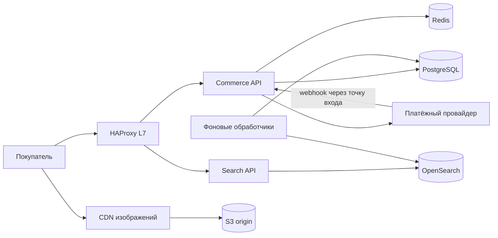
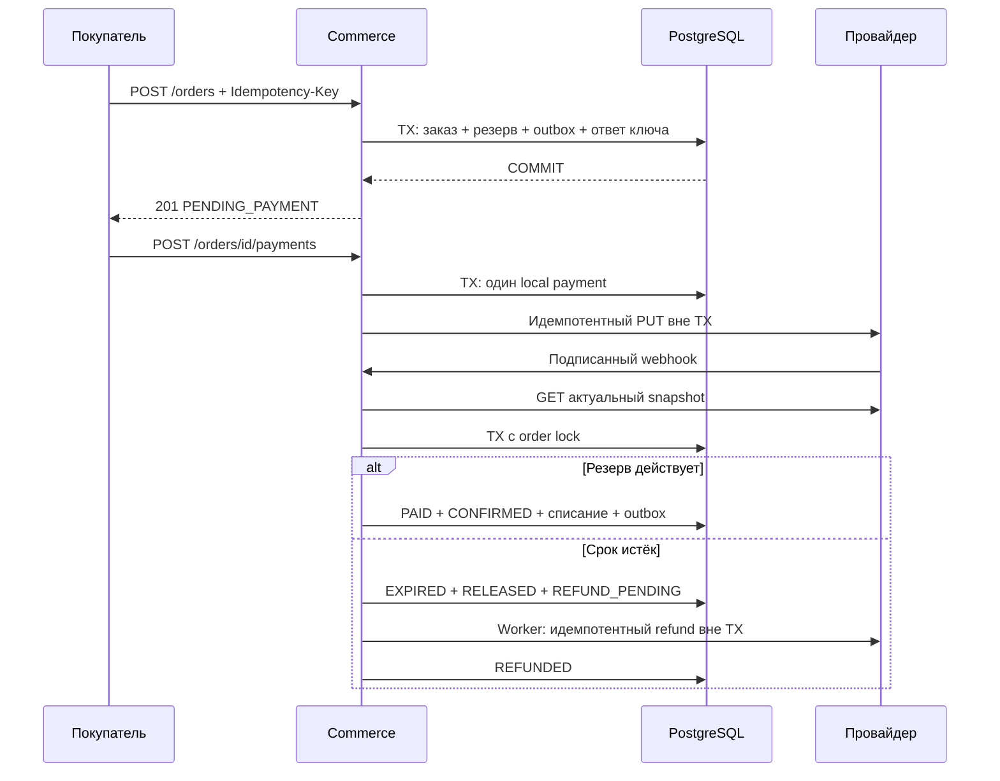

# Электронная коммерция

Учебный проект интернет-магазина товаров для дома и электроники для курса по распределённым высоконагруженным системам. Проектируем собственный магазин одного продавца с единым учётом запасов. Целевая система рассчитана на аудиторию от 1 млн активных пользователей в месяц; начальный расчётный сценарий использует ровно 1 млн MAU.

Покупатель находит товар, добавляет его в корзину, оформляет и оплачивает заказ, затем проверяет его статус. Основной сложный сценарий — распродажа ограниченного запаса: конкурентные заказы, повторные запросы и задержки оплаты должны сохранять корректность остатков и платежей.

Основной результат курса — расчётно-пояснительная записка в этом README. Прототип на Java дополняет её экспериментами. Существующие интернет-магазины используем как аналоги и источники опубликованных данных; их показатели отделяем от допущений нашей модели.

## Состояние проекта

Реализованы этапы 0–4 и основная часть этапа 5; его нагрузочная приёмка ещё не завершена. Java/Spring Boot Commerce API обслуживает каталог, корзину, заказы, резервирование и локальные платежи. Добавлены отдельный Search API, RabbitMQ/outbox workers, сверка оплаты и компенсации, Garage S3 и выдача изображений. Оплата выполняется через устойчивый локальный эмулятор провайдера. Результаты нагрузочных и аварийных проверок приведены в соответствующих чекпоинтах; этап 5 добавляет метрики/алерты/traces, admission, retention и восстановление PostgreSQL/S3.

Проект ведётся в отдельном репозитории [hdls-ecom-project](https://github.com/maria-igntv/hdls-ecom-project). Локальная рабочая папка — `hlds`.

| Документ | Назначение |
| --- | --- |
| [Границы продукта и сценарии](docs/product_scope.md) | Роли, пять функций MVP, исключения, операции, данные, обычный день и распродажа |
| [Исходные параметры](docs/assumptions.md) | Значения, единицы, статус, источники и влияние параметров |
| [Источники](docs/sources.md) | Материалы курса, решения проекта, техническая документация и план исследования аналогов |
| [План проекта](project_plan.md) | Порядок работы по пяти чекпоинтам и рекомендуемый прототип |
| [Исследование аналогов](docs/market_research.md) | Проверенные первичные публикации и ограничения переноса данных |
| [Расчёт нагрузки и хранения](docs/capacity.md) | Формулы, RPS, трафик, данные на пользователя, рост и чувствительность |
| [Балансировка](docs/balancing.md) | Сетевой путь, алгоритмы, альтернативы, health, таймауты и проверка |
| [Модель](model/capacity.json) и [калькулятор](scripts/calculate_capacity.py) | Воспроизводимые исходные числа и генерация расчётных таблиц |
| [Проверки этапа 1](docs/stage1_verification.md) | Фактический результат функционального Java-стенда и границы проверки |
| [Хранилища и ER-модель](docs/storage.md) | Категории данных, выбор/альтернативы, индексы, ресурсы, эксплуатация и восстановление |
| [Запуск backend и API](docs/backend_api.md) | Spring Boot, PostgreSQL, Redis, примеры запросов и воспроизводимая проверка |
| [Проверки этапа 2](docs/stage2_verification.md) | Конкурентный checkout, cache/failure-сценарии, SQL-планы и реальный restore |
| [Программные компоненты и ресурсы](docs/runtime_resources.md) | Java/JVM, границы процессов, CPU/RAM/диск/IOPS/сеть, экземпляры и размещение по AZ |
| [Проверки этапа 3](docs/stage3_verification.md) | Открытая нагрузка k6, прогрев, пределы, JFR, SQL, память и воспроизведение |
| [Доработка этапа 3](docs/stage3_followup.md) | Единый runtime, холодный запуск, плавная замена API, длительная нагрузка и модульные тесты |

## Продукт и границы MVP

Магазин обслуживает покупателей в России. Один продавец управляет каталогом и единым логическим складом. Одна позиция SKU имеет одну действующую цену в рублях; запас учитывается целыми единицами. Формирование поставок, несколько складов и расчёты с независимыми продавцами находятся за пределами MVP.

| Функция | Поведение для покупателя | Существенное условие |
| --- | --- | --- |
| Каталог | Просмотр категорий, карточек, цен и изображений | Изображения выдаются отдельно от основного API |
| Поиск | Поиск по названию и описанию, фильтры по категории, цене и наличию | Результат поиска может отставать от источника истины |
| Корзина | Просмотр, добавление, изменение количества и удаление товаров | Корзина не резервирует товар и не фиксирует цену покупки |
| Заказ и оплата | Подтверждение актуальной суммы, резервирование всех позиций и оплата | Повтор запроса не создаёт второй заказ или второй резерв |
| История заказов | Список собственных заказов и просмотр состояния заказа/оплаты | Доступ разрешён только владельцу заказа |

Посетитель может просматривать каталог и искать без входа. Корзина, оформление и история доступны зарегистрированному покупателю. Администратор ведёт каталог, цены, изображения и корректировки запасов; его операции необходимы для работы магазина, но не образуют отдельный пользовательский продукт.

В MVP нет рекомендаций, отзывов, промокодов, кабинетов продавцов, сложной логистики и обычных покупательских возвратов. Компенсационный возврат при поздней оплате истёкшего заказа входит в границы: он необходим для корректности основного процесса.

## Пользовательские сценарии и корректность

**Обычный день:** покупатель находит товар, меняет корзину, подтверждает актуальные цены, создаёт заказ и получает резерв. Платёжный провайдер обрабатывает оплату; магазин проверяет webhook и обновляет состояние. Покупатель видит результат в истории.

**Распродажа:** 1000 уникальных попыток за 10 с на запас 100 единиц одного SKU, по одной единице в заказе; дополнительные повторы — 20%. Равномерная интенсивность этого окна — 120 запросов/с поверх обычного пика, а одновременный старт 1000 запросов проверяется отдельным стресс-вариантом. Гонка оплаты и истечения резерва — отдельный сценарий.

Инварианты проекта:

- `0 <= reserved <= on_hand`; доступный запас равен `on_hand - reserved`.
- Все позиции одного заказа резервируются целиком или не резервируются вовсе.
- Товар в корзине ещё не является зарезервированным.
- Цены и наличие при оформлении проверяются в источнике истины; заказ хранит согласованную сумму и снимок позиций.
- Повтор в контрактном окне идемпотентности с тем же ключом и содержимым возвращает тот же бизнес-результат; другое содержимое с тем же ключом отклоняется. Созданный заказ дополнительно защищён долговременным уникальным ключом.
- Один резерв подтверждается либо освобождается однократно. Подтверждение оплаты и истечение резерва не могут оба распорядиться одним запасом.
- Неоднозначный ответ платёжного провайдера требует сверки состояния. Поздняя оплата истёкшего заказа приводит к компенсации, а не к продаже отсутствующего товара.

Полные условия и критерии будущих проверок приведены в [сценариях](docs/product_scope.md).

## Аудитория география и горизонт расчёта

Востребованность подтверждают первичные публикации: [М.Видео за 2025 год](https://www.mvideoeldorado.ru/ru/press-centr/press-relizy/detail/4211) сообщает 134,8 млрд руб. онлайн-продаж; [Ozon за 2025 год](https://corp.ozon.ru/ru/sth/vyruchka-ozon-v-2025-godu-dostigla-998-mlrd-rubley-861b0820) — 65,1 млн активных покупателей и 2,481 млрд доставленных заказов. Определения клиентской базы и годовых покупателей не равны MAU. М.Видео также развивает marketplace-модель; наши границы остаются магазином одного продавца.

[АКИТ за 2025 год](https://akit.ru/news/11-5-trln-rublej-akit-podvela-itogi-internet-torgovli-za-2025-god) оценивает рынок в 11,5 трлн руб. и публикует региональные доли оборота. Их используем как явно модельный proxy географии пользователей. Подробности методики и ограничений — в [исследовании](docs/market_research.md).

Числа ниже описывают наш целевой сценарий. 1 млн MAU — цель проектирования, а не обещание привлечения аудитории или преобразованное число покупателей аналога.

| Параметр | Начальное значение | Основание |
| --- | ---: | --- |
| Минимальная аудитория | Не менее 1 млн MAU | Требование курса |
| MAU основного сценария | 1 000 000 | Выбранная проектная цель |
| DAU основного сценария | 200 000 | Допущение; отношение DAU/MAU = 20% |
| Каталог целевой системы | 100 000 SKU | Допущение |
| География | Россия | Модель регионов на основе оборота АКИТ, приведена ниже |
| Горизонты | Запуск, 1 год и 3 года после запуска | Решение для расчётов; календарная дата запуска не задана |
| Сценарии | Обычный день и распродажа | Различаются общим пиком и концентрацией запросов на SKU |

Зарегистрированная база принята 2 млн; частоты и размеры пакетов, retention и рост заданы как допущения в [модели](model/capacity.json). Разницу часовых поясов не используем для уменьшения общего пика. Более точные значения будут получены после реализации и измерений.

## Базовая архитектура

Принята структура: модульный Commerce API, отдельный Search API и фоновые обработчики. Рабочий язык backend — Java. Начальный стек из плана: Java 25 LTS, Spring Boot, Spring MVC, Spring JDBC и HikariCP. Обоснование версий, альтернатив и ресурсов приведено в [чекпоинте 3](docs/runtime_resources.md).



Commerce API владеет каталогом, ценами, корзинами, заказами, остатками и локальным состоянием платежей. Заказы и остатки на старте находятся в одной транзакционной БД. Search API читает производную поисковую проекцию. Workers обновляют проекции, обрабатывают уведомления, истечение резервов и сверку платежей. Физическое размещение, брокер, схема событий и правила взаимодействия уточняются в соответствующих чекпоинтах.

| Аспект | Целевая система | Учебный стенд |
| --- | --- | --- |
| Нагрузка | Рассчитывается для целевой аудитории | Генерируется тестами на фактически доступных ресурсах |
| Размещение | Несколько экземпляров и зон при обоснованном требовании | Mac M4 Pro и существующая ВМ; ресурсы пока не измерены |
| Изображения | S3-совместимое хранилище и CDN | Garage на локальном диске/диске ВМ; HTTP-кэш при необходимости |
| Резервные копии | Независимое хранение и проверенное восстановление | Доступные 100 ГБ Облака Mail рассматриваются для копий |
| Отказоустойчивость | Определяется через модель отказов и RTO/RPO | Несколько контейнеров на одном узле не доказывают устойчивость к потере узла |

## Продуктовые и технические метрики

<!-- capacity:start -->
Все значения ниже — результаты модели с допущениями, а не замеры стенда. Подробные таблицы, формулы и чувствительность: [расчёт](docs/capacity.md); исходные числа: [capacity.json](model/capacity.json).

| Показатель | Результат |
| --- | --- |
| MAU / DAU / зарегистрировано | 1 000 000 / 200 000 / 2 000 000 |
| Попытки / созданные / оплаченные заказы в сутки | 10 000 / 9 000 / 7 776 |
| API в среднем / пик ×10 | 64.01 / 640.11 RPS |
| Медиа через CDN в среднем / пик | 322.69 / 3 226.85 RPS |
| Медиа на origin при hit 95%, пик | 161.34 RPS |
| Вход / выход API | 4.18 / 52.99 ГБ/сутки |
| Выход медиа CDN / origin | 1 365.60 / 68.28 ГБ/сутки |
| Пиковый вход / выход API | 3.87 / 49.07 Мбит/с |
| Пиковый выход медиа CDN / origin | 1 264.44 / 63.22 Мбит/с |
| Вход image GET CDN / origin | 13.94 / 0.70 ГБ/сутки |
| Данные с копиями/overhead, год 1 / год 3 | 0.3930 / 1.0260 ТБ |
| Бэкапы отдельно, год 1 / год 3 | 0.2379 / 0.4972 ТБ |

Частоты действий относятся к одному DAU; для служебных и платёжных запросов частота выводится из сценария. В RPS уже включены повторы.

| Операция | Действий/DAU/сутки | Запросов/сутки с повторами | Средний RPS | Пик RPS |
| --- | --- | --- | --- | --- |
| OP01 Категория | 6.00 | 1 212 000.00 | 14.03 | 140.28 |
| OP02 Карточка | 14.00 | 2 828 000.00 | 32.73 | 327.31 |
| OP03 Поиск | 5.00 | 1 010 000.00 | 11.69 | 116.90 |
| OP04 Чтение корзины | 1.40 | 282 800.00 | 3.27 | 32.73 |
| OP05 Изменение корзины | 0.60 | 121 200.00 | 1.40 | 14.03 |
| OP06 Попытка заказа | 0.05 | 10 200.00 | 0.12 | 1.18 |
| OP09 История | 0.04 | 8 080.00 | 0.09 | 0.94 |
| OP10 Детали заказа | 0.16 | 32 320.00 | 0.37 | 3.74 |
| OP07 Инициация оплаты | По сценарию | 9 072.00 | 0.10 | 1.05 |
| OP08 Webhook оплаты | По сценарию | 10 800.00 | 0.12 | 1.25 |
| OP11 Изменения каталога | По сценарию | 5 000.00 | 0.06 | 0.58 |
| OP12 Корректировки запаса | По сценарию | 1 000.00 | 0.01 | 0.12 |
| OP13 Загрузки изображений | По сценарию | 100.00 | 0.00 | 0.01 |

Продуктовые данные на MAU за первый год — распределённая доля общего хранения, а не персональная квота. Общие данные помечены отдельно; профиль на одного зарегистрированного пользователя — одна запись по 2 КБ.

| Категория | Штук на MAU | ГБ на MAU, логически |
| --- | --- | --- |
| Профили | 2.0000 | 0.000004000 |
| Карточки (общие) | 0.1000 | 0.000000400 |
| Корзины | 2.0000 | 0.000000512 |
| Позиции корзин | 1.5000 | 0.000000240 |
| Заказы | 3.2850 | 0.000006570 |
| Позиции заказов | 9.8550 | 0.000019710 |
| Платежи | 3.1536 | 0.000003154 |
| Исходные изображения (общие) | 0.4000 | 0.000100000 |
| Превью двух размеров (общие) | 0.8000 | 0.000060000 |

Хранение по системам включает указанные в модели индексы/overhead и копии; внутренние копии управляемого S3 не прибавляются. Подробные числа записей/объектов и retention каждой категории доступны в расчёте.

| Система/категория | Логических записей/объектов, год 1 | С копиями/overhead, ТБ, год 1 | ТБ, год 3 |
| --- | --- | --- | --- |
| PostgreSQL | 24 149 600 | 0.214766 | 0.768346 |
| OpenSearch | 100 000 | 0.001200 | 0.001728 |
| Redis | 10 000 | 0.000240 | 0.000346 |
| Медиа, исходники и превью | 1 200 000 | 0.160000 | 0.230400 |
| Брокер, backlog 6 часов | 19 500 | 0.000070 | 0.000119 |
| Логи и спаны, после сжатия | 40 089 590 | 0.012193 | 0.020606 |
| Метрики | 1 728 000 000 | 0.004493 | 0.004493 |

Объём SQL включает корзины, историю, платежи, резервы, идемпотентность, outbox/inbox и дедупликацию webhook. Для копий БД принят множитель 3, для индексов/версий — 2; физические конфигурации и коэффициенты уточним в чекпоинте 2.

География России в модели использует доли оборота из исследования АКИТ как proxy долей пользователей. Это допущение; фактическую аудиторию нашего магазина эти доли не измеряют.

| Регион | Доля модели | MAU |
| --- | --- | --- |
| Москва | 16.5% | 165 000 |
| Московская область | 7.8% | 78 000 |
| Санкт-Петербург | 6.2% | 62 000 |
| Краснодарский край | 4.8% | 48 000 |
| Свердловская область | 2.8% | 28 000 |
| Ростовская область | 2.8% | 28 000 |
| Самарская область | 2.0% | 20 000 |
| Республика Татарстан | 2.0% | 20 000 |
| Нижегородская область | 2.0% | 20 000 |
| Красноярский край | 1.9% | 19 000 |
| Остальные регионы России | 51.2% | 512 000 |

F01: 1000 уникальных checkout за 10 с плюс 20% повторов = дополнительные 120 RPS к одному SKU поверх обычного пика; запаса хватает на 100 заказов. Профиль ×30 и отсутствие CDN рассматриваются отдельно, чтобы не скрывать чувствительность результата.
<!-- capacity:end -->

Пересчитать таблицы: `python3 scripts/calculate_capacity.py --write`; проверить согласованность: `python3 scripts/calculate_capacity.py --check`. Python используется только для расчётной утилиты; backend остаётся Java.

## Балансировка нагрузки

Выбран HAProxy Community в роли L7: поиск направляется в отдельный пул Search, остальные API — в Commerce, загрузки медиа получают отдельные лимиты. Между одинаковыми stateless-экземплярами — round-robin, при разных мощностях — weights. Sticky sessions не нужны. Least connections не считаем эквивалентом least requests при HTTP/2.

| Инструмент | Роль и причина выбора | Альтернатива и компромисс |
| --- | --- | --- |
| HAProxy Community | HTTP routing, active readiness, лимиты и очереди, воспроизводимый локальный стенд | Nginx OSS даёт пассивные upstream checks; стандартные active HTTP checks относятся к Plus. Envoy полезен при более сложной динамике сервисов |
| Управляемая L4-точка + два HAProxy в разных AZ | Устраняет зависимость входа от одного LB в целевой системе | Управляемый L7 может заменить этот слой при подходящих функциях и стоимости; продукт провайдера пока не выбран |
| CDN и S3 origin | При hit 95% до origin доходит 5% запросов изображений | Один Nginx-кэш на ВМ снижает обращения к диску, но не внешний сетевой поток и не является географическим CDN |
| HikariCP и при необходимости PgBouncer | Ограничивают число соединений всех API к БД | Увеличение числа API не означает неограниченного увеличения пулов; критические чтения направляются в primary |

Основания: [HAProxy manual](https://docs.haproxy.org/3.2/configuration.html), [HTTP health checks](https://www.haproxy.com/documentation/haproxy-configuration-tutorials/reliability/health-checks/), [Nginx load balancing](https://nginx.org/en/docs/http/load_balancing.html).

Readiness проверяется каждые 2 с, `fall 3`, `rise 2`, timeout 1 с. Прокси не повторяет запросы автоматически; клиентский retry ограничен и учитывает идемпотентность. Для планового вывода сначала снимается readiness, затем завершаются уже принятые запросы. DNS TTL не гарантирует мгновенного failover; две AZ требуют проверки ёмкости после потери зоны.

Сетевой путь, схема размещения, бюджеты и сравнение решений — в [описании балансировки](docs/balancing.md). Проверяемая конфигурация — [HAProxy](infra/lb-smoke/haproxy.cfg), запуск — [Compose](infra/lb-smoke/compose.yaml). Это HTTP-стенд с Java-заглушками; его результаты не являются замером производительности будущего Commerce API.

Функциональный прогон прошёл: 20 запросов разделены 10/10, неготовый живой процесс исключён за 5,91 с, начатые запросы завершились при остановке. Команда воспроизведения: `python3 scripts/check_balancing.py --start`. Она поднимает и затем удаляет только выделенный диагностический Compose-проект. [Подробный результат](docs/stage1_verification.md).

## Самопроверка чекпоинта 1

- [x] Описаны собственный продукт, пять функций и реальные аналоги с первичными источниками.
- [x] MAU не ниже 1 млн, DAU и география заданы с явным статусом допущений.
- [x] Есть таблицы действий и данных на пользователя в штуках и ГБ.
- [x] Рассчитаны API RPS, входящий/исходящий трафик и пики, медиа/CDN/origin, категории хранения в штуках и ТБ.
- [x] Указаны алгоритмы и инструменты балансировки, альтернативы, health, timeout и отказные сценарии.
- [x] Понятны пути запросов и нагрузка внутренних компонентов; расчёты воспроизводятся из JSON.
- [x] Выполнена функциональная проверка балансировки на Java-заглушках.

Отличия от тем других студентов нужно сверить с группой. Уникальность относительно работ однокурсников не устанавливается рыночной статистикой.

## Системы хранения данных

Реализован [Commerce API](backend/commerce/pom.xml) на Java 25 / Spring Boot 3.5.16 с [Flyway-схемой](backend/commerce/src/main/resources/db/migration/V1__commerce_schema.sql). Цена/наличие проверяются по PostgreSQL в одной транзакции: корзина и товары блокируются в стабильном порядке, резервируются все позиции либо ни одна. Orders хранит снимки цены/названия, уникальный ключ запроса и первоначальный ответ. Outbox записывается в той же транзакции; в этапе 4 publisher доставляет события через RabbitMQ с подтверждениями и безопасным повтором.

| Категория | Система | Почему / альтернатива | Настройка и надёжность |
| --- | --- | --- | --- |
| Пользователи, каталог/цены, корзины, заказы/остатки, платежи, idempotency/outbox/inbox | PostgreSQL | Транзакции и ограничения; JSONB достаточно для атрибутов без отдельной MongoDB | Индексы, bounded pools; primary + standby, независимые бэкапы/WAL; модель RPO зависит от синхронности и failover |
| Карточки | Redis | Cache-aside, TTL, CAS версий; корзина не зависит от сохранности Redis | TTL 60–90 с, single-flight, лимит origin-load, fallback; при отказе кэш восстанавливается |
| Полнотекстовая проекция | OpenSearch | Релевантность/фильтры и независимый поиск; PostgreSQL FTS — более простая альтернатива | 1 primary shard + replica, snapshots и полная пересборка из SQL, контроль indexing lag |
| Изображения | S3 API / Garage | Объектный доступ; байты не увеличивают SQL/WAL | Версионные ключи, CDN; при self-host RF=3, независимая копия медиа |
| Очереди/DLQ | RabbitMQ | Задачи/события, at-least-once; длительный Kafka replay пока не нужен | 3 quorum-узла, confirms, ack, prefetch, ограниченный backlog и наблюдение возраста |
| Метрики/логи/трассы | Prometheus / Loki / Tempo | Временные ряды и эксплуатационный поиск изолированы от OLTP | Ограниченные labels/retention и sampling; локально Prometheus/Tempo и ECS stdout, Loki остаётся целевым контуром |

Оценка аппаратных ресурсов (на узел, до профилирования):

| Хранилище | Узлы | CPU / RAM | Диск и сеть |
| --- | --- | --- | --- |
| PostgreSQL | 3 по AZ | 8 vCPU / 32 ГиБ | 512 ГБ NVMe, от 3000 IOPS и 100 МБ/с, 1 Гбит/с |
| Redis | Primary + replica | 1–2 vCPU / 1 ГиБ | maxmemory 512 МиБ; кэш восстанавливаем, 1 Гбит/с |
| OpenSearch | 3 | 4 vCPU / 8 ГиБ | SSD 50 ГБ, heap 4 ГиБ, 1 Гбит/с |
| Self-host S3 | 3 | 2 vCPU / 2 ГиБ | SSD 512 ГБ, RF=3, от 1 Гбит/с; управляемому S3 не приписываем выдуманные CPU |
| RabbitMQ | 3 | 2 vCPU / 2 ГиБ | SSD 20 ГБ, 1 Гбит/с |
| Prometheus | 1 + backup | 2 vCPU / 4 ГиБ | SSD 20 ГБ, retention 15 суток |
| Loki/Tempo | 2 контура | 2 vCPU / 4 ГиБ | 20 ГБ буфера и отдельное object storage |

Размеры в штуках и ТБ, копии, рост и данные на пользователя приведены выше и в [расчёте](docs/capacity.md). S3-ёмкость в модели логическая: самостоятельный RF=3 потребует утроить медиа на физических дисках. Для PostgreSQL оставляем 30% диска свободным; грубые IOPS и CPU — бюджеты, а не измеренная производительность этого оборудования.

Метрики по системам, ER, консистентность, шардирование/партиционирование, vacuum, безопасные миграции и политика бэкапов подробно определены в [storage.md](docs/storage.md). В будущем разбиение orders и inventory по разным шардам потребует нового протокола резервирования; горизонтальный рост API эту задачу не решает.

### Работающий прототип

```bash
docker compose -f infra/stage2/compose.yaml up -d --build
```

После работы с ручным стендом остановите его и запустите отдельную проверку:

```bash
docker compose -f infra/stage2/compose.yaml down
python3 scripts/check_stage2.py
```

Проверяющий скрипт использует те же loopback-порты, самостоятельно создаёт отдельный временный проект и удаляет только его тестовый volume. Пошаговый сценарий и тестовые учётные записи — в [описании API](docs/backend_api.md).

Результат на двух API и 64 параллельных клиентах: 1000 попыток → 100 заказов и 900 OUT_OF_STOCK; 64 одинаковых повтора → один заказ и один резерв. Проверены атомарность нескольких SKU, проверка цены по БД, снимки позиций, отказ Redis, single-flight и однократное истечение. Получены SQL-планы на 100 тыс. товаров / 200 тыс. исторических заказов, выполнен dump/restore в новую БД с совпадающими отпечатками. [Полный результат](docs/stage2_verification.md).

### Самопроверка чекпоинта 2

- [x] Перечислены категории данных, источник истины и производные копии.
- [x] Выбор хранилищ сопоставлен с альтернативами и паттернами запросов.
- [x] Объёмы посчитаны в штуках и ТБ, с копиями, retention и ростом.
- [x] Есть ER, SQL-ограничения, индексы и реальные EXPLAIN ANALYZE BUFFERS.
- [x] Для систем указаны CPU/RAM/диск/сеть, метрики, надёжность и способы роста.
- [x] Реализован и проверен транзакционный прототип с Redis-кэшем.
- [x] Выполнен логический restore отдельного снимка; целевой PITR и production RTO остаются отдельной проверкой.

## Программные инструменты и аппаратное обеспечение

Этап 3 использует Java 25 LTS и Spring Boot 3.5.16, MVC с virtual threads, JDBC/HikariCP и Jackson. Явный SQL сохраняет контроль транзакций и порядка блокировок. JVM требует прогрева и бюджета native memory сверх heap. G1, аллокации, RSS и задержки проверены нагрузкой. Сравнение Java с Go, WebFlux/R2DBC и JPA, роли процессов и полный аппаратный бюджет приведены в [обосновании](docs/runtime_resources.md).

Реализованный состав Commerce операций даёт около 521 RPS модели. k6 проверяет его и повышенную интенсивность того же состава операций. На Mac M4 Pro два API имеют по 1 CPU / 512 МиБ с heap 256 МиБ. JVM настроена на ActiveProcessorCount=1, HAProxy на один поток под CPU quota контейнера. PostgreSQL ограничен 2 CPU / 768 МиБ. Фактические задержки, ошибки и пропуски измерены после отдельного прогрева, исходные неудачные прогоны сохранены в отчёте.

<!-- stage3:start -->
| Профиль | API | Секунды | RPS задано / завершено | p50 / p95 / p99, мс | Тех. ошибки | Dropped | Результат |
| --- | --- | --- | --- | --- | --- | --- | --- |
| warmup | 2 | 90 | 521.00 / 518.00 | 0.92 / 402.55 / 1 731.16 | 282 | 275 | прогрев |
| baseline | 2 | 60 | 200.00 / 200.15 | 1.18 / 2.93 / 4.67 | 0 | 0 | пройден |
| target | 2 | 120 | 521.00 / 521.08 | 0.76 / 2.04 / 7.65 | 0 | 0 | пройден |
| headroom | 2 | 90 | 640.02 / 640.08 | 0.60 / 1.48 / 3.69 | 0 | 0 | пройден |
| stress | 2 | 90 | 960.02 / 960.09 | 0.53 / 1.49 / 6.24 | 0 | 0 | пройден |
| saturation | 2 | 60 | 1 439.98 / 1 440.13 | 0.65 / 2.75 / 27.84 | 0 | 0 | пройден |
| overload | 2 | 60 | 2 880.00 / 2 880.05 | 0.72 / 60.25 / 19 999.74 | 2684 | 0 | пороги превышены |
| single | 1 | 90 | 521.00 / 521.08 | 0.65 / 2.19 / 14.56 | 0 | 0 | пройден |
| single-stress | 1 | 60 | 960.02 / 960.15 | 0.52 / 3.29 / 81.50 | 0 | 0 | пройден |
| single-overload | 1 | 60 | 1 439.98 / 1 440.10 | 0.93 / 88.52 / 230.98 | 0 | 0 | пройден |

Один экземпляр прошёл проверенный уровень 1 439.98 RPS. При резерве 30% используем 1 007.99 RPS/экземпляр. Для Commerce пика 523.21 RPS выбираем 3 экземпляра в 3 AZ. После потери самой большой AZ расчётная ёмкость составляет 2 015.98 RPS. Перенос этой ёмкости на облачные vCPU требует повторного измерения.
<!-- stage3:end -->

Таблица воспроизводится из [сводки измерений](docs/stage3_results.json). Проверка актуальности выполняется командой `python3 scripts/analyze_stage3.py --check`. Все HTTP-запросы, support-запросы подготовки корзины, ошибки, кэш, SQL и профилирование разобраны в [отчёте](docs/stage3_verification.md).

| Компонент | Целевой бюджет на экземпляр | Размещение и статус оценки |
| --- | --- | --- |
| Commerce API | 1 vCPU / 768 МиБ, heap 256 МиБ | 3 экземпляра по AZ, ёмкость выводится из одноэкземплярного теста |
| Search API | 1 vCPU / 512 МиБ | 3 по AZ, требуются замеры поискового профиля |
| Workers | Publisher, уведомления, истечение/сверка по 0,5 vCPU / 512 МиБ, индексатор 1 vCPU / 512 МиБ | По 2 процесса каждой роли в разных AZ, проектный бюджет |
| HAProxy / PgBouncer | 1 vCPU / 2 ГиБ и 0,5 vCPU / 512 МиБ | По 2, LB рассчитан на 20 тыс. клиентских соединений и весь API пик, пулер опционален |
| PostgreSQL | 8 vCPU / 32 ГиБ, NVMe 512 ГБ, 3000 IOPS / 100 МБ/с | Primary + 2 standby по AZ, бюджет многолетней модели |
| Redis | 1 vCPU / 1 ГиБ, maxmemory 512 МиБ | Primary + replica, 3 Sentinel, оценка кэш-контура |
| OpenSearch / RabbitMQ | 4 vCPU / 8 ГиБ / SSD 50 ГБ и 2 vCPU / 2 ГиБ / SSD 20 ГБ | По 3 узла, оценка будущих компонентов |
| Garage / CDN | 3 узла по 2 vCPU / 2 ГиБ / SSD 512 ГБ, RF=3 и внешний CDN | Медиа origin и edge имеют отдельные сетевые бюджеты |
| Наблюдаемость и бэкапы | Prometheus 2 vCPU / 4 ГиБ, два контура логов/трасс по 2 vCPU / 4 ГиБ, независимый S3 | Ресурсы, retention, IOPS и throughput приведены в аппаратной модели |

Сеть целевых узлов от 1 Гбит/с. Модель даёт 145,98 Мбит/с совокупного исходящего API + S3 origin при CDN hit 95% с запасом 30%. Межзонная репликация и restore добавляют свой поток. При потере AZ ёмкость API пересчитывается по оставшимся экземплярам. Целевые многозонные бюджеты Search, workers и инфраструктуры требуют отдельной проверки; локальный прототип измерен в этапе 4. Локальные результаты получены на одном Docker host, payload синтетических карточек компактнее расчётных. Измерение полного состава API с поиском, оплатой и изображениями приведено в [этапе 4](docs/stage4_verification.md).

Доработка этапа 3 согласует обычную и нагрузочную конфигурации JVM. Readiness учитывает Spring ApplicationAvailability, SQL и завершение startup-прогрева. HAProxy вводит новый экземпляр через slowstart 60 секунд. В многостадийную сборку включён Maven verify с JUnit Jupiter, AssertJ и Mockito. Методика и измерения приведены в [отчёте доработки](docs/stage3_followup.md).

<!-- stage3-followup:start -->
| Проверка | Секунды | RPS | p95, мс | p99, мс | Тех. ошибки | Dropped | Результат |
| --- | --- | --- | --- | --- | --- | --- | --- |
| cold-521 | 120 | 521.08 | 1.80 | 10.72 | 0 | 0 | пройден |
| rolling-521 | 240 | 521.03 | 1.63 | 3.45 | 0 | 0 | пройден |
| soak-521 | 1800 | 521.00 | 1.44 | 2.52 | 10 | 0 | пройден |
| soak-640 | 1800 | 640.02 | 1.31 | 2.87 | 0 | 0 | пройден |
<!-- stage3-followup:end -->

Все заданные пороги пройдены. На 521 RPS получены 10 ответов 503 в начале профиля, или 0,001066% запросов. На 640 RPS технических ошибок 0. Холодный запуск и плавная замена API прошли с нулём ошибок пользовательских запросов. Максимальный RSS JVM составил 484,26 МиБ, OOM и автоматических перезапусков 0. Динамика памяти и оставшийся сценарий начальных отказов каталога описаны в отчёте.

Сводка воспроизводится командой `python3 scripts/analyze_stage3_followup.py --check`. Длительные профили выполняются локально на Mac для текущего состава Commerce API. Их результаты дополняют ресурсные оценки целевого развёртывания.

## Взаимодействие компонентов и обработка данных

Чекпоинт 4 реализован в [полном Java-стенде](infra/stage4/compose.yaml). [OpenAPI 3.1](docs/openapi.json) фиксирует основные операции, [описание взаимодействий](docs/interactions.md) — протоколы, таймауты/retry, схемы событий, sequence-диаграммы оплаты/истечения и порядок восстановления DLQ. [Инструкция и проверка](docs/stage4_verification.md) связывают реализацию с измерениями.

| Контур | Реализованное поведение | Граница гарантии |
| --- | --- | --- |
| Оплата | Один paymentId на заказ, сумма из SQL, HTTP вне TX, подписанный webhook, сверка PENDING | Локальный устойчивый эмулятор; реальный эквайринг не подключён |
| Оплата / expiry | Order lock сериализует PAID/CONFIRMED и EXPIRED/RELEASED; поздняя оплата → идемпотентный refund | Решение по времени БД при обработке snapshot; отгрузка отсутствует |
| Outbox / RabbitMQ | Lease, persistent + mandatory + confirm, manual ack, prefetch 8, bounded retry/jitter, quorum DLQ/replay | At-least-once; один узел брокера в локальном стенде |
| Consumers | SQL inbox, внешние версии OpenSearch и eventId sink уведомлений | Нет глобальной exactly-once; SMTP не используется |
| Поиск | Отдельный API, русский анализатор, фильтры, inactive tombstones, безопасный rebuild с alias swap | Производная eventually consistent проекция; checkout проверяет SQL |
| Изображения | Garage S3, immutable keys, SQL upload intent, cleanup, отдельный GET/HEAD cache | RF=1, локальный Nginx cache; внешний CDN не подключён |



Каждое событие содержит event_id, aggregate_id/type/version, event_type, schema_version, occurred_at и trace_id. Publisher отмечает SQL-запись только после confirm. Consumer подтверждает доставку после идемпотентного эффекта и inbox. Неизвестная версия после ограниченных повторов изолируется в DLQ. Уведомления идут в учебный sink с UNIQUE(event_id).

Контракты синхронных зависимостей ограничены по времени: провайдер connect 500 мс/request 3 с и 8 одновременных вызовов на процесс; S3 call 4 с и две загрузки до 2 МиБ; Search → OpenSearch request 2 с. Expiry и reconciliation работают раз в секунду, задачи выбираются с SKIP LOCKED; сетевой вызов не держит бизнес-блокировки. Retry одного уровня не умножается автоматическими повторами каждого адаптера.

Запуск: `docker compose -f infra/stage4/compose.yaml up -d --build`, затем `python3 scripts/init_stage4.py`. Основной API — localhost:18080, изображения — localhost:18086. Проверки: `python3 scripts/check_stage4.py`; смешанная нагрузка: `python3 scripts/load_stage4.py --project hdls-stage4 --seconds 300 --cold-cache`. Команды используют реальные локальные зависимости; результаты и ограничения — в [отчёте](docs/stage4_verification.md).

<!-- stage4-results:start -->
Проверки этапа 4: 17 групп проверок, нарушений инвариантов 0. Изменение товара стало видимым в поиске за 1.023 с в отдельном опыте.

| Профиль | Длительность | API RPS | API p95 / p99, мс | Технические / неожиданные ошибки | Dropped |
| --- | --- | --- | --- | --- | --- |
| Пустой Redis + media | 60 с | 640.22 | 2.76 / 133.78 | 0 / 0 | 0 |
| Полный API + media | 300 с | 640.05 | 1.93 / 3.68 | 0 / 0 | 0 |

Дополнительно выполнено 48301 media GET по 120303 байт; media p95 0.23 мс, ошибок 0. Максимальный RSS Commerce — 394.50 МиБ при лимите 640 МиБ. Deadlocks — 0, OOM — 0. Пороги измерительного профиля пройдены; особенности прогрева и support traffic описаны в отчёте.
<!-- stage4-results:end -->

## Обеспечение надёжности

Чекпоинт 5 задаёт [SLI/SLO и границы RTO/RPO](docs/reliability.md), реализует [эксплуатационный стенд](infra/stage5/compose.yaml) и [runbook по отказам](docs/runbooks.md). PostgreSQL остаётся источником бизнес-истины; индексы и кэш производны. Целевая синхронная репликация, quorum/fencing и независимый DR описаны отдельно от одноузлового локального восстановления.

Запуск: `STAGE5_PROJECT=hdls-stage5-verify python3 scripts/init_stage5.py` после сборки образов; [полная инструкция](docs/stage5_verification.md) содержит scoped Compose-команды, адреса и повторение проверок. Management 9091 доступен только внутри сети Docker, UI привязаны к loopback.

<!-- stage5-results:start -->
**Нагрузочная приёмка не завершена. Повторный прогон отложен пользователем; текущая конфигурация генератора под нагрузкой ещё не проверена.**

Реализованы Prometheus/Alertmanager, 22 панели Grafana, 17 scrape targets, Tempo с W3C-контекстом через outbox/RabbitMQ и ECS JSON logs. Admission/retention и 34 модульных теста Commerce проверены; после SIGKILL PostgreSQL подтверждённый PAID и replay сохранены.

| Измерение | Секунды | Фактический primary RPS | HTTP p95 / p99, мс | Технические ошибки | Dropped всех сценариев | Пороги |
| --- | --- | --- | --- | --- | --- | --- |
| Прогрев перед первым часом | 180 | 640.04 | 2.20 / 5.66 | 0 | 0 | пройден |
| Первый полный час | 3600 | 589.15 | 210.51 / 1021.41 | 972 | 262320 | не пройден |
| Проба с предвыделением 50 мс | 180 | 635.37 | 2.77 / 30.28 | 0 | 977 | не пройден |

В первом полном часу выполнено 2,120,936 primary запросов при заданных 640 RPS. Инварианты / deadlocks / OOM — 0, но latency и пропуски нагрузки не прошли пороги. Зелёные up/readiness не подтверждают выполнение клиентского SLO. Выборочный максимум Docker working set с генератором — 5.60 ГиБ; CPU k6 во второй части упирался в выделенные 2 CPU. Связь с ограничением Go memory — рабочая гипотеза, а не доказанный профиль GC.

Исправленная конфигурация: 219 предвыделенных VU, максимум 1445 сохранён, задано 640.02 primary RPS. Предвыделение рассчитано на 200 мс и настраивается через VU_PREALLOC_SECONDS. Лимиты k6 — 2 ГиБ / Go 1536 МиБ; добавлен live-контроль клиентских RPS, dropped, p95 завершённой минуты и cgroup CPU/memory. Лимиты Tempo/Grafana/blackbox увеличены по измеренным пикам. Новый час и финальный smoke ещё предстоят; пороги не ослаблены.

Локальный PITR восстановил оплаченный заказ и 2 изображения с совпадающим SHA-256; изменение после точки исключено. Base backup/verify 3.981 с, recovery → API 17.560 с. Это локальный drill; многозонные RPO/RTO остаются целями архитектуры.

Сохранены первый прерванный опыт с OOM Tempo, неуспешный полный час и короткие пробы. Ошибочные 401 при отказе SQL исправлены и отдельно перепроверены как 503. [Все результаты и ограничения](docs/stage5_verification.md), [SLO](docs/reliability.md), [runbook](docs/runbooks.md).
<!-- stage5-results:end -->
