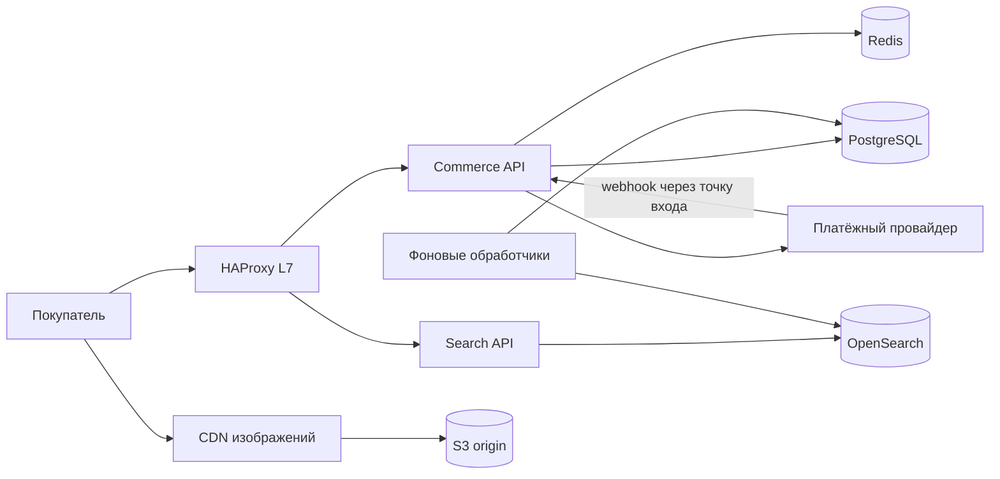

# Электронная коммерция

Учебный проект интернет-магазина товаров для дома и электроники для курса по распределённым высоконагруженным системам. Проектируем собственный магазин одного продавца с единым учётом запасов. Целевая система рассчитана на аудиторию от 1 млн активных пользователей в месяц; начальный расчётный сценарий использует ровно 1 млн MAU.

Покупатель находит товар, добавляет его в корзину, оформляет и оплачивает заказ, затем проверяет его статус. Основной сложный сценарий — распродажа ограниченного запаса: конкурентные заказы, повторные запросы и задержки оплаты должны сохранять корректность остатков и платежей.

Основной результат курса — расчётно-пояснительная записка в этом README. Прототип на Java дополняет её экспериментами. Существующие интернет-магазины используем как аналоги и источники опубликованных данных; их показатели отделяем от допущений нашей модели.

## Состояние проекта

Подготовлены этап 0 и расчётная часть чекпоинта 1: границы MVP, источники, аудитория и география, модель нагрузки/хранения и выбор балансировки. Java-стенд проверяет HTTP-маршрутизацию и readiness; работа с заказами и хранилищами реализуется на следующих этапах.

Проект ведётся в отдельном репозитории [hdls-ecom-project](https://github.com/maria-igntv/hdls-ecom-project). Локальная рабочая папка — `hlds`.

| Документ | Назначение |
| --- | --- |
| [Границы продукта и сценарии](docs/product_scope.md) | Роли, пять функций MVP, исключения, операции, данные, обычный день и распродажа |
| [Исходные параметры](docs/assumptions.md) | Значения, единицы, статус, источники и влияние параметров |
| [Источники](docs/sources.md) | Материалы курса, решения проекта, техническая документация и план исследования аналогов |
| [План проекта](project_plan.md) | Порядок работы по пяти чекпоинтам и рекомендуемый прототип |
| [Исследование аналогов](docs/market_research.md) | Проверенные первичные публикации и ограничения переноса данных |
| [Расчёт нагрузки и хранения](docs/capacity.md) | Формулы, RPS, трафик, данные на пользователя, рост и чувствительность |
| [Балансировка](docs/balancing.md) | Сетевой путь, алгоритмы, альтернативы, health, таймауты и проверка |
| [Модель](model/capacity.json) и [калькулятор](scripts/calculate_capacity.py) | Воспроизводимые исходные числа и генерация расчётных таблиц |
| [Проверки этапа 1](docs/stage1_verification.md) | Фактический результат функционального Java-стенда и границы проверки |

## Продукт и границы MVP

Магазин обслуживает покупателей в России. Один продавец управляет каталогом и единым логическим складом. Одна позиция SKU имеет одну действующую цену в рублях; запас учитывается целыми единицами. Формирование поставок, несколько складов и расчёты с независимыми продавцами находятся за пределами MVP.

| Функция | Поведение для покупателя | Существенное условие |
| --- | --- | --- |
| Каталог | Просмотр категорий, карточек, цен и изображений | Изображения выдаются отдельно от основного API |
| Поиск | Поиск по названию и описанию, фильтры по категории, цене и наличию | Результат поиска может отставать от источника истины |
| Корзина | Просмотр, добавление, изменение количества и удаление товаров | Корзина не резервирует товар и не фиксирует цену покупки |
| Заказ и оплата | Подтверждение актуальной суммы, резервирование всех позиций и оплата | Повтор запроса не создаёт второй заказ или второй резерв |
| История заказов | Список собственных заказов и просмотр состояния заказа/оплаты | Доступ разрешён только владельцу заказа |

Посетитель может просматривать каталог и искать без входа. Корзина, оформление и история доступны зарегистрированному покупателю. Администратор ведёт каталог, цены, изображения и корректировки запасов; его операции необходимы для работы магазина, но не образуют отдельный пользовательский продукт.

В MVP нет рекомендаций, отзывов, промокодов, кабинетов продавцов, сложной логистики и обычных покупательских возвратов. Компенсационный возврат при поздней оплате истёкшего заказа входит в границы: он необходим для корректности основного процесса.

## Пользовательские сценарии и корректность

**Обычный день:** покупатель находит товар, меняет корзину, подтверждает актуальные цены, создаёт заказ и получает резерв. Платёжный провайдер обрабатывает оплату; магазин проверяет webhook и обновляет состояние. Покупатель видит результат в истории.

**Распродажа:** 1000 уникальных попыток за 10 с на запас 100 единиц одного SKU, по одной единице в заказе; дополнительные повторы — 20%. Равномерная интенсивность этого окна — 120 запросов/с поверх обычного пика, а одновременный старт 1000 запросов проверяется отдельным стресс-вариантом. Гонка оплаты и истечения резерва — отдельный сценарий.

Инварианты проекта:

- `0 <= reserved <= on_hand`; доступный запас равен `on_hand - reserved`.
- Все позиции одного заказа резервируются целиком или не резервируются вовсе.
- Товар в корзине ещё не является зарезервированным.
- Цены и наличие при оформлении проверяются в источнике истины; заказ хранит согласованную сумму и снимок позиций.
- Повтор в контрактном окне идемпотентности с тем же ключом и содержимым возвращает тот же бизнес-результат; другое содержимое с тем же ключом отклоняется. Созданный заказ дополнительно защищён долговременным уникальным ключом.
- Один резерв подтверждается либо освобождается однократно. Подтверждение оплаты и истечение резерва не могут оба распорядиться одним запасом.
- Неоднозначный ответ платёжного провайдера требует сверки состояния. Поздняя оплата истёкшего заказа приводит к компенсации, а не к продаже отсутствующего товара.

Полные условия и критерии будущих проверок приведены в [сценариях](docs/product_scope.md).

## Аудитория география и горизонт расчёта

Востребованность подтверждают первичные публикации: [М.Видео за 2025 год](https://www.mvideoeldorado.ru/ru/press-centr/press-relizy/detail/4211) сообщает 134,8 млрд руб. онлайн-продаж; [Ozon за 2025 год](https://corp.ozon.ru/ru/sth/vyruchka-ozon-v-2025-godu-dostigla-998-mlrd-rubley-861b0820) — 65,1 млн активных покупателей и 2,481 млрд доставленных заказов. Определения клиентской базы и годовых покупателей не равны MAU. М.Видео также развивает marketplace-модель; наши границы остаются магазином одного продавца.

[АКИТ за 2025 год](https://akit.ru/news/11-5-trln-rublej-akit-podvela-itogi-internet-torgovli-za-2025-god) оценивает рынок в 11,5 трлн руб. и публикует региональные доли оборота. Их используем как явно модельный proxy географии пользователей. Подробности методики и ограничений — в [исследовании](docs/market_research.md).

Числа ниже описывают наш целевой сценарий. 1 млн MAU — цель проектирования, а не обещание привлечения аудитории или преобразованное число покупателей аналога.

| Параметр | Начальное значение | Основание |
| --- | ---: | --- |
| Минимальная аудитория | Не менее 1 млн MAU | Требование курса |
| MAU основного сценария | 1 000 000 | Выбранная проектная цель |
| DAU основного сценария | 200 000 | Допущение; отношение DAU/MAU = 20% |
| Каталог целевой системы | 100 000 SKU | Допущение |
| География | Россия | Модель регионов на основе оборота АКИТ, приведена ниже |
| Горизонты | Запуск, 1 год и 3 года после запуска | Решение для расчётов; календарная дата запуска не задана |
| Сценарии | Обычный день и распродажа | Различаются общим пиком и концентрацией запросов на SKU |

Зарегистрированная база принята 2 млн; частоты и размеры пакетов, retention и рост заданы как допущения в [модели](model/capacity.json). Разницу часовых поясов не используем для уменьшения общего пика. Более точные значения будут получены после реализации и измерений.

## Базовая архитектура

Принята структура: модульный Commerce API, отдельный Search API и фоновые обработчики. Рабочий язык backend — Java. Начальный стек из плана: Java 25 LTS, Spring Boot, Spring MVC, Spring JDBC и HikariCP. Обоснование версий, альтернатив и ресурсов будет дополнено в чекпоинте 3.

Commerce API владеет каталогом, ценами, корзинами, заказами, остатками и локальным состоянием платежей. Заказы и остатки на старте находятся в одной транзакционной БД. Search API читает производную поисковую проекцию. Workers обновляют проекции, обрабатывают уведомления, истечение резервов и сверку платежей. Физическое размещение, брокер, схема событий и правила взаимодействия уточняются в соответствующих чекпоинтах.

| Аспект | Целевая система | Учебный стенд |
| --- | --- | --- |
| Нагрузка | Рассчитывается для целевой аудитории | Генерируется тестами на фактически доступных ресурсах |
| Размещение | Несколько экземпляров и зон при обоснованном требовании | Mac M4 Pro и существующая ВМ; ресурсы пока не измерены |
| Изображения | S3-совместимое хранилище и CDN | Garage на локальном диске/диске ВМ; HTTP-кэш при необходимости |
| Резервные копии | Независимое хранение и проверенное восстановление | Доступные 100 ГБ Облака Mail рассматриваются для копий |
| Отказоустойчивость | Определяется через модель отказов и RTO/RPO | Несколько контейнеров на одном узле не доказывают устойчивость к потере узла |

## Продуктовые и технические метрики

<!-- capacity:start -->
Все значения ниже — результаты модели с допущениями, а не замеры стенда. Подробные таблицы, формулы и чувствительность: [расчёт](docs/capacity.md); исходные числа: [capacity.json](model/capacity.json).

| Показатель | Результат |
| --- | --- |
| MAU / DAU / зарегистрировано | 1 000 000 / 200 000 / 2 000 000 |
| Попытки / созданные / оплаченные заказы в сутки | 10 000 / 9 000 / 7 776 |
| API в среднем / пик ×10 | 64.01 / 640.11 RPS |
| Медиа через CDN в среднем / пик | 322.69 / 3 226.85 RPS |
| Медиа на origin при hit 95%, пик | 161.34 RPS |
| Вход / выход API | 4.18 / 52.99 ГБ/сутки |
| Выход медиа CDN / origin | 1 365.60 / 68.28 ГБ/сутки |
| Пиковый вход / выход API | 3.87 / 49.07 Мбит/с |
| Пиковый выход медиа CDN / origin | 1 264.44 / 63.22 Мбит/с |
| Вход image GET CDN / origin | 13.94 / 0.70 ГБ/сутки |
| Данные с копиями/overhead, год 1 / год 3 | 0.3885 / 1.0184 ТБ |
| Бэкапы отдельно, год 1 / год 3 | 0.2364 / 0.4947 ТБ |

Частоты действий относятся к одному DAU; для служебных и платёжных запросов частота выводится из сценария. В RPS уже включены повторы.

| Операция | Действий/DAU/сутки | Запросов/сутки с повторами | Средний RPS | Пик RPS |
| --- | --- | --- | --- | --- |
| OP01 Категория | 6.00 | 1 212 000.00 | 14.03 | 140.28 |
| OP02 Карточка | 14.00 | 2 828 000.00 | 32.73 | 327.31 |
| OP03 Поиск | 5.00 | 1 010 000.00 | 11.69 | 116.90 |
| OP04 Чтение корзины | 1.40 | 282 800.00 | 3.27 | 32.73 |
| OP05 Изменение корзины | 0.60 | 121 200.00 | 1.40 | 14.03 |
| OP06 Попытка заказа | 0.05 | 10 200.00 | 0.12 | 1.18 |
| OP09 История | 0.04 | 8 080.00 | 0.09 | 0.94 |
| OP10 Детали заказа | 0.16 | 32 320.00 | 0.37 | 3.74 |
| OP07 Инициация оплаты | По сценарию | 9 072.00 | 0.10 | 1.05 |
| OP08 Webhook оплаты | По сценарию | 10 800.00 | 0.12 | 1.25 |
| OP11 Изменения каталога | По сценарию | 5 000.00 | 0.06 | 0.58 |
| OP12 Корректировки запаса | По сценарию | 1 000.00 | 0.01 | 0.12 |
| OP13 Загрузки изображений | По сценарию | 100.00 | 0.00 | 0.01 |

Продуктовые данные на MAU за первый год — распределённая доля общего хранения, а не персональная квота. Общие данные помечены отдельно; профиль на одного зарегистрированного пользователя — одна запись по 2 КБ.

| Категория | Штук на MAU | ГБ на MAU, логически |
| --- | --- | --- |
| Профили | 2.0000 | 0.000004000 |
| Карточки (общие) | 0.1000 | 0.000000400 |
| Корзины | 0.5000 | 0.000000128 |
| Позиции корзин | 1.5000 | 0.000000240 |
| Заказы | 3.2850 | 0.000006570 |
| Позиции заказов | 9.8550 | 0.000019710 |
| Платежи | 3.1536 | 0.000003154 |
| Исходные изображения (общие) | 0.4000 | 0.000100000 |
| Превью двух размеров (общие) | 0.8000 | 0.000060000 |

Хранение по системам включает указанные в модели индексы/overhead и копии; внутренние копии управляемого S3 не прибавляются. Подробные числа записей/объектов и retention каждой категории доступны в расчёте.

| Система/категория | Логических записей/объектов, год 1 | С копиями/overhead, ТБ, год 1 | ТБ, год 3 |
| --- | --- | --- | --- |
| PostgreSQL | 21 897 200 | 0.210375 | 0.760925 |
| OpenSearch | 100 000 | 0.001200 | 0.001728 |
| Redis | 10 000 | 0.000240 | 0.000346 |
| Медиа, исходники и превью | 1 200 000 | 0.160000 | 0.230400 |
| Брокер, backlog 6 часов | 10 500 | 0.000038 | 0.000064 |
| Логи и спаны, после сжатия | 39 837 590 | 0.012117 | 0.020478 |
| Метрики | 1 728 000 000 | 0.004493 | 0.004493 |

Объём SQL включает корзины, историю, платежи, резервы, идемпотентность, outbox/inbox и дедупликацию webhook. Для копий БД принят множитель 3, для индексов/версий — 2; физические конфигурации и коэффициенты уточним в чекпоинте 2.

География России в модели использует доли оборота из исследования АКИТ как proxy долей пользователей. Это допущение; фактическую аудиторию нашего магазина эти доли не измеряют.

| Регион | Доля модели | MAU |
| --- | --- | --- |
| Москва | 16.5% | 165 000 |
| Московская область | 7.8% | 78 000 |
| Санкт-Петербург | 6.2% | 62 000 |
| Краснодарский край | 4.8% | 48 000 |
| Свердловская область | 2.8% | 28 000 |
| Ростовская область | 2.8% | 28 000 |
| Самарская область | 2.0% | 20 000 |
| Республика Татарстан | 2.0% | 20 000 |
| Нижегородская область | 2.0% | 20 000 |
| Красноярский край | 1.9% | 19 000 |
| Остальные регионы России | 51.2% | 512 000 |

F01: 1000 уникальных checkout за 10 с плюс 20% повторов = дополнительные 120 RPS к одному SKU поверх обычного пика; запаса хватает на 100 заказов. Профиль ×30 и отсутствие CDN рассматриваются отдельно, чтобы не скрывать чувствительность результата.
<!-- capacity:end -->

Пересчитать таблицы: `python3 scripts/calculate_capacity.py --write`; проверить согласованность: `python3 scripts/calculate_capacity.py --check`. Python используется только для расчётной утилиты; backend остаётся Java.

## Балансировка нагрузки

Выбран HAProxy Community в роли L7: поиск направляется в отдельный пул Search, остальные API — в Commerce, загрузки медиа получают отдельные лимиты. Между одинаковыми stateless-экземплярами — round-robin, при разных мощностях — weights. Sticky sessions не нужны. Least connections не считаем эквивалентом least requests при HTTP/2.

| Инструмент | Роль и причина выбора | Альтернатива и компромисс |
| --- | --- | --- |
| HAProxy Community | HTTP routing, active readiness, лимиты и очереди, воспроизводимый локальный стенд | Nginx OSS даёт пассивные upstream checks; стандартные active HTTP checks относятся к Plus. Envoy полезен при более сложной динамике сервисов |
| Управляемая L4-точка + два HAProxy в разных AZ | Устраняет зависимость входа от одного LB в целевой системе | Управляемый L7 может заменить этот слой при подходящих функциях и стоимости; продукт провайдера пока не выбран |
| CDN и S3 origin | При hit 95% до origin доходит 5% запросов изображений | Один Nginx-кэш на ВМ снижает обращения к диску, но не внешний сетевой поток и не является географическим CDN |
| HikariCP и при необходимости PgBouncer | Ограничивают число соединений всех API к БД | Увеличение числа API не означает неограниченного увеличения пулов; критические чтения направляются в primary |

Основания: [HAProxy manual](https://docs.haproxy.org/3.2/configuration.html), [HTTP health checks](https://www.haproxy.com/documentation/haproxy-configuration-tutorials/reliability/health-checks/), [Nginx load balancing](https://nginx.org/en/docs/http/load_balancing.html).

Readiness проверяется каждые 2 с, `fall 3`, `rise 2`, timeout 1 с. Прокси не повторяет запросы автоматически; клиентский retry ограничен и учитывает идемпотентность. Для планового вывода сначала снимается readiness, затем завершаются уже принятые запросы. DNS TTL не гарантирует мгновенного failover; две AZ требуют проверки ёмкости после потери зоны.

Сетевой путь, схема размещения, бюджеты и сравнение решений — в [описании балансировки](docs/balancing.md). Проверяемая конфигурация — [HAProxy](infra/lb-smoke/haproxy.cfg), запуск — [Compose](infra/lb-smoke/compose.yaml). Это HTTP-стенд с Java-заглушками; его результаты не являются замером производительности будущего Commerce API.

Функциональный прогон прошёл: 20 запросов разделены 10/10, неготовый живой процесс исключён за 5,91 с, начатые запросы завершились при остановке. Команда воспроизведения: `python3 scripts/check_balancing.py --start`. Она поднимает и затем удаляет только выделенный диагностический Compose-проект. [Подробный результат](docs/stage1_verification.md).

## Самопроверка чекпоинта 1

- [x] Описаны собственный продукт, пять функций и реальные аналоги с первичными источниками.
- [x] MAU не ниже 1 млн, DAU и география заданы с явным статусом допущений.
- [x] Есть таблицы действий и данных на пользователя в штуках и ГБ.
- [x] Рассчитаны API RPS, входящий/исходящий трафик и пики, медиа/CDN/origin, категории хранения в штуках и ТБ.
- [x] Указаны алгоритмы и инструменты балансировки, альтернативы, health, timeout и отказные сценарии.
- [x] Понятны пути запросов и нагрузка внутренних компонентов; расчёты воспроизводятся из JSON.
- [x] Выполнена функциональная проверка балансировки на Java-заглушках.

Отличия от тем других студентов нужно сверить с группой. Уникальность относительно работ однокурсников не устанавливается рыночной статистикой.

## Системы хранения данных

Чекпоинт 2. Предстоит составить ER-диаграмму, сравнить хранилища, рассчитать записи и ТБ, индексы, репликацию, бэкапы, рост и ресурсы. [Категории данных](docs/product_scope.md#data-categories) уже перечислены.

## Программные инструменты и аппаратное обеспечение

Чекпоинт 3. Предстоит обосновать Java/runtime и библиотеки по компонентам, определить CPU/RAM/диск/сеть и число экземпляров, подготовить контейнеризацию и методику тестирования. Проектные ресурсы и измеренные характеристики стенда будут указаны раздельно.

## Взаимодействие компонентов и обработка данных

Чекпоинт 4. Предстоит описать API-контракты, таблицу взаимодействий, checkout, оплату и компенсации, outbox, доставку событий, повторную обработку, DLQ и фоновые задачи. Начальный [перечень операций](docs/product_scope.md#operations) задаёт границы контрактов.

## Обеспечение надёжности

Чекпоинт 5. Предстоит определить SLI/SLO, RTO/RPO по модели отказов, метрики, алерты, консистентность, репликацию и восстановление, матрицу деградации и инструкции обработки инцидентов.
