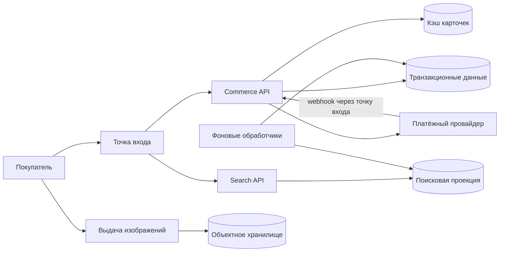

# Электронная коммерция

Учебный проект интернет-магазина товаров для дома и электроники для курса по распределённым высоконагруженным системам. Проектируем собственный магазин одного продавца с единым учётом запасов. Целевая система рассчитана на аудиторию от 1 млн активных пользователей в месяц; начальный расчётный сценарий использует ровно 1 млн MAU.

Покупатель находит товар, добавляет его в корзину, оформляет и оплачивает заказ, затем проверяет его статус. Основной сложный сценарий — распродажа ограниченного запаса: конкурентные заказы, повторные запросы и задержки оплаты должны сохранять корректность остатков и платежей.

Основной результат курса — расчётно-пояснительная записка в этом README. Прототип на Java дополняет её экспериментами. Существующие интернет-магазины используем как аналоги и источники опубликованных данных; их показатели отделяем от допущений нашей модели.

## Состояние проекта

Этап 0 подготовлен: определены границы MVP, роли, операции, категории данных, сценарии и исходные параметры. Следующий этап — расчёт нагрузки и балансировка.

Проект ведётся в отдельном репозитории [hdls-ecom-project](https://github.com/maria-igntv/hdls-ecom-project). Локальная рабочая папка — `hlds`.

| Документ | Назначение |
| --- | --- |
| [Границы продукта и сценарии](docs/product_scope.md) | Роли, пять функций MVP, исключения, операции, данные, обычный день и распродажа |
| [Исходные параметры](docs/assumptions.md) | Значения, единицы, статус, источники, дата и влияние параметров |
| [Источники](docs/sources.md) | Материалы курса, решения проекта, техническая документация и план исследования аналогов |
| [План проекта](project_plan.md) | Порядок работы по пяти чекпоинтам и рекомендуемый прототип |

## Продукт и границы MVP

Магазин обслуживает покупателей в России. Один продавец управляет каталогом и единым логическим складом. Одна позиция SKU имеет одну действующую цену в рублях; запас учитывается целыми единицами. Формирование поставок, несколько складов и расчёты с независимыми продавцами находятся за пределами MVP.

| Функция | Поведение для покупателя | Существенное условие |
| --- | --- | --- |
| Каталог | Просмотр категорий, карточек, цен и изображений | Изображения выдаются отдельно от основного API |
| Поиск | Поиск по названию и описанию, фильтры по категории, цене и наличию | Результат поиска может отставать от источника истины |
| Корзина | Просмотр, добавление, изменение количества и удаление товаров | Корзина не резервирует товар и не фиксирует цену покупки |
| Заказ и оплата | Подтверждение актуальной суммы, резервирование всех позиций и оплата | Повтор запроса не создаёт второй заказ или второй резерв |
| История заказов | Список собственных заказов и просмотр состояния заказа/оплаты | Доступ разрешён только владельцу заказа |

Посетитель может просматривать каталог и искать без входа. Корзина, оформление и история доступны зарегистрированному покупателю. Администратор ведёт каталог, цены, изображения и корректировки запасов; его операции необходимы для работы магазина, но не образуют отдельный пользовательский продукт.

В MVP нет рекомендаций, отзывов, промокодов, кабинетов продавцов, сложной логистики и обычных покупательских возвратов. Компенсационный возврат при поздней оплате истёкшего заказа входит в границы: он необходим для корректности основного процесса.

## Пользовательские сценарии и корректность

**Обычный день:** покупатель находит товар, меняет корзину, подтверждает актуальные цены, создаёт заказ и получает резерв. Платёжный провайдер обрабатывает оплату; магазин проверяет webhook и обновляет состояние. Покупатель видит результат в истории.

**Распродажа:** много покупателей одновременно оформляют один популярный SKU. Начальный проверочный сценарий — 1000 уникальных попыток на запас 100 единиц, по одной единице в заказе. Дополнительно повторяются запросы и платёжные события, а часть оплат приходит после истечения резерва. Временной профиль поступления запросов будет задан при расчёте нагрузки и подготовке тестов.

Инварианты проекта:

- `0 <= reserved <= on_hand`; доступный запас равен `on_hand - reserved`.
- Все позиции одного заказа резервируются целиком или не резервируются вовсе.
- Товар в корзине ещё не является зарезервированным.
- Цены и наличие при оформлении проверяются в источнике истины; заказ хранит согласованную сумму и снимок позиций.
- Повтор с тем же ключом идемпотентности и тем же содержимым возвращает тот же бизнес-результат; другое содержимое с тем же ключом отклоняется.
- Один резерв подтверждается либо освобождается однократно. Подтверждение оплаты и истечение резерва не могут оба распорядиться одним запасом.
- Неоднозначный ответ платёжного провайдера требует сверки состояния. Поздняя оплата истёкшего заказа приводит к компенсации, а не к продаже отсутствующего товара.

Полные условия и критерии будущих проверок приведены в [сценариях](docs/product_scope.md).

## Аудитория география и горизонт расчёта

Все числа этой таблицы описывают проектируемую систему и не являются показателями существующего магазина.

| Параметр | Начальное значение | Основание |
| --- | ---: | --- |
| Минимальная аудитория | Не менее 1 млн MAU | Требование курса |
| MAU основного сценария | 1 000 000 | Выбранная проектная цель |
| DAU основного сценария | 200 000 | Допущение; отношение DAU/MAU = 20% |
| Каталог целевой системы | 100 000 SKU | Допущение |
| География | Россия | Граница продукта; доли регионов пока не определены |
| Горизонты | Запуск, 1 год и 3 года после запуска | Решение для расчётов; календарная дата запуска не задана |
| Сценарии | Обычный день и распродажа | Различаются общим пиком и концентрацией запросов на SKU |

Распределение по федеральным округам/часовым поясам, число зарегистрированных пользователей, размеры запросов и ответов, сроки хранения и рост данных пока открыты. Для них указан следующий шаг в [реестре параметров](docs/assumptions.md). MAU нельзя заменять количеством покупателей за год или размером накопленной базы пользователей.

## Базовая архитектура

Принята структура: модульный Commerce API, отдельный Search API и фоновые обработчики. Рабочий язык backend — Java. Начальный стек из плана: Java 25 LTS, Spring Boot, Spring MVC, Spring JDBC и HikariCP. Обоснование версий, альтернатив и ресурсов будет дополнено в чекпоинте 3.

Commerce API владеет каталогом, ценами, корзинами, заказами, остатками и локальным состоянием платежей. Заказы и остатки на старте находятся в одной транзакционной БД. Search API читает производную поисковую проекцию. Workers обновляют проекции, обрабатывают уведомления, истечение резервов и сверку платежей. Физическое размещение, брокер, схема событий и правила взаимодействия уточняются в соответствующих чекпоинтах.

| Аспект | Целевая система | Учебный стенд |
| --- | --- | --- |
| Нагрузка | Рассчитывается для целевой аудитории | Генерируется тестами на фактически доступных ресурсах |
| Размещение | Несколько экземпляров и зон при обоснованном требовании | Mac M4 Pro и существующая ВМ; ресурсы пока не измерены |
| Изображения | S3-совместимое хранилище и CDN | Garage на локальном диске/диске ВМ; HTTP-кэш при необходимости |
| Резервные копии | Независимое хранение и проверенное восстановление | Доступные 100 ГБ Облака Mail рассматриваются для копий |
| Отказоустойчивость | Определяется через модель отказов и RTO/RPO | Несколько контейнеров на одном узле не доказывают устойчивость к потере узла |

## Продуктовые и технические метрики

Чекпоинт 1. Предстоит рассчитать таблицы MAU/DAU и действий по операциям, данные на пользователя, средний и пиковый RPS, входящий/исходящий трафик, медиа, объёмы хранения и нагрузку внутренних компонентов. Исходные частоты и сценарии зафиксированы в [реестре](docs/assumptions.md); они ещё требуют проверки и обоснования.

## Балансировка нагрузки

Чекпоинт 1. Предстоит определить точки L4/L7-маршрутизации, алгоритмы распределения, health/readiness, keep-alive, таймауты и поведение при выводе экземпляра. Выбор инструментов связывается с рассчитанной нагрузкой и географией.

## Системы хранения данных

Чекпоинт 2. Предстоит составить ER-диаграмму, сравнить хранилища, рассчитать записи и ТБ, индексы, репликацию, бэкапы, рост и ресурсы. [Категории данных](docs/product_scope.md#data-categories) уже перечислены.

## Программные инструменты и аппаратное обеспечение

Чекпоинт 3. Предстоит обосновать Java/runtime и библиотеки по компонентам, определить CPU/RAM/диск/сеть и число экземпляров, подготовить контейнеризацию и методику тестирования. Проектные ресурсы и измеренные характеристики стенда будут указаны раздельно.

## Взаимодействие компонентов и обработка данных

Чекпоинт 4. Предстоит описать API-контракты, таблицу взаимодействий, checkout, оплату и компенсации, outbox, доставку событий, повторную обработку, DLQ и фоновые задачи. Начальный [перечень операций](docs/product_scope.md#operations) задаёт границы контрактов.

## Обеспечение надёжности

Чекпоинт 5. Предстоит определить SLI/SLO, RTO/RPO по модели отказов, метрики, алерты, консистентность, репликацию и восстановление, матрицу деградации и инструкции обработки инцидентов.
