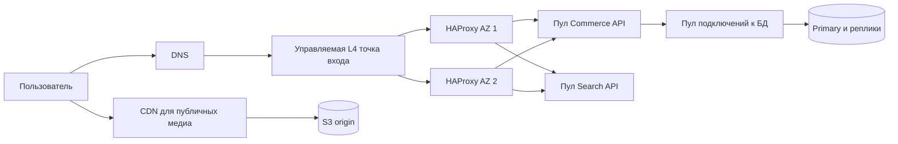

# Балансировка и сетевой путь

Выбор связан с [расчётом](capacity.md): API и медиа имеют разные профили, поиск отделён от транзакционной покупки, пик checkout может концентрироваться на одном SKU. Сессии пользователя не хранятся в конкретном API-экземпляре.

## Точки распределения нагрузки



Это целевая схема. Управляемая L4-точка должна поддерживать несколько AZ, проверки HAProxy и необходимую пиковую ёмкость; конкретный облачный продукт и его стоимость выбираются вместе с физическим размещением. DNS указывает на эту точку, а не заменяет быстрый внутрикластерный failover. Для имеющейся ВМ с одним SSH-входом такая инфраструктура не считается уже доступной.

| Уровень | Выбор | Алгоритм/политика | Обоснование |
| --- | --- | --- | --- |
| Статика и картинки | CDN, отдельный media host | Cache key по версии объекта, длительный TTL публичных неизменяемых изображений | Меньше запросов/байтов до origin, региональная доставка |
| Вход в регион | Управляемый L4 перед двумя HAProxy | Распределение TCP-потоков и исключение неготового LB | Вход не зависит от единственного процесса HAProxy |
| HTTP API | HAProxy Community, L7 | `/api/search` в Search; остальные API в Commerce; внутри пула round-robin | Контроль маршрутов, active readiness и воспроизводимая конфигурация без лицензии |
| Разные мощности | HAProxy weights при необходимости | Взвешенный round-robin | Вес меняется по измеренной ёмкости, не по названию машины |
| База | HikariCP; PgBouncer по результатам sizing | Чтения критичного состояния/после записи идут в primary | Пул ограничивает конкуренцию; произвольный round-robin на реплики может дать stale read |
| Workers | Независимые очереди и число потребителей | Ограниченный prefetch/concurrency | Брокер и запас БД ограничивают темп, не HTTP LB |

Кэш Redis не является балансировщиком: он уменьшает число обращений к БД. Consistent hashing пригоден для размещения ключей, но sticky routing по покупателю не нужен stateless API и не разделяет горячий SKU на несколько независимых остатков.

## Почему HAProxy

| Вариант | Что подходит | Причина выбора/отказа на старте |
| --- | --- | --- |
| HAProxy Community | HTTP routing, round-robin/weights, active HTTP checks, таймауты, лимиты | Выбран для отдельного API-пула и проверяемой конфигурации |
| Nginx Open Source | HTTP proxy, static/media cache, passive upstream checks | Хорошо подходит медиа; стандартные active HTTP health checks относятся к NGINX Plus. Для учебного API выбираем HAProxy |
| Envoy | L7, least-request, outlier detection, динамическая конфигурация | Возможности полезны при более сложном service discovery; текущему числу компонентов не требуется такой control plane |
| Управляемый L7 LB | Эксплуатацию входа берёт провайдер | Практичная альтернатива в production, если его routing/health/timeout и цена устраивают; локальный стенд сохраняет HAProxy |
| Service mesh | Общие политики межсервисного трафика | Пока нет количества сервисов и независимых политик, оправдывающих его эксплуатацию |

Round-robin выбран для одинаковых коротких HTTP API внутри раздельных пулов. Дорогие поисковые запросы не конкурируют в том же пуле с checkout. Если профиль внутри пула станет неоднородным, сравниваем алгоритмы на p95/p99 и очередях. Least connections не равно least requests: особенно при HTTP/2 одно соединение несёт несколько запросов.

Основания: [HAProxy 3.2 manual](https://docs.haproxy.org/3.2/configuration.html), [active health checks](https://www.haproxy.com/documentation/haproxy-configuration-tutorials/reliability/health-checks/), [Nginx load balancing](https://nginx.org/en/docs/http/load_balancing.html).

## Health readiness и вывод из работы

- Liveness проверяет, способен ли процесс работать; внешний отказ БД не должен сам по себе вызывать бесконечные рестарты JVM.
- Readiness проверяет запуск, локальную готовность и draining. Критические зависимости оцениваются для конкретного API с кэшированием результата проверки, без тяжёлого запроса на каждый probe.
- Redis, уведомления и брокер не становятся обязательными readiness-зависимостями всего магазина, если для них предусмотрена деградация.
- HAProxy выполняет `GET /readyz`, ждёт 200, проверяет раз в 2 с; `fall 3`, `rise 2`, timeout проверки 1 с. Ориентир обнаружения — несколько секунд, для зависающего узла до порядка 6–9 с; это проверяемая оценка, а не гарантия точного времени.
- Для планового вывода сначала выключаем readiness, дожидаемся прекращения новых запросов и завершаем принятые. Graceful-stop deadline больше максимальной длительности принятого запроса.

Падение процесса, доступность TCP и готовность принять новую покупку — разные сигналы. После удаления узла оставшиеся экземпляры должны иметь запас; `N+1` покрывает отказ одного экземпляра, но не автоматически целой AZ.

## Таймауты ограничения и повторы

В [стендовой конфигурации](../infra/lb-smoke/haproxy.cfg): ожидание заголовков 5 с, connect 300 мс, очередь 100 мс, server timeout обычного API 2 с, клиентский idle 15 с. Загрузка изображений получает отдельный backend с лимитом конкуренции и 30 с server timeout. Эти значения — стартовые защитные границы; они не заменяют бизнес-SLO и уточняются измерением.

Повторы прокси отключены (`retries 0`). Клиент может повторять безопасные чтения с ограниченным бюджетом и jitter; повтор создания заказа разрешён только с тем же ключом идемпотентности. Приложение передаёт downstream оставшийся deadline и ограничивает ожидание SQL/pool. Нельзя выделять по 2 с каждому последовательному вызову и заявлять 500 мс на всю операцию.

Лимиты `maxconn`/очередей задают ограничение конкуренции; превышение ёмкости должно давать быстрый контролируемый ответ. Пользовательский rate limit по идентичности и политика нагрузки при распродаже реализуются с backend, а не считаются уже доказанными одним maxconn.

## DNS TLS и соединения

Для целевой точки входа используем HTTPS с HTTP/2 до L7, TLS termination в HAProxy, повторное использование upstream HTTP-соединений и ограниченные пулы. Приватные межузловые соединения защищаются в соответствии с размещением. На публичных медиа нет пользовательских cookies и приватных ответов в общем кэше.

Межрегиональное переключение через DNS учитывает TTL, клиентский кэш и уже открытые соединения. Короткий TTL не гарантирует мгновенного переключения. Один регион записи и CDN по стране уменьшают объём межрегиональной координации остатков; второй регион рассматривается как DR в чекпоинте надёжности.

## Проверка на стенде

Стенд [lb-smoke](../infra/lb-smoke/compose.yaml) содержит HAProxy и три небольших Java HTTP-процесса: два Commerce и один Search. Это диагностические заглушки, не реализация заказов. Они нужны для проверки маршрутизации, исключения неготового процесса и draining до создания бизнес-логики.

```bash
docker compose -f infra/lb-smoke/compose.yaml up -d
python3 scripts/check_balancing.py
docker compose -f infra/lb-smoke/compose.yaml down
```

Запуск использует только loopback-порты 18080 и 18404. Прямые порты Java не публикуются. HTTP выбран для локального диагностического контура; публичный TLS и failover двух LB этим стендом не проверяются. Результаты функционального прогона записываются отдельно от расчётной нагрузки. Отчёт о throughput и p95/p99 относится к последующим нагрузочным экспериментам.
