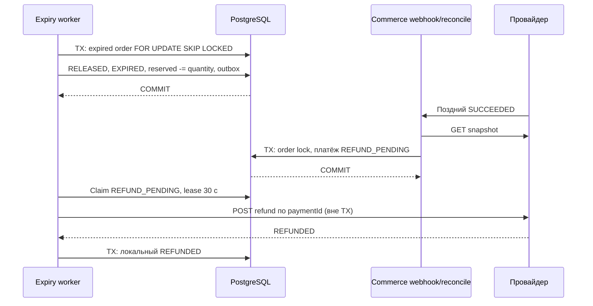
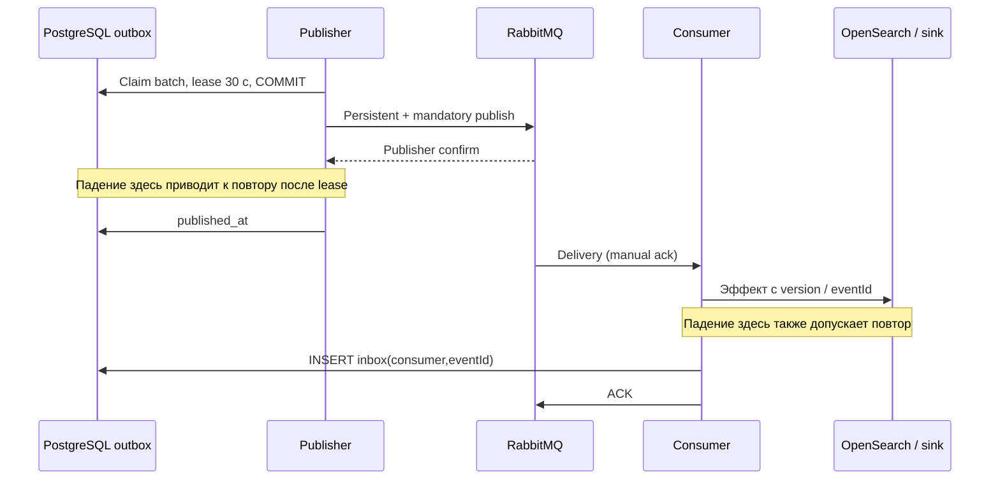

# Взаимодействия, оплата и фоновые процессы

Чекпоинт 4 реализует синхронные контракты и доставку событий из занятий 6–7. [OpenAPI 3.1](openapi.json) описывает внешние операции. [Стенд и проверки](stage4_verification.md) связывают решения с воспроизводимыми опытами. PostgreSQL остаётся источником цен, остатков и состояния заказа. Redis и OpenSearch — производные представления.

## Границы и протоколы

| Кто → кому | Протокол / режим | Таймаут и ограничение | Повтор и идемпотентность | Причина |
| --- | --- | --- | --- | --- |
| Клиент → Commerce | HTTP/JSON, синхронно; HTTPS снаружи целевого стенда | HAProxy connect 1 с, queue 15 с, server 25 с; k6 timeout 20 с | GET можно повторять; checkout повторяется с тем же ключом и телом | Простые проверяемые контракты, клиентский доступ |
| Клиент → Search | HTTP/JSON через HAProxy, синхронно | OpenSearch connect 300 мс, request 2 с; limit ≤100, offset ≤1000 | Повтор GET, fallback к категориям | Индекс обслуживает запрос без обращения к Commerce/OLTP |
| Commerce/worker → PostgreSQL | JDBC, локальные транзакции | По 8 соединений на процесс; в стенде этапа 4 pool wait 1 с, lock 500 мс, statement 2 с, transaction default 5 с | Автоматического повтора SQL-транзакций в приложении нет; API возвращает 503 при transient failure | Общая транзакция защищает заказ и запас |
| Commerce → Redis | RESP, синхронный cache-aside | Connect/read 150 мс, circuit 1 с, origin-load limit 4/процесс, ожидание слота 500 мс в полном стенде | Fallback и single-flight, версия/TTL | Ограниченная задержка при отказе кэша |
| Commerce/worker → провайдер | HTTP/JSON, синхронный адаптер | Connect 500 мс, request 3 с, максимум 8 одновременных вызовов/процесс; HTTP вне SQL-транзакции | PUT по paymentId, GET snapshot, POST refund по тому же paymentId; сверка с backoff 1–60 с | Таймаут не доказывает отсутствие списания |
| Провайдер → Commerce | HTTP webhook, асинхронный с точки зрения бизнеса | Request 10 с, HMAC timestamp ±300 с, тело ≤2048 байт | Durable callback outbox, backoff 1–60 с; eventId + hash тела | Уведомление переживает недоступность API; snapshot предотвращает регрессию |
| Publisher → RabbitMQ | AMQP 0-9-1, асинхронно | Connect 1 с, heartbeat 10 с, confirm 3 с; batch 100, lease 30 с, poll 200 мс | Persistent + mandatory + confirm; отметка в SQL после confirm | Фиксация заказа не зависит от доступности брокера |
| RabbitMQ → consumer | AMQP, manual ack | Prefetch 8 на очередь/worker; исходная доставка + до 5 повторов | Backoff 100–1600 мс + jitter 0–99 мс; затем DLQ | Ограничение незавершённой обработки и изоляция ошибок |
| Индексатор → OpenSearch | HTTP bulk, асинхронная проекция | Connect 500 мс, request 5 с, rebuild batch 500 | external_gte по версии товара; устаревшие 409 пропускаются | Повторы и перестановка событий не откатывают индекс |
| Consumer → sink уведомлений | HTTP PUT, асинхронно | Тот же адаптер: connect 500 мс, request 3 с | eventId — уникальный ключ внешнего эффекта; inbox после успеха | Падение после отправки до ack допускает доставку повтора |
| Commerce/worker → Garage | S3 SigV4, синхронная операция объекта | Connect 500 мс, attempt 3 с, call 4 с, maxAttempts=1, upload ≤2 МиБ | UUID object key, durable upload intent; очистка сирот | Байты изображения вынесены из OLTP |
| Клиент → media → Garage | HTTP GET/HEAD, локальный Nginx cache | Immutable UUID key, cache до 128 МиБ | Cache lock, только успешные 200; запись запрещена | Разделение медиавыдачи и API; это локальный кэш |

Числа в таблице — настройки прототипа, а не измеренные перцентили. Spring transaction timeout ограничивает JDBC через оставшееся время транзакции; это не самостоятельный таймер отмены всего HTTP-запроса. Цель создания заказа p95 ≤500 мс проверяется отдельно. На каждом HTTP-вызове адаптера одна попытка, повторы принадлежат worker или клиенту. Верхние ограничения HAProxy не заменяют бизнес-идемпотентность: клиент может потерять ответ уже зафиксированного заказа.

REST выбран для небольшого числа понятных операций и удобной проверки curl/OpenAPI. gRPC здесь не устраняет транзакционные гонки и не нужен для подтверждённого профиля нагрузки. RabbitMQ позволяет независимо обслуживать поиск и уведомления. Долгосрочный replay всей истории событий не заявляется: OpenSearch восстанавливается сканированием PostgreSQL; при необходимости отдельного журнала для многих потоковых потребителей пересматриваем выбор в пользу Kafka.

## Checkout и оплата

```mermaid
sequenceDiagram
    participant U as Покупатель
    participant C as Commerce API
    participant D as PostgreSQL
    participant P as Провайдер
    participant W as Worker
    U->>C: POST /orders + Idempotency-Key
    C->>D: TX: key, cart, products по id, inventory
    Note over C,D: Проверка суммы и запаса; заказ, резерв, outbox, ответ ключа
    D-->>C: COMMIT
    C-->>U: 201 PENDING_PAYMENT
    U->>C: POST /orders/id/payments
    C->>D: TX: order lock, один local payment
    D-->>C: COMMIT paymentId
    C->>P: PUT paymentId, сумма из заказа
    P-->>C: PENDING или неоднозначный timeout
    C-->>U: 202 с локальным состоянием
    P->>C: HMAC webhook eventId/paymentId
    C->>P: GET актуальный snapshot
    P-->>C: SUCCEEDED
    C->>D: TX: order → payment → reservation → products по id
    Note over C,D: Проверка срока; PAID, CONFIRMED, on_hand и reserved уменьшаются; outbox
    D-->>C: COMMIT
    C-->>P: 200
    W->>D: Периодическая сверка PENDING
    W->>P: Идемпотентный PUT / GET snapshot
```

Один платёж на заказ обеспечивается UNIQUE(order_id), provider_key равен paymentId. Повтор POST не создаёт новую попытку и не принимает сумму клиента. Первое обращение создаёт PENDING в БД, завершает транзакцию и только затем обращается к провайдеру. В учебном контракте повтор PUT одновременно создаёт отсутствующий платёж и возвращает текущий snapshot уже существующего. Поэтому повтор после потерянного ответа безопасен. Для реального провайдера нужно подтвердить именно этот контракт, включая срок хранения ключа.

Допустимые состояния платежа: PENDING → SUCCEEDED или FAILED; PENDING → REFUND_PENDING → REFUNDED при поздней оплате. SUCCEEDED, FAILED и REFUNDED терминальны в границах MVP. FAILED оставляет заказ до истечения 15 минут; повторная попытка после отказа не входит в текущий интерфейс. Учебный провайдер автоматически закрывает неоплаченную сессию в FAILED после 30 минут (batch 100 раз в секунду). Его индекс по created_at для PENDING и независимый scheduler позволяют довести брошенные платежи до терминального состояния вместо бессрочного polling. Уже SUCCEEDED сессия не закрывается как неоплаченная, а поздний успех по истёкшему заказу компенсируется. Полноценные возвраты покупателю и отгрузка не реализуются на этом этапе.

Webhook проверяет HMAC-SHA256 над `timestamp + "." + rawBody` с constant-time сравнением. После проверки подписи Commerce запрашивает актуальный snapshot и проверяет идентификатор, сумму и RUB. Одинаковый eventId с другим телом отклоняется; одинаковые/разные eventId о том же успехе не повторяют списание товара. Состояние заказа не берётся из callback-тела. Сверка обеспечивает продвижение и при потерянном webhook.

## Истечение и компенсация



Решение о своевременности принимается по времени БД при обработке snapshot под блокировкой заказа. Даже ранее списанный провайдером платёж, впервые подтверждённый после истечения, компенсируется. Это консервативная продуктовая политика: заказ EXPIRED не возвращается в PAID. Если успешная оплата обработана первой при живом резерве, expiry уже не освобождает CONFIRMED запас. Если срок прошёл во время недоступности expiry, обработчик оплаты сам освобождает ACTIVE резерв и ставит REFUND_PENDING в той же транзакции.

Expiry выполняет до 100 заказов за проход, по отдельной транзакции на каждый. Везде порядок блокировок — заказ, платёж при необходимости, резерв, товары по id, остатки по id. Сверка каждые 1 с выбирает до 20 платежей через SKIP LOCKED с lease. После падения lease истекает, работа повторяется. Временный отказ refund сохраняет REFUND_PENDING и повторяется; локальная отметка не подменяет реальный ответ провайдера.

## События и доставка

Формальная [схема envelope](events.schema.json), пример:

```json
{
  "event_id": "549f647b-4f15-461e-8324-f0c1784f9379",
  "aggregate_type": "Product",
  "aggregate_id": "150",
  "aggregate_version": 7,
  "event_type": "ProductUpdated",
  "schema_version": 1,
  "occurred_at": "2026-01-01T00:00:00Z",
  "trace_id": "59f44d8f-af49-4435-89b6-86648e39865f",
  "payload": {"productId": 150, "version": 7}
}
```

`occurred_at` — время события, а не дата документа. События ProductUpdated/InventoryChanged маршрутизируются по aggregate_type=Product в очередь search, OrderCreated/PaymentSucceeded/OrderExpired — по Order в notifications. Envelope version=1 проверяется перед исполнением; неизвестная версия после ограниченных повторов попадает в DLQ. X-Request-ID UUID проходит через Commerce, платежный адаптер, сохранённый trace провайдера, callback и outbox. Worker устанавливает trace в MDC. В этапе 5 добавлена [W3C/OTel трассировка](reliability.md): контекст сохраняется в outbox, проходит через AMQP headers и связывает consumer с исходным HTTP span.



В целевой архитектуре нужны три RabbitMQ-узла и quorum queues. На локальном стенде durable quorum queues работают на одном узле и сохраняются в volume; защита от потери узла этим не доказана. DLQ тоже quorum. Включена at-least-once dead lettering с reject-publish при переполнении, поэтому очередь-источник не должна подтверждать перенос до приёма целевой очередью. Prefetch не равен гарантии параллельности: текущий callback обрабатывает сообщения своей очереди последовательно, два worker дают два consumer.

Inbox фиксируется после успешного внешнего эффекта. OpenSearch external_gte и уникальный eventId sink защищают повтор эффекта до inbox commit. Для обычной почты без idempotency key возможны дубли, поэтому здесь используется учебный sink, а не SMTP. Глобальной exactly-once гарантии нет. Истечение inbox retention при replay старых сообщений также требует поддержки идемпотентности на стороне внешнего получателя.

### DLQ и восстановление

1. Проверить `/api/admin/background-stats`, очередь и DLQ в management UI на loopback 15672; найти eventId/traceId и причину в логах worker.
2. Восстановить зависимость либо исправить несовместимый consumer. Не возвращать poison message в основной поток без устранения причины.
3. Вызвать `POST /api/admin/queues/search/replay?limit=100` или notifications с ролью ADMIN. Сначала confirm новой публикации, затем ack из DLQ. При падении между ними возможен безопасный повтор.
4. Проверить уменьшение DLQ, появление inbox, свежесть поисковой карточки и единственный внешний эффект. При потере поискового индекса использовать rebuild.

Replay сохраняет envelope/eventId и снимает старые delivery/death headers. Ошибочное содержимое не переписывается автоматически. В тесте неизвестная schema_version намеренно остаётся в DLQ как свидетельство карантина.

## Поисковая проекция и rebuild

Search API имеет собственный Java-процесс и обращается только к OpenSearch. Русский анализатор, поля name^3/description, фильтры active/category/price/availability и limit/offset описаны в контракте. Индексатор читает актуальный снимок товара из SQL вместе с версией; external_gte защищает от задержки между чтением и записью. Неактивный товар сохраняется как версионированный tombstone с active=false. Физическое удаление товара в MVP отсутствует. Задержка индекса не участвует в проверке запаса при checkout.

Rebuild создаёт новый физический индекс и регистрирует BUILDING до начала сканирования. Consumer пишет в LIVE и BUILDING; сканирование пишет с теми же внешними версиями. Поэтому уже применённая более новая версия побеждает старый снимок. Cursor хранится в PostgreSQL; batch=500, lease=30 с, шаг раз в 100 мс на worker. После полного сканирования refresh и атомарная смена alias products предшествуют SQL-отметке DONE. Повтор после падения между alias/SQL выполняет ту же смену безопасно. UNIQUE допускает одну активную job.

Старые индексы помечаются RETIRED и пока сохраняются для разбора; администратор удаляет их после проверки alias и отсутствия активного rebuild. Автоматический retention индексов и inbox/outbox относится к эксплуатационной доработке. Очередь не является резервной копией каталога.

## Изображения и загрузки

AWS SDK v2 использует Garage endpoint, регион garage, path-style SigV4 и checksum WHEN_REQUIRED. Изображение принимает только ADMIN; разрешены PNG/JPEG/WebP с соответствующей сигнатурой, размером до 2 МиБ. Это ограниченная проверка формата, полную перекодировку/антивирус не заявляем. Тело ограничено; перед чтением в byte[] берётся один из двух upload permits на процесс, затем содержимое передаётся SDK; прямые presigned uploads в текущем API отсутствуют.

До PUT фиксируется PENDING intent с неизменяемым ключом products/id/uuid.ext. После PUT в одной SQL-транзакции блокируется intent, затем товар, записываются метаданные, READY и новая версия/event. Если процесс упал между S3 и SQL, сирота обнаруживается по intent. Через час cleanup переводит intent в CLEANUP и удаляет объект. Блокировка/проверка состояния не позволяют cleanup удалить объект, который одновременно финализируется в READY. Повторная очистка через 5 минут удаляет и PUT, завершившийся уже после первого DELETE; ротация next_cleanup не даёт первым 100 intent задержать следующие.

Публичная выдача идёт через отдельный Nginx GET/HEAD cache; каталог возвращает URL. Immutable ключи позволяют Cache-Control на год. Повторная загрузка получает новый ключ. После удаления объекта уже закэшированная публичная версия может жить до срока cache; срочное удаление требует purge, это не механизм приватных файлов. RF=1 на Mac — доступный бесплатный стенд на своём диске; полноценный CDN и реплики Garage остаются целевой архитектурой.

## Лимиты фоновых ролей

| Роль | Частота / объём | Локальное размещение | Наблюдение |
| --- | --- | --- | --- |
| Publisher | 200 мс, batch 100, lease 30 с | 2 worker-процесса | outbox_pending, oldest_event_seconds, attempts |
| Search consumer | Prefetch 8, manual ack, 5 повторов | По одному consumer/worker | Queue depth, inbox, DLQ, версия/freshness |
| Notifications consumer | Те же лимиты | По одному consumer/worker, учебный sink | Inbox и UNIQUE sink event_id |
| Expiry | 1 с, до 100 заказов | Оба worker, SKIP LOCKED | Возраст просроченного ACTIVE резерва |
| Reconciliation/refund | 1 с, до 20, lease 30 с, backoff до 60 с | Оба worker | Pending/refund_pending, attempts/last_error |
| Rebuild | 100 мс, batch 500, одна job | Оба worker, lease 30 с | Cursor/state, alias и число документов |
| Media cleanup | 30 с, batch 100, повтор через 5 минут | Оба worker, SKIP LOCKED | PENDING/CLEANUP, возраст intent |

Каждый worker имеет лимит 1 CPU / 512 МиБ, heap 256 МиБ, 6 scheduler threads и 8 JDBC connections. Scheduler разделяет независимые задачи, поэтому отказ поиска не должен останавливать expiry или сверку. На стенде роли размещены в двух общих worker-процессах; при росте нагрузки их разделяют настройками запуска и выделенными бюджетами из аппаратной модели. Целевые ресурсы и отказоустойчивое размещение из этапа 3 остаются оценками, которые не следует подменять измерением одного Mac.


## Технические основания

- [RabbitMQ publisher confirms и consumer acknowledgements](https://www.rabbitmq.com/docs/confirms).
- [RabbitMQ at-least-once dead lettering](https://www.rabbitmq.com/docs/dlx#at-least-once-dead-lettering).
- [OpenSearch document versioning](https://docs.opensearch.org/latest/api-reference/document-apis/index-document/).
- [Garage quick start](https://garagehq.deuxfleurs.fr/documentation/quick-start/) и [конфигурация](https://garagehq.deuxfleurs.fr/documentation/reference-manual/configuration/).

Версии контейнеров/SDK зафиксированы в Compose и pom.xml; проверена фактически используемая часть API. Описание репликации в документации продукта само по себе не доказывает отказоустойчивость локального одноузлового стенда.

## Эксплуатационные ограничения этапа 5

Publisher в простое увеличивает poll 200 мс → 2 с; активная пачка возвращает исходный интервал. Отсутствующий rebuild проверяется раз в 5 с, AMQP topology — не чаще раза в 30 с при здоровом соединении; RPC ограничен 3 с. Cleanup published outbox/inbox после 7 суток не распространяется на unpublished события. Новые checkout ограничены admission; критические payment/refund/release продолжаются. [Надёжность](reliability.md), [runbook](runbooks.md) и [результаты проверок](stage5_verification.md) задают точные границы.
