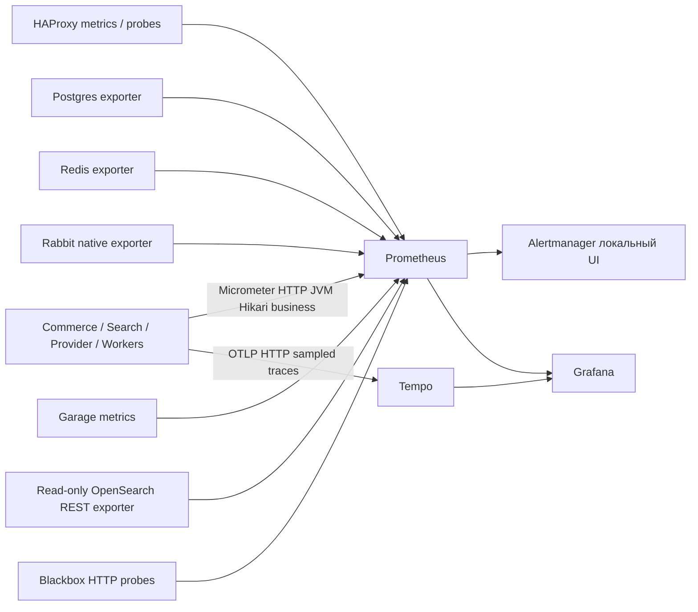

# Надёжность и наблюдаемость

Чекпоинт 5 связывает требования с метриками, деградацией и проверками восстановления. [Локальный запуск и доказательства](stage5_verification.md), [runbook](runbooks.md), [правила алертов](../infra/stage5/alerts.yaml) и [dashboard](../infra/stage5/grafana/dashboards/ecom.json) входят в репозиторий. Требования к многозонной системе и результаты на одном Mac указаны раздельно.

## SLI и целевые SLO

| Контур | SLI и точка измерения | Целевой SLO / окно |
| --- | --- | --- |
| Каталог / корзина / история | Успешные eligible HTTP-ответы на gateway; задержка клиента до последнего байта | Доступность 99,9% за 30 суток; каталог p95 ≤200 мс, окна latency по 5 минут |
| Создание заказа | То же, только POST orders; создание и резерв без ожидания действий покупателя | 99,9% за 30 суток, p95 ≤500 мс |
| Search | Gateway/search backend; запрос с валидными ограничениями limit/offset | 99,9%, p95 ≤300 мс |
| Инициация платежа | HTTP 202 с сохранённой локальной записью; завершение оплаты отдельно | 99,9%, p95 ≤500 мс при доступном провайдере; при его отказе ответ ограничен сетевым timeout и платёж остаётся PENDING |
| Свежесть поиска | От успешной записи новой версии через gateway до наблюдения версии ≥ неё в Search API | 99% изменений за ≤10 с при штатных зависимостях; локальный canary — выборочная проверка, не все изменения каталога |
| Истечение резерва | Время между expires_at и RELEASED/EXPIRED | 99% ≤10 с в штатном режиме; неоплаченный заказ не расходует запас повторно |
| Сверка / компенсация | Возраст PENDING/REFUND_PENDING, время после восстановления провайдера | 99% завершений сверки/возвратов ≤120 с после доступности внешней системы; длительная неопределённость требует вмешательства |
| RabbitMQ / workers | Возраст outbox, размер очереди/DLQ, время delivery; бизнес-эффект через inbox | 99% штатных изменений поиска в пределах freshness SLO; уведомления 99% ≤60 с; дубликаты допускаются транспортом |
| PostgreSQL | Подтверждённые транзакции, доступность записи, WAL/архив и восстановление | Цели RPO/RTO ниже; все подтверждённые резервы и заказы согласованы |
| Redis | redis_up, hits/misses, лимит fallback и ошибки каталога | Потеря всего кэша допустима; бизнес-данные не теряются; восстановление горячих карточек целевым образом ≤5 мин |
| OpenSearch | HTTP probe, cluster health, JVM/FS, очередь индексатора | Перестроение из SQL; цель восстановления поиска ≤30 мин на целевом каталоге, требует измерения на целевом объёме |
| Garage / media | Доступность объекта, статус/latency media GET, S3-операции и byte checksum | 99,9% выдачи, p95 ≤200 мс на выбранной сетевой точке; origin, локальный cache и WAN/CDN измеряются раздельно |

Eligible population онлайн SLI: HTTP 2xx и 5xx. 5xx — техническая ошибка, 2xx — успешная обработка. 4xx нейтральны: ошибки аутентификации/валидации и бизнес-отказы вроде OUT_OF_STOCK не расходуют error budget доступности. Это SLI технической обработки, а не конверсии покупки. Ошибки клиента до HTTP-ответа учитываются клиентскими/синтетическими проверками. Задержка и статус считаются независимо: медленный 200 ухудшает latency SLI.

Gateway SLI строится по backend response counters HAProxy, включая отсутствие доступного сервера. `/readyz` обслуживается HAProxy monitor-uri и не попадает в backend traffic. Метрики приложения исключают health/actuator и помогают локализовать причину, но сами по себе не видят запрос, отклонённый балансировщиком. Их нельзя складывать с gateway counters: это двойной счёт. Application histograms измеряют обработку в приложении; локальные HTTP duration и ошибки соединения проверяются k6 на входе gateway. В текущем runner response.timings.duration не включает blocked/DNS/connect/TLS; полный клиентский end-to-end SLO остаётся отдельным измерением на выбранной сетевой точке.

99,9% за 30 суток соответствует 43,2 минуты недоступности при time-based оценке. Request-based бюджет составляет 0,1% eligible запросов; это другая величина, зависящая от трафика. Burn-rate 14,4× требует превышения порога в окнах 5 мин и 1 час; отдельный gateway alert ловит ошибки до приложения. Один час успешной нагрузки не доказывает месячный SLO. Время плановых fault/restore-опытов явно отделено от штатного измерения; скрытого исключения реальных отказов из production SLI не предполагается.

## Сбор сигналов

Период scrape/evaluation — 10 с. Management endpoints находятся на внутреннем 9091; он не публикуется на хост. Публичный API не даёт анонимно читать Prometheus endpoint. Доступ к административным операциям магазина остаётся за ролью ADMIN. Exporters и OTLP доступны внутри Docker-сети. Порты UI привязаны к loopback. В Alertmanager нет внешнего receiver, письма/мессенджеры не используются.

Четыре Java-процесса ядра экспортируют одинаковые SQL business gauges. Для глобального состояния используется **max**, не sum. При неуспешном SQL сборе db_up=0 и стареет last_success_unixtime: старый ноль backlog не должен создавать видимость здоровой БД. Gauge ecom_expired_reservations считает только резервы с просрочкой более 10 с; постоянный поток новых expiry сам по себе не должен вызывать алерт. Это сигнал backlog, а не измерение распределения задержек всех release. Проверка инварианта — раз в минуту; точная SQL-проверка выполняется также после сценариев отказов/нагрузки. Ни orderId, ни userId, ни productId не являются labels метрик.

Canary работает только в demo/observability worker-1. Он раз в 30 с меняет выделенный синтетический SKU 100000 и читает его через gateway/Search до 10 с; записывает histogram и success=false при неуспехе. Эти служебные запросы идут сверх моделируемого пользовательского трафика. Таймер начинается перед запросом записи и включает её HTTP latency, поэтому это консервативная оценка относительно момента успешного commit. Для production нужен отдельный canary tenant/SKU, исключённый из продаж. Время записи индексатором и фактическая видимость в поиске не приравниваются.

Трассы используют W3C propagation. Контекст сохраняется в outbox.trace_context, передаётся AMQP headers и извлекается consumer; downstream HTTP к провайдеру имеет дочерний span. Сэмплирование — 10%, явный sampled traceparent применяется в проверке контракта. Business X-Request-ID/trace_id UUID сохраняется как корреляционный идентификатор; OTel traceId/spanId — отдельные поля. Логи — ECS JSON stdout, по 3 файла до 10 МиБ на контейнер. Их читают через Compose logs; централизованный Loki в этом локальном варианте не развёрнут. Трассы диагностические и best effort, платёжная корректность не зависит от их экспорта.

Prometheus: retention 7 суток и 2 ГБ. Tempo: 24 часа, локальные blocks/WAL. Grafana provisioning хранится в Git. Метрики процесса/файловой системы относятся к Linux Docker VM; свободное место физического Mac дополнительно записывается генератором нагрузки. Для целевого развёртывания нужны node/container agents на реальных узлах.

## Ограничение накопления и retention

- Admission проверяется перед новой checkout-транзакцией после поиска уже созданного заказа по ключу. В локальной конфигурации ≥50 000 неопубликованных событий либо возраст старейшего ≥600 с дают 503 OUTBOX_CAPACITY. Предупреждение — 25 000 / 300 с. SQL-снимок admission кэшируется до 5 с на API: это защитный порог с запасом, не точная физическая квота. Нужно оставить место на принятые операции и критические события.
- Оплата, refund и release резерва продолжаются. Повтор уже созданного заказа возвращает durable response даже при admission block. Административное обновление каталога и загрузки не подпадают под этот checkout guard; их поток также нужно ограничивать на production входе.
- Пустой publisher увеличивает интервал 200 мс → максимум 2 с; активная пачка возвращает 200 мс. Rebuild без работы проверяется раз в 5 с. AMQP topology declaration кэшируется до 30 с, RPC ограничен 3 с.
- Published outbox и inbox очищаются после 7 суток, payment webhook dedup — 30, быстрые idempotency_keys — 7. Пачка до 1000 строк, отдельные короткие TX, SKIP LOCKED. Unpublished outbox не удаляется по возрасту. Order UNIQUE(user,key) и исходный checkout response остаются после удаления быстрого ключа.
- Replay за пределами inbox retention требует внешней идемпотентности: OpenSearch version и UNIQUE eventId у учебного notification sink. Бессрочная гарантия exactly-once не заявляется; DLQ не удаляется автоматически. У реального notification провайдера срок dedup должен покрывать разрешённый replay horizon.
- RETIRED поисковые индексы удаляются после суток, последние два сохраняются; индекс с alias не удаляется. Для индексов старой версии миграция V6 начинает сутки grace с момента обновления. Сбой после DELETE до SQL-отметки восстанавливается повтором, 404 принимается идемпотентно.
- Cleanup intents изображений сохраняются как tombstones: повторный DELETE защищает от позднего PUT. READY изображения не удаляются этой задачей. WAL нельзя очищать простым возрастным DELETE: сначала нужен проверенный базовый бэкап и сохранённая цепочка для требуемого PITR horizon.

## Консистентность и целевые RTO/RPO

| Данные / отказ | Целевая архитектура | RPO | RTO / граница |
| --- | --- | --- | --- |
| Заказы, запас, корзины, локальные платежи, outbox; потеря primary-узла | Primary + синхронный standby по AZ, commit после durable WAL; HA failover с quorum и fencing | 0 для подтверждённых операций при оговорённом одиночном отказе | ≤5 мин, требует проверки с выбранным HA manager и диском |
| Потеря региона | Независимый base backup + непрерывный WAL вне региона; готовая инфраструктура восстановления | ≤5 мин | ≤1 часа, первоначальная DR-цель |
| Redis | Производный кэш, SQL authoritative | Весь кэш | Горячие карточки ≤5 мин; бизнес-потери нет |
| OpenSearch | 3 узла, shard copies, восстановление из SQL | Производный индекс допускает пересборку | ≤30 мин как цель; freshness отдельно |
| RabbitMQ | 3 узла/quorum queues + confirms/manual ack; outbox остаётся до confirm | Подтверждённые сообщения при допустимой потере quorum member; повторы возможны | ≤5 мин при потере одного узла; догоняющая обработка измеряется |
| Garage | RF=3 по независимым узлам/AZ, immutable keys, независимый logical backup | 0 при поддерживаемом одиночном отказе и выбранном consistency mode | ≤5 мин на одиночный отказ; полное восстановление зависит от объёма/throughput |
| Stateless API / worker | Несколько экземпляров, readiness, draining, leases | Не применимо к локальной памяти | Исключение API за несколько health-интервалов; worker lease 30 с |

Синхронная реплика без безопасного выбора новой primary не даёт автоматического failover. HA manager должен иметь quorum, выбирать пригодный подтверждённый standby и изолировать старую primary (fencing/STONITH/отзыв доступа) до разрешения записи новой. Если подтверждающий standby недоступен, нельзя молча переключаться на async и продолжать заявлять RPO 0. Read-only standby с lag нельзя использовать для проверки запаса при checkout.

Локально PostgreSQL, OpenSearch, RabbitMQ и Garage одноузловые. SIGKILL/restart на сохранённом томе проверяет crash recovery, но не потерю диска, узла Mac или AZ. Автоматическое promotion/fencing нескольких PostgreSQL-узлов не реализовано на этом стенде; это остаётся отдельной проверкой целевой архитектуры. Нулевой RPO для потери региона не обещается.

## Бэкапы и проверяемое восстановление

Локальный PostgreSQL архивирует закрытые WAL-сегменты с timeout 60 с. Копирование идёт во временный файл, затем sync, atomic rename и sync каталога; только завершённый файл виден восстановлению. Это другой Docker volume на том же Mac, поэтому он не является независимым DR-хранилищем. При низком WAL rate timeout может давать около 16 МиБ в минуту несжатого архива, примерно 1 ГиБ за час; свободное место контролируется.

Проверка делает pg_basebackup с WAL stream, pg_verifybackup, затем создаёт оплаченный заказ и изображение после base backup. На короткое время останавливает writers, выгружает все SQL-referenced immutable S3 objects с SHA-256, создаёт именованную WAL-точку и ждёт её архива. После точки выполняется контрольное изменение. В отдельной БД WAL replay до имени точки должен восстановить оплаченный заказ и исключить последующее изменение. Объекты загружаются в пустой отдельный Garage, сверяются SHA-256 и читаются через восстановленный API/media.

Quiescence используется для согласования SQL manifest с копией объектов: оно не заменяется предположением о совпадении двух независимых snapshot. Базовый бэкап и артефакты сохраняются в artifacts/stage5/backups, в Git не попадают. Источники и тома drill сохраняются. Целевая эксплуатация требует внешних независимых копий, автоматизации расписания, шифрования/контроля доступа и retention: например, проверенные full/incremental copies плюс WAL, покрывающий как минимум 7 суток. Сроки и объём выбираются по аппаратной модели и реальному WAL rate; удалять файлы до проверки цепочки нельзя.

У реального платёжного провайдера ledger не откатывается вместе с локальным PITR. После восстановления нужны запрет новой записи до reconciliation, проверка внешних списаний/возвратов и обработка callback за утраченный интервал. В учебном stub провайдер использует ту же PostgreSQL, поэтому drill не доказывает корректность финансовой сверки с независимым эквайрингом.
