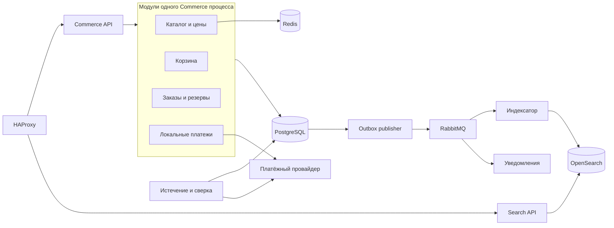

# Программные компоненты и аппаратные ресурсы

Этап 3 связывает выбор Java, устройство процессов и ресурсный бюджет с нагрузочными измерениями. Фактические результаты Commerce API приведены в [отчёте](stage3_verification.md) и [машиночитаемой сводке](stage3_results.json). Ресурсы поиска, платежей, workers и целевой инфраструктуры ниже являются проектными оценками. Исходная нагрузка и объёмы хранения вычисляются из [модели](../model/capacity.json).

## Язык runtime и библиотеки

Java выбрана с учётом рабочего языка автора. Backend использует Java 25 LTS, Spring Boot 3.5.16, Spring MVC с virtual threads, Spring JDBC, HikariCP, Jackson, Spring Security, Bean Validation и Flyway. Maven собирает исполняемый JAR в многостадийном Docker build. Версии транзитивных зависимостей согласуются Spring Boot BOM. Совместимость Java 25 с выбранной веткой уже проверена реальной сборкой и запуском.

| Решение | Применение и стоимость | Рассмотренная альтернатива |
| --- | --- | --- |
| Java / JVM | JIT требует прогрева. Heap, metaspace, code cache, стеки, direct buffers и JFR вместе определяют RSS. Измеряем CPU, полный RSS, heap и паузы GC отдельно | Go упрощает поставку одним бинарным файлом и обычно уменьшает стартовую память. Измерения проекта покрывают реализацию Java. Она подходит по полученной ёмкости и бюджету памяти |
| Spring MVC / virtual threads | Сохраняет последовательный код транзакций при ожидании JDBC/Redis. Количество CPU и соединений остаётся ограниченным. Hikari 8/API ограничивает SQL-конкуренцию, HAProxy maxconn 32/API ограничивает вход | WebFlux/R2DBC требует другого стека доступа и транзакций. Его внедрение оправдывается измеренным ограничением конкурентного I/O |
| JDBC / явный SQL | Видны блокировки, порядок SKU, число обращений и индексы. ResultSet преобразуется в короткоживущие records, списки и карты. Выборка категории и истории ограничена 20 строками в нагрузочном профиле | JPA/Hibernate уменьшает ручной mapping, добавляет persistence context и риск неявных запросов. Для конкурентного резервирования важен непосредственный контроль SQL |
| Jackson / JSON / HTTP | UTF-8, разбор тел, создание строк и сериализация расходуют CPU и порождают объекты. Карточка и категория используют разные объёмы данных при одной стоимости HTTP-вызова | Protobuf/gRPC уместны для измеренно дорогого внутреннего обмена. Публичные операции MVP остаются HTTP/JSON |
| G1 / heap 256 МиБ на стенде | В нагрузочной конфигурации сборщик задан явно. JFR показывает причины GC, паузы и выборочные аллокации. Лимит контейнера 512 МиБ учитывает память за пределами heap | ZGC требует отдельной проверки CPU/RAM и задержек. Native image требует проверки reflection, библиотек и сборки. Их внедрение пока не обосновано |
| HikariCP / Redis client | Переиспользование TCP-соединений исключает handshake на каждом обращении. Redis timeout 150 мс ограничивает задержку деградации кэша. Cache-aside и single-flight уменьшают запросы к SQL | Бесконтрольное увеличение pool size переносит очередь в БД. Виртуальные потоки позволяют ждать, но сохраняют стоимость очереди и удерживаемой памяти |
| Flyway | Применяет версионированные SQL-миграции. Demo fixtures включены отдельным profile | Автоматическое изменение схемы ORM не выбирается для миграций с ограничениями и контролем блокировок |

Время checkout включает проверку пользователя, ожидание пула, последовательные SQL-шаги, commit и сериализацию. Время ожидания платёжной страницы появится в отдельном пользовательском сценарии. Текущий checkout исполняет локальную SQL-транзакцию. Локальный Basic Auth читает пользователя из SQL на каждом приватном запросе и использует синтетические учётные записи. Эта стоимость включена в измерения.

Объекты запроса и строки JDBC преимущественно короткоживущие. Удерживаемая память образуется инфраструктурой Spring, пулами, JIT и загруженными классами. В прототипе этапа 4 файл ограничен 2 МиБ, в каждом Commerce-процессе допускаются две параллельные загрузки; после приёма multipart содержимое читается в byte[] и передаётся AWS SDK v2. Это осознанное упрощение для малого административного потока: около 4 МиБ полезных буферов на процесс плюс копии SDK/HTTP. Для больших объектов нужен streaming/presigned upload. S3 call ограничен 4 с, платёжный HTTP — 3 с и 8 параллельными вызовами на процесс.

Документация runtime и virtual threads, G1 и инструментов профилирования приведена в [источниках этапа 3](sources.md#источники-чекпоинта-3).

## Модули и процессы

Каталог, корзина, заказы и запасы уже работают в одном Commerce процессе и одной транзакционной БД. Платежи занимают подготовленную границу модуля. Search API получает готовую проекцию из OpenSearch. Индексатор, publisher и другие workers запускаются независимо от HTTP API, чтобы backfill и повторная обработка имели собственные CPU, память, пулы и очереди. Наличие двух workers требует идемпотентного захвата и обработки задач.

Один модульный backend уменьшает стоимость согласования заказа и резервов. Разделение этих данных на независимые сервисы потребовало бы дополнительного протокола согласования. Поиск и фоновые задачи уже имеют отдельные границы масштабирования.

## Локальный стенд

Измерения выполняются на Mac M4 Pro с 12 CPU и 24 ГиБ RAM. Docker Engine предоставляет Linux/aarch64, 12 виртуальных CPU и 7,75 ГиБ RAM. Все контейнеры делят один Docker host и диск. На хосте также работают другие контейнеры. Ограничения cgroup и конкуренция за ресурсы входят в результат этого стенда.

| Процесс | Число | CPU limit на экземпляр | RAM limit на экземпляр | Настройка |
| --- | --- | --- | --- | --- |
| Commerce API | 2, затем 1 | 1 | 512 МиБ | Java 25, heap 256 МиБ, G1, ActiveProcessorCount=1, Hikari 8 |
| PostgreSQL | 1 | 2 | 768 МиБ | shared_buffers 128 МиБ, max_connections 80, pg_stat_statements, track_io_timing |
| Redis | 1 | 0,5 | 128 МиБ | maxmemory 64 МиБ, allkeys-lru, persistence отключена |
| HAProxy | 1 | 0,5 | 128 МиБ | nbthread 1, round-robin, /readyz, maxconn 32/API |
| k6 | 1 | 2 | 1536 МиБ | Открытая модель поступления, генератор в той же Docker VM |

Сумма лимитов двух API, инфраструктуры и генератора составляет 7 CPU и 3,5 ГиБ RAM. Это потолки контейнеров. Реальное потребление приведено в отчёте. Данные синтетические, отдельный volume создаётся на каждый запуск и удаляется его владельцем после проверки. Диск PostgreSQL использует файловую систему Docker VM. Для физического NVMe, межзонной сети и TLS требуются отдельные измерения.

## Ресурсный бюджет целевого развёртывания

Все строки описывают отдельный экземпляр процесса или узла. ГБ и МБ ниже десятичные, ГиБ и МиБ двоичные. Число Commerce экземпляров и проверенная ёмкость с резервом вычисляются в [сводке измерений](stage3_results.json). Выбраны три зоны доступности. CPU облачной машины требуется перепроверить тем же профилем, поскольку один vCPU в облаке и одно ядро M4 имеют разную производительность.

| Компонент | Экземпляры / CPU / RAM каждого | Диск каждого | IOPS / throughput ориентир | Сеть каждого | Основание и запас |
| --- | --- | --- | --- | --- | --- |
| Commerce API | 3 × 1 vCPU / 768 МиБ, heap 256 МиБ | 10 ГБ ephemeral SSD | 100 / 10 МБ/с | 1 Гбит/с | По экземпляру в AZ. Лимит RAM повышен относительно стенда для native memory и профилирования. Пользовательское состояние вынесено в SQL |
| Search API | 3 × 1 vCPU / 512 МиБ, heap 256 МиБ | 10 ГБ ephemeral SSD | 100 / 10 МБ/с | 1 Гбит/с | Пик 116,90 RPS. После потери AZ два экземпляра должны выдерживать по 58,45 RPS. С резервом 30% требуется измеренная ёмкость от 83,50 RPS/экземпляр |
| Outbox publisher | 2 × 0,5 vCPU / 512 МиБ | 5 ГБ ephemeral SSD | 50 / 5 МБ/с | 100 Мбит/с | Пик 9,03 событий/с. Один процесс должен обслуживать от 12,90 событий/с с учётом резерва. SQL pool 2, ограниченный batch |
| Индексатор поиска | 2 × 1 vCPU / 512 МиБ | 5 ГБ ephemeral SSD | 50 / 5 МБ/с | 1 Гбит/с | Пик 6,94 updates/с. Отдельный bounded batch и ограничение backfill. Требуется от 9,92 updates/с одним процессом |
| Уведомления | 2 × 0,5 vCPU / 512 МиБ | 5 ГБ ephemeral SSD | 50 / 5 МБ/с | 100 Мбит/с | Пик 2,08 события/с. Требуется от 2,98/с одним процессом. Пул запросов и prefetch согласуются с лимитами провайдера |
| Истечение / сверка | 2 × 0,5 vCPU / 512 МиБ | 5 ГБ ephemeral SSD | 50 / 5 МБ/с | 100 Мбит/с | SKIP LOCKED, короткие пачки. Пик истечений 0,14/с, исходящих платёжных обращений со сверкой 1,10/с. Сверка ограничивает долю DB/HTTP pool |
| HAProxy | 2 × 1 vCPU / 2 ГиБ | 10 ГБ SSD для буфера логов | 100 / 10 МБ/с | 1 Гбит/с | Две AZ за управляемой L4-точкой. На каждый бюджет 20 тыс. клиентских соединений, весь API пик 640,11 RPS и TLS после потери соседа |
| PgBouncer | 2 × 0,5 vCPU / 512 МиБ | 5 ГБ ephemeral SSD | 50 / 5 МБ/с | 1 Гбит/с | Опционален при росте соединений. Общий лимит server connections двух пулеров 64, по 32. Сумма клиентских пулов учитывает 3×8 Commerce и 4×2×2 workers |
| PostgreSQL | 1 primary + 2 standby, 8 vCPU / 32 ГиБ | 512 ГБ NVMe | 3000 / 100 МБ/с | 1 Гбит/с | Год 3 и 30% свободного диска по модели этапа 2. CPU/IOPS являются консервативным бюджетом. Нужны fsync, restore и проверка после promotion |
| Redis | 1 primary + 1 replica, 1 vCPU / 1 ГиБ | 5 ГБ SSD | 100 / 10 МБ/с | 1 Гбит/с | maxmemory 512 МиБ, ориентир 1000 логических операций/с. Для автоматического failover три Sentinel по AZ, каждому бюджет 0,1 vCPU / 64 МиБ |
| OpenSearch | 3 × 4 vCPU / 8 ГиБ, heap 4 ГиБ | 50 ГБ SSD | 1000 / 50 МБ/с | 1 Гбит/с | По узлу/AZ, один primary shard + replica. Запас для сегментов, merge и пересборки индекса. Поисковые latency и reindex проверяются после реализации |
| RabbitMQ | 3 × 2 vCPU / 2 ГиБ | 20 ГБ SSD | 1000 / 50 МБ/с | 1 Гбит/с | Quorum queues с majority, backlog 6 часов. Диск/CPU оцениваются также на publisher confirms и повторную доставку |
| Garage, self-hosted S3 | 3 × 2 vCPU / 2 ГиБ | 512 ГБ SSD, RF=3 | 1000 / 100 МБ/с | 1 Гбит/с | Год 3 даёт 230,4 ГБ медиа до репликации. На узел остаётся более 30% диска. При CDN miss 100% сеть origin требует отдельной проверки |
| CDN | Управляемый внешний сервис | Логический кэш | От 3227 GET/с и 158,1 МБ/с суммарной выдачи | От 1,65 Гбит/с с запасом 30% | Географически распределённая выдача. Условия провайдера, cache hit и стоимость проверяются при выборе |
| Prometheus | 1 × 2 vCPU / 4 ГиБ | 20 ГБ SSD | 1000 / 50 МБ/с | 1 Гбит/с | 20 тыс. рядов, scrape 15 с, retention 15 суток. Отказ сохраняет бизнес-контур, теряется часть наблюдения |
| Loki/Tempo и сбор | 2 контура × 2 vCPU / 4 ГиБ | 20 ГБ SSD буфера + независимый S3 | 1000 / 50 МБ/с | 1 Гбит/с | Логи 7 суток, traces 3 суток, выборка 1%. Графана размещается в наблюдаемости с дополнительным бюджетом 0,5 vCPU / 512 МиБ |
| Бэкапы | Независимое объектное хранилище | 0,238 ТБ год 1 / 0,497 ТБ год 3 | Цель загрузки/restore от 50 МБ/с | От 1 Гбит/с для restore | Две SQL-копии, медиа, WAL 7 суток. Нужен свободный SQL-узел для проверки восстановления |

IOPS, disk throughput и сетевые интерфейсы таблицы задают требуемый класс ресурса для последующей проверки. Локальные SQL cache hit, WAL и Block I/O не характеризуют производительность облачного диска. Стенд использует малые строки и историю 200 тыс. заказов. Целевая модель включает более полные карточки и многолетнюю историю.

Модель даёт 49,07 Мбит/с исходящего API-трафика и 63,22 Мбит/с от S3 origin при CDN hit 95%. Сетевой запас 30% даёт 145,98 Мбит/с совокупно. Межсервисные запросы, репликация, загрузка бэкапов и восстановление дополнительно занимают сеть. Интерфейс 1 Гбит/с оставляет место этим потокам, а синхронная межзонная репликация требует отдельного измерения RTT и commit latency.

Локальный HAProxy имеет `maxconn 2000`. В профиле 2880 RPS k6 выделяет 2898 VU, которые сохраняют keep-alive соединения. При таком составе клиентов появляется конкуренция за лимит соединений. Целевой бюджет рассчитывается отдельно. При верхнем сценарии нового клиентского соединения на каждый API-запрос и 30-секундном keep-alive получаем 640,11 × 30 ≈ 19 203 соединения на surviving LB. Выбираем 20 тыс. и допущение 64 КБ памяти на соединение с буферами/TLS. 20 000 × 64 КБ × 1,3 = 1,664 ГБ, что помещается в бюджет 2 ГиБ на LB. Фактические bytes/connection, TLS CPU и idle time проверяются на целевом балансировщике.

Для S3 origin без CDN-кэша исходящая модель достигает 1264,44 Мбит/с. С запасом 30% это 1643,77 Мбит/с суммарно. Отказ кэша должен сопровождаться ограничением нагрузки или заранее проверенной ёмкостью медиаконтура.

## Размещение и отказ AZ

Commerce, Search, PostgreSQL, OpenSearch, RabbitMQ и Garage распределяются по одному узлу каждой роли в AZ A/B/C. Два LB, по два workers каждой роли и Redis primary/replica размещаются в разных AZ. Sentinel размещаются в трёх AZ. Доступ к LB обеспечивает внешняя отказоустойчивая L4-точка.

После потери AZ остаются два Commerce и два Search API, два голоса RabbitMQ/OpenSearch, две копии Garage. Доступность записи SQL зависит от promotion, fencing и доступного подтверждающего standby. Доступность Garage при потере зоны зависит от настроенного consistency mode и состояния layout. В этапе 5 описаны требования и runbook этих операций; выполненные локальные restart/PITR не проверяют promotion/fencing на независимых узлах. Для этого нужен отдельный HA-стенд.

Число API вычисляется через измеренную ёмкость одного экземпляра, 30% резерва и число экземпляров в самой большой AZ. Требование имеет вид `surviving_instances × safe_rps >= model_peak_rps`. Простое суммирование vCPU для общего RPS не учитывает очереди, БД, GC и общие зависимости. Проверка на одном Docker host даёт исходную точку sizing. Для заявления о работе после потери AZ требуется стенд с независимыми узлами и межзонной сетью.

## Контейнеры и проверка изменений

Существующий Dockerfile собирает приложение Maven/JDK и переносит JAR в JRE-образ. Приложение запускается UID 10001, Java получает сигналы как PID 1, остановка ограничена 20 секундами с 15-секундным graceful shutdown Spring. Постоянное состояние PostgreSQL хранится в volume. Конфигурация и credentials передаются окружением. В нагрузочном окружении используются только demo-данные.

Для повторения нужны Docker Compose и Python 3. Сборка выполняется контейнерным JDK 25. Применённые image ID и версии Java/Docker сохраняются в сводке. Перед целевым развёртыванием образы закрепляются digest и сканируются, секреты передаются отдельно от Compose. Demo-profile с генератором данных включается только на учебном стенде.

| Уровень проверки | Реально используемый инструмент / предмет |
| --- | --- |
| Расчёты | `calculate_capacity.py --check`, соответствие README и JSON-модели |
| Сборка | Maven verify в Docker, Java 25, модульные тесты и упаковка JAR |
| Модульные тесты | JUnit Jupiter / AssertJ / Mockito через spring-boot-starter-test, readiness и границы входных контрактов |
| Интеграция / корректность | `check_stage2.py`, реальный PostgreSQL/Redis, конкурентный checkout, авторизация, идемпотентность, rollback, истечение и dump/restore |
| Балансировка | `check_balancing.py`, round-robin/readiness/failure/draining функционального стенда этапа 1 |
| Нагрузка | `check_stage3.py`, k6 constant-arrival-rate, отдельный прогрев, stepped load, один и два API |
| Профилирование | JFR, Actuator, Docker CPU/memory, PostgreSQL pg_stat_statements, SQL планы этапа 2 |
| Платежи и доставка | JUnit-проверки переходов/HMAC и [интеграционный прогон этапа 4](stage4_verification.md) с реальными отказами зависимостей |

Отдельный CI/CD pipeline остаётся дополнительной частью проекта. Проверенный локальный путь состоит из проверки модели, сборки, интеграционного прогона, нагрузки и анализа артефактов. Для будущего deployment миграции выполняются отдельно до переключения трафика, изменения схемы следуют expand/contract. Rollback приложения требует обратной совместимости с уже применённой схемой.

Конфигурация готовности, init-state fully-down / slowstart HAProxy и длительная проверка описаны в [доработке этапа 3](stage3_followup.md). Нагрузочный профиль дополняет общий JVM runtime записью JFR через JDK_JAVA_OPTIONS.

## Измеряемый локальный состав этапа 5

[Overlay наблюдаемости](../infra/stage5/compose.yaml) добавляет Prometheus 512 МиБ (7 суток / 2 ГБ), Grafana 384 МиБ, Tempo 768 МиБ (24 ч), Alertmanager 64 МиБ, exporters/probes 32–64 МиБ каждый. Commerce — 2 × 640 МиБ, workers — 2 × 640 МиБ, Search/Provider — по 512 МиБ, PostgreSQL 768 МиБ, OpenSearch 1280 МиБ, RabbitMQ 512 МиБ, Garage 256 МиБ, Redis/HAProxy — по 128 МиБ, media 64 МиБ, blackbox 64 МиБ. Лимиты контейнеров являются верхними границами; их сумма вместе с генератором k6 2048 МиБ превышает бюджет Docker VM 8 ГиБ, поэтому совместная работа проверяется по фактической памяти и OOM, а не по возможности одновременно занять все лимиты.

Tempo использует GOMEMLIMIT 384 МиБ внутри лимита 768 МиБ и blocks до 16 МиБ/1 мин; в полном часовом опыте после ограничения Go runtime OOM не повторился, но нагрузочные пороги не были пройдены. Grafana/Prometheus/k6 также получают ограничения Go runtime в пределах cgroup. Локальная выборка traces — 10%, а целевая бюджетная модель выше использует 1%; это разные профили. ECS logs ограничены 3 × 10 МиБ на контейнер и доступны через Compose logs, Loki локально не поднят. WAL архив несжатый, timeout 60 с; нужен контроль физического диска Mac сверх метрик файловой системы Docker. Подробные фактические RSS и результаты часовой нагрузки находятся в [отчёте этапа 5](stage5_verification.md).

Первый полный час измерен при лимитах Tempo 512 МиБ, Grafana 256 МиБ, blackbox 32 МиБ и k6 1536 МиБ/Go 1 ГиБ. Данные этого опыта сохранены в stage5_first_hour_resource_results.json. После пиков у cgroup limits и насыщения генератора лимиты скорректированы; новый набор ещё ожидает нагрузочной проверки. У k6 сокращено предвыделение VU при сохранённом максимуме, а Go memory limit увеличен до 1536 МиБ внутри 2 ГиБ.
