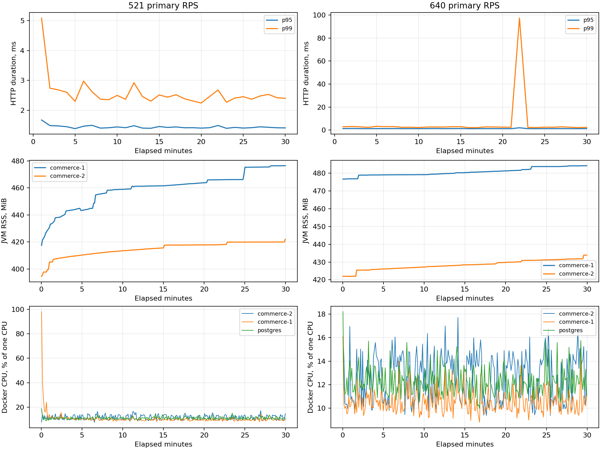

# Доработка запуска и длительная нагрузка

Работа дополняет [исходные измерения этапа 3](stage3_verification.md) проверками готовности, плавного ввода API и двумя 30-минутными профилями. Среда — локальный Mac M4 Pro, Docker ARM64. Состав пользовательских запросов соответствует реализованному Commerce API.

## Единая конфигурация

Обычный Compose задаёт Java heap 256 МиБ, ActiveProcessorCount=1, G1 и лимит одного CPU / 512 МиБ на API. Нагрузочный override добавляет JFR через JDK_JAVA_OPTIONS. Скрипт проверяет совпадение JAVA_TOOL_OPTIONS обоих вариантов. Профилирование SQL включается отдельной конфигурацией PostgreSQL.

HAProxy использует один поток, одинаковый полный вес 100 на каждый сервер, init-state fully-down и slowstart 60 секунд. Начальное состояние DOWN требует успешных readiness-проверок после появления DNS-записи сервера. Runtime API доступен на loopback-порту 18084 для чтения статистики и управляемого drain. Балансировщик принимает пользовательские запросы на 18080, прямые порты API — 18081 и 18082.

## Готовность и прогрев

Liveness возвращает состояние живого HTTP-процесса. Readiness требует Spring ReadinessState.ACCEPTING_TRAFFIC и успешный SQL-запрос. ApplicationRunner выполняется до объявления приложением готовности. При запуске и штатном завершении Spring переводит приложение в REFUSING_TRAFFIC.

Код проверок и прогрева находится в [ProbeController](../backend/commerce/src/main/java/ru/mipt/ecom/commerce/ProbeController.java) и [StartupWarmup](../backend/commerce/src/main/java/ru/mipt/ecom/commerce/StartupWarmup.java).

StartupWarmup читает до 1000 активных карточек по возрастанию ID и до 20 категорий, выполняет сериализацию ответов и 1000 локальных HTTP-чтений каталога. Это прогревает Redis, SQL, сериализацию и HTTP-фильтры. Чтения охватывают набор, соответствующий горячим товарам синтетической модели. Для другого распределения популярности набор подбирается по наблюдаемым обращениям.

Первая попытка с прогревом только сервисных чтений дала ноль ошибок и пропусков на 521 RPS, p99 617,26 мс. Порог p99 был превышен в первую минуту. После этого в startup-прогрев добавлены HTTP-чтения. Исходные метрики первой попытки сохранены в отдельной сводке.

Следующая проверка замены API выявила ранний допуск второго сервера после DNS resolution. HAProxy успел сделать 41 неуспешное соединение до открытия HTTP-порта. k6 зафиксировал 39 ошибок основных запросов и 2 ошибки подготовки checkout. Начальное состояние fully-down добавлено после этой проверки. Предыдущие попытки сохранены для сопоставления причин и исправлений.

## Эксперименты

Сначала создаётся отдельный Docker project с новой БД и пустым Redis. Поднимается первый API. Скрипт наблюдает liveness/readiness каждые 250 мс и фиксирует период, когда HTTP-процесс доступен, а readiness возвращает 503. После готовности выполняется двухминутный профиль 521 RPS на одном API.

Затем начинается четырёхминутная непрерывная нагрузка 521 RPS. Примерно через 30 секунд запускается второй API, наблюдаются его готовность и увеличение веса HAProxy. Примерно через 160 секунд первый сервер переводится в drain. После завершения активных запросов контейнер останавливается, нагрузку обслуживает второй API. Успешность проверяется по результату k6, состояниям серверов и счётчикам HAProxy.

Перед длительной частью первый API запускается повторно. Скрипт ждёт готовности обоих экземпляров и достижения полного веса 100. Далее последовательно выполняются 30 минут на 521 RPS и 30 минут на 640 RPS. Данные и процессы сохраняют состояние между двумя длительными профилями.

Критерии включают менее 0,1% технических и неожиданных ответов, ноль dropped iterations, p95 <200 мс и p99 <500 мс для основных операций. Для checkout используются p95 <500 мс и p99 <1000 мс. Дополнительно проверяются p95/p99 и технические ошибки каждой минуты. Для плавной замены ожидается ноль технических и неожиданных ответов. После нагрузки проверяется равенство reserved сумме активных резервов.

Каждые пять секунд с учётом времени опроса сохраняются CPU, working set, RSS, heap, GC, SQL pool и HAProxy connections/queues/weights. Окна памяти сравнивают минуты 10–15 с последними пятью минутами каждого длительного профиля. Финальные Docker-состояния фиксируют OOMKilled и число перезапусков. JFR имеет ограничение размера 128 МиБ, сохранённая запись может охватывать часть длительного прогона. Временные ряды метрик охватывают всю нагрузку.

## Модульные и интеграционные проверки

spring-boot-starter-test предоставляет JUnit Jupiter, AssertJ и Mockito. Maven Surefire запускает тесты в фазе test, Dockerfile выполняет mvn verify перед созданием runtime-образа. Используется контейнерный JDK 25.

17 модульных проверок покрывают отказ readiness до завершения запуска/при draining, проверку SQL, независимость liveness от SQL, допустимые количества товара, диапазоны суммы/версии checkout и цены. Транзакционные проверки с PostgreSQL/Redis выполняются существующим check_stage2.py. Для будущих платёжных переходов модульные тесты добавляются вместе с реализацией этапа 4.

## Повторение

Из корня репозитория выполняются команды.

```bash
python3 scripts/check_stage2.py
caffeinate -i python3 scripts/check_stage3_followup.py
python3 scripts/analyze_stage3_followup.py --jfr --plot
python3 scripts/analyze_stage3_followup.py --check
```

Нужны Docker Compose, Python 3 и свободные loopback-порты 18080–18082 и 18084. Для графика используется matplotlib. caffeinate удерживает macOS от автоматического сна на время процесса. Для отдельной проверки запуска доступен параметр --startup-only.

Скрипт удаляет созданный им Docker project и его синтетический volume после сохранения артефактов. Raw-данные находятся в artifacts/stage3-followup. Сводка и график сохранены в репозитории. Полная смесь API с поиском, оплатой и медиаконтуром относится к дальнейшей реализации.

## Результаты

| Проверка | Секунды | RPS | p95, мс | p99, мс | Тех. ошибки | Dropped | Результат |
| --- | --- | --- | --- | --- | --- | --- | --- |
| cold-521 | 120 | 521.08 | 1.80 | 10.72 | 0 | 0 | пройден |
| rolling-521 | 240 | 521.03 | 1.63 | 3.45 | 0 | 0 | пройден |
| soak-521 | 1800 | 521.00 | 1.44 | 2.52 | 10 | 0 | пройден |
| soak-640 | 1800 | 640.02 | 1.31 | 2.87 | 0 | 0 | пройден |



За два длительных профиля выполнены 2 089 846 основных запросов и 2 104 069 HTTP-запросов с учётом подготовки checkout. Все общие, операционные и поминутные пороги пройдены, dropped iterations равны 0.

В первой минуте soak-521 зарегистрированы 10 ответов 503 на GET /api/products/{id} у первого API. Доля ошибок всего профиля 0,001066%, в этой минуте 0,031990%, при пороге 0,1%. Ошибки подготовки checkout отсутствовали. Прогон soak-640 дал ноль технических и неожиданных ответов. Остаточный сценарий ошибок при начале нагрузки после простоя кэша учитывается в проверках деградации этапа 5.

Клиентские счётчики k6 охватывают весь профиль. Первый ресурсный отсчёт создаётся после завершения docker stats, поэтому короткая начальная серия ошибок может предшествовать первому отсчёту. В повторяемый сбор добавлены отдельные HAProxy snapshots до и после генератора. В этом прогоне десять ответов подтверждены полным счётчиком k6 и Actuator, доступными в JSON-сводке.

### Запуск и замена API

Холодный стек достиг готовности за 17.52 с после начала запуска. Наблюдалось 12 отсчётов liveness=200/readiness=503 во время прогрева. Затем один API прошёл 521 RPS в течение двух минут с нулём ошибок и пропусков.

Второй API достиг readiness за 9.21 с после команды запуска. Наблюдались значения веса UP-сервера от 7 до 100. Первый API остановлен примерно на 161.33 секунде четырёхминутного профиля. Переход на второй API дал ноль технических/неожиданных ответов, ноль ошибок подготовки checkout и ноль dropped iterations.

### Память и очереди

| Профиль | API | RSS max, МиБ | Working set max, МиБ | RSS средний 10–15 мин, МиБ | RSS средний последние 5 мин, МиБ | Hikari pending max |
| --- | --- | --- | --- | --- | --- | --- |
| soak-521 | commerce-1 | 476.49 | 457.70 | 460.91 | 475.82 | 0 |
| soak-521 | commerce-2 | 421.96 | 402.60 | 414.58 | 419.98 | 0 |
| soak-640 | commerce-1 | 484.26 | 465.80 | 479.80 | 483.99 | 0 |
| soak-640 | commerce-2 | 433.88 | 415.70 | 427.81 | 431.77 | 0 |

В течение часа RSS продолжал медленно расти. Во втором профиле разница между окнами составила около 4 МиБ у каждого API. Максимальный RSS 484,26 МиБ, working set 465,80 МиБ, лимит контейнера 512 МиБ. OOMKilled и автоматические перезапуски равны 0. Проверка подтверждает соблюдение ресурсов на измеренном часовом интервале. Целевой бюджет API 768 МиБ предусматривает дополнительное место для native memory и будущих библиотек.

Дополнительные отсчёты первого профиля показали committed heap около 116 МиБ у первого API и 65 МиБ у второго. Non-heap used составлял примерно 110–112 МиБ и 100–101 МиБ соответственно. Используемый heap и полный RSS имеют разные значения, динамика показана на графике.

### SQL и JFR

| Профиль | SQL commits | Deadlocks | Temp bytes | WAL, МБ | Checkout p95, мс | Checkout p99, мс |
| --- | --- | --- | --- | --- | --- | --- |
| soak-521 | 525130 | 0 | 0 | 101.89 | 6.64 | 10.24 |
| soak-640 | 637252 | 0 | 0 | 124.65 | 5.96 | 8.36 |

Сумма reserved совпала с суммой активных резервов после всей серии. В JFR сохранены отдельная запись холодного запуска/замены первого API и записи двух API после длительных профилей. Максимальные GC pauses составили 71,67 мс у первого API и 101,06 мс у второго. Временные ряды GC из Actuator дополняют JFR и включены в memory_windows сводки.

### Повторная интеграция

Обычный Compose повторно проверен после всех изменений запуска. Из 1000 попыток распродажи получены 100 заказов и 900 OUT_OF_STOCK за 2.68 с. 64 одинаковых повтора дали один заказ и один резерв. Проверки доступа, многопозиционного rollback, цен/кэша, отключения Redis и истечения прошли. Restore дал совпадающие отпечатки данных.

Результаты получены для синтетического каталога и локальной сети Docker. Поиск, платежи, медиаконтур и межзонные отказы входят в дальнейшие реализации и проверки.
