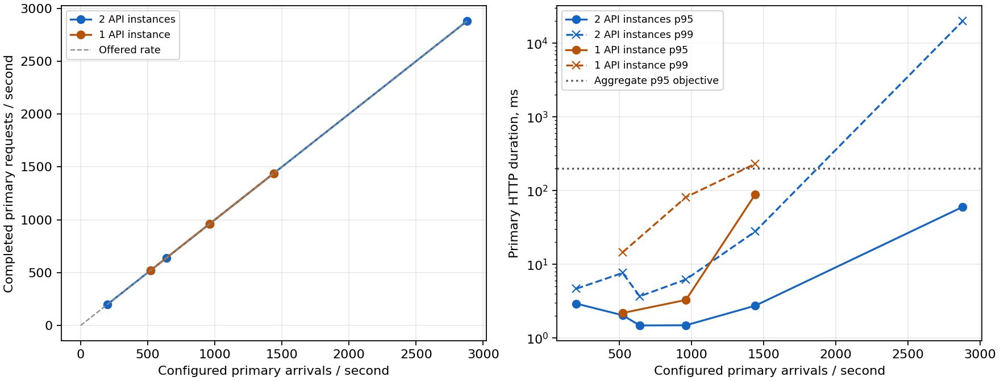

# Проверка программных компонентов и ресурсов

Измеряется реальный Java Commerce API с PostgreSQL, Redis и HAProxy. Методика, raw-артефакты и компактная сводка позволяют пересчитать результаты. Ресурсные бюджеты остальных компонентов описаны в [аппаратной модели](runtime_resources.md).

## Повторение

Нужны Docker Compose, свободные loopback-порты 18080–18082 и Python 3. Запуск выполняется из корня репозитория.

```bash
python3 scripts/calculate_capacity.py --check
python3 scripts/check_stage3.py
python3 scripts/analyze_stage3.py --jfr --plot
```

Последняя команда использует matplotlib для PNG-графика. Сбор нагрузки, сводка и JFR-анализ используют Python standard library и Java 25 JDK-контейнер. Потоковый [JfrSummary.java](../scripts/JfrSummary.java) разбирает запись с heap 256 МиБ и лимитом контейнера 512 МиБ. Это ограничивает память анализа независимо от количества развёрнутых stack traces.

Для короткого отдельного прогона доступен выбор профилей, например `python3 scripts/check_stage3.py --profiles warmup target single`. Сводка отражает выбранный набор. Ресурсный расчёт Commerce требует прошедшего одноэкземплярного профиля. Генератор и приложение запускаются в одном Docker host.

Скрипт создаёт уникальный Compose project и volume с синтетическими данными. После прогона сохраняет `artifacts/stage3`, останавливает API для записи JFR и удаляет собственный проект вместе с его volume. Каталог raw-артефактов исключён из Git. В репозитории сохранены [результаты основной серии](stage3_results.json), [первоначальный прогон](stage3_initial_results.json) и график.

## Среда и данные

| Параметр | Фактическое значение |
| --- | --- |
| Хост | Mac M4 Pro, Mac16,8, 12 CPU, RAM 24 ГиБ, macOS 26.7.1 |
| Docker | Engine 29.9.2, Linux aarch64, 12 виртуальных CPU, RAM 8 319 238 144 байт |
| Runtime | Temurin 25.0.5+8 LTS, Spring Boot 3.5.16, MVC/JDBC/virtual threads |
| JVM/API | 1 CPU, 512 МиБ limit, heap 256 МиБ, G1, ActiveProcessorCount=1, JFR profile |
| PostgreSQL | 17-alpine, 2 CPU, 768 МиБ, shared_buffers 128 МиБ, Hikari 8 на API |
| Redis / HAProxy | 128 МиБ / 0,5 CPU каждый, Redis maxmemory 64 МиБ, HAProxy nbthread 1 |
| Генератор | grafana/k6 1.4.2, 2 CPU / 1536 МиБ |
| Fixture | 100 000 SKU, 1000 покупателей, 200 000 исторических заказов, 600 000 позиций, 100 000 опубликованных outbox-событий |

Каждая серия начинается с нового PostgreSQL volume. В исторической выборке есть 200 заказов на покупателя. Нагрузочные checkout используют три SKU и увеличенный запас выделенных товаров. Они добавляют новые заказы и события. Общий инвариант `reserved = sum(active reservation quantities)` проверяется после всей серии.

Синтетические описания товаров и snapshots компактнее консервативных размеров модели. Сеть работает внутри Docker без TLS. Для production sizing отдельно проверяются полные payload, многолетний объём SQL, TLS, сеть и диск выбранных машин. Image ID конкретного прогона сохранены в JSON.

## Профиль и критерии

Полная модель даёт 640,11 API RPS. Реализованные OP01/02/04/05/06/09/10/11/12 дают 521 RPS после округления. OP03 поиск, OP07/08 оплата и OP13 изображения реализуются дальше. Профили 640–2880 RPS масштабируют доли уже реализованных Commerce операций.

k6 использует отдельный `constant-arrival-rate` scenario для каждой операции, с единицей интенсивности одна минута. Вес берётся из JSON-модели. Округление каждой операции до целого числа запросов в минуту даёт небольшое расхождение с заданным целевым RPS. `configuredRate` сохраняет итог настройки. В исходной модели уже учтены повторы, дополнительного множителя retries у генератора нет.

95% чтений карточек обращаются к горячим 1000 SKU, 5% выбираются из всего каталога. Cache hit измеряется отдельно. Checkout использует покупателей 1–200, корзина 201–800, история 801–1000. Перед каждым checkout выполняются три настоящих PUT для наполнения корзины. Они помечены как support и входят в HTTP и SQL нагрузку. Основная checkout latency измеряет один POST, версия и сумма берутся из последнего ответа сервера.

| Метрика | Условие прохождения |
| --- | --- |
| Технические ошибки | Менее 0,1% основных запросов, HTTP status 0 или ≥500 |
| Неожиданный статус операции | Менее 0,1%, ожидается 200 либо 201 для checkout |
| Ошибки подготовки checkout | Менее 0,1% support-запросов |
| Dropped iterations | 0, каждый запланированный запуск должен получить VU |
| Основные запросы вместе | p95 <200 мс, p99 <500 мс |
| Каждая операция кроме checkout | p95 <200 мс, p99 <500 мс |
| Checkout | p95 <500 мс, p99 <1000 мс |

Эти пороги выбраны для инженерной проверки этапа 3. Пользовательские SLO и окна наблюдения уточняются на этапе 5. `operation_requests / nominal_seconds` показывает завершённые основные запросы, включая неожиданные ответы. Отдельно сохраняются все HTTP-запросы и число ошибок. Latency является HTTP duration со стороны k6 до HAProxy, очередь VU отражается через dropped iterations. Graceful completion может добавить время после прекращения новых поступлений.

Сначала отдельно измеряется запуск нового стека после сборки образов. Он включает создание контейнеров, PostgreSQL init, миграции и seed. Затем идут 90 секунд прогрева на 521 RPS. Прогрев сохранён отдельной строкой и исключён из поиска рабочей ёмкости. Основные профили выполняются последовательно на тех же прогретых JVM. Перед одноэкземплярной частью второй API останавливается, после health-check перехода HAProxy нагрузка направляется в оставшийся API.

## Первоначальный прогон

При прогреве 200 RPS в течение 45 секунд и небольшом preAllocatedVUs профиль 521 RPS дал 46 dropped iterations, p95 7,26 мс и ноль технических ошибок. Профиль 640 RPS дал 1141 пропуск, p95 391,83 мс и p99 942,68 мс. Часть дополнительных VU выделялась во время теста. Пропуски и превышение latency сохранены в отдельной сводке.

В основной серии VU заранее выделены из бюджета одной секунды поступлений на scenario, минимум восемь для редких операций. Прогрев увеличен до 90 секунд на 521 RPS. Дополнительно снимается cgroup CPU throttling. Изменения касаются методики генерации и наблюдения. Прототип Commerce API использует исходный код этапа 2.

## Настройка CPU

HAProxy автоматически запускал 12 потоков на Docker host с 12 CPU при квоте контейнера 0,5 CPU. JVM использовала ActiveProcessorCount=2 при квоте 1 CPU. Во второй серии профиль 960 RPS показал 51,23 секунды суммарного cgroup throttled time HAProxy и 33,79 / 26,26 секунды у двух JVM. В этом интервале также выполнялся отдельный контейнер диагностики JFR, что добавляло нагрузку общему host.

Для итоговой серии задано `nbthread 1` в HAProxy и `ActiveProcessorCount=1` для нагрузочных JVM. Полная конфигурация приведена в таблице среды. Предыдущие метрики находятся в поле `before_cpu_tuning` первоначальной сводки. В итоговом прогоне дополнительный анализ JFR выполняется после завершения нагрузки.

На одинаковом уровне 521 RPS в двух сериях получены следующие показатели. Это наблюдения последовательных прогонов на общем Docker host.

| Метрика | До настройки | После настройки |
| --- | --- | --- |
| p99 основных запросов | 40,29 мс | 7,65 мс |
| Throttled time HAProxy | 3,034 с | 0 с |
| Throttled time JVM 1 | 2,099 с | 0,139 с |
| Throttled time JVM 2 | 2,053 с | 0,068 с |
| Dropped iterations | 0 | 0 |

## Наблюдаемость

Каждые пять секунд с учётом времени опроса снимаются Docker CPU/working set, JVM heap, GC, Hikari active/pending, cache counters и `/proc/1/status`. Полный RSS содержит память за пределами heap. Working set Docker вычитает часть файлового кэша Linux, поэтому два показателя имеют разный смысл. Максимумы таблиц являются максимумами наблюдённых отсчётов.

Перед каждым профилем сбрасывается `pg_stat_statements`. Сохраняются 20 SQL с наибольшим total_exec_time, calls, mean_exec_time, буферы и WAL. Снимки `pg_stat_database` дают разности deadlocks, disk blocks, cache hits, temporary bytes и времени I/O. Состояние cgroup CPU снимается до и после профиля. Метрики включают служебные health и запросы наблюдения.

JFR с `settings=profile` работает от старта JVM до остановки, включая cold start, прогрев и перегрузку. В сводке сохранены GC causes, count, sumOfPauses, longestPause и выборочные аллокации. Allocation weight является статистической оценкой. CPU execution samples помогают исследовать framework и сериализацию. Метрики SQL и JVM дополняют latency k6.

Редкие административные операции дают небольшое число наблюдений за 60–120 секунд. Их p99 требует более длинной выборки для эксплуатационных выводов. В этом прогоне эти квантили используются для обнаружения заметной деградации.

## Результаты нагрузки

| Профиль | API | Секунды | RPS задано / завершено | p50 / p95 / p99, мс | Тех. ошибки | Dropped | Результат |
| --- | --- | --- | --- | --- | --- | --- | --- |
| warmup | 2 | 90 | 521.00 / 518.00 | 0.92 / 402.55 / 1 731.16 | 282 | 275 | прогрев |
| baseline | 2 | 60 | 200.00 / 200.15 | 1.18 / 2.93 / 4.67 | 0 | 0 | пройден |
| target | 2 | 120 | 521.00 / 521.08 | 0.76 / 2.04 / 7.65 | 0 | 0 | пройден |
| headroom | 2 | 90 | 640.02 / 640.08 | 0.60 / 1.48 / 3.69 | 0 | 0 | пройден |
| stress | 2 | 90 | 960.02 / 960.09 | 0.53 / 1.49 / 6.24 | 0 | 0 | пройден |
| saturation | 2 | 60 | 1 439.98 / 1 440.13 | 0.65 / 2.75 / 27.84 | 0 | 0 | пройден |
| overload | 2 | 60 | 2 880.00 / 2 880.05 | 0.72 / 60.25 / 19 999.74 | 2684 | 0 | пороги превышены |
| single | 1 | 90 | 521.00 / 521.08 | 0.65 / 2.19 / 14.56 | 0 | 0 | пройден |
| single-stress | 1 | 60 | 960.02 / 960.15 | 0.52 / 3.29 / 81.50 | 0 | 0 | пройден |
| single-overload | 1 | 60 | 1 439.98 / 1 440.10 | 0.93 / 88.52 / 230.98 | 0 | 0 | пройден |

Один экземпляр прошёл проверенный уровень 1 439.98 RPS. При резерве 30% используем 1 007.99 RPS/экземпляр. Для Commerce пика 523.21 RPS выбираем 3 экземпляра в 3 AZ. После потери самой большой AZ расчётная ёмкость составляет 2 015.98 RPS. Перенос этой ёмкости на облачные vCPU требует повторного измерения.



На графике throughput учитывает все завершённые основные запросы. На 2880 RPS зарегистрированы 2684 технические ошибки из 172 803 основных запросов, то есть 1,553%. Ещё 9 ошибок возникли в 1161 support-запросе. Dropped iterations равны нулю, p99 достигает 20-секундного request timeout. Профиль превышает пороги. Два API прошли 1440 RPS с p99 27,84 мс. Таким образом, проверенная граница всего локального контура лежит между этими двумя уровнями при заданных соединениях и профиле клиентов.

На 2880 RPS генератор использовал 2898 VU, а HAProxy имеет maxconn 2000. Сохраняемые VU keep-alive соединения конкурируют за этот лимит. Средний CPU API составлял 44,19% / 40,87%, HAProxy 21,53%, k6 44,12%. Рабочая память генератора достигала 1194 МиБ при лимите 1536 МиБ. Для проверки гипотезы о соединениях нужен отдельный прогон с метрикой frontend sessions и изменением maxconn. Результат характеризует всю текущую конфигурацию.

### Операции при 521 RPS

| Операция | p50, мс | p95, мс | p99, мс |
| --- | --- | --- | --- |
| category | 1.04 | 1.83 | 7.97 |
| cartRead | 1.39 | 2.47 | 10.51 |
| stockUpdate | 2.95 | 5.73 | 5.94 |
| history | 1.06 | 3.27 | 8.65 |
| card | 0.56 | 1.25 | 6.18 |
| catalogUpdate | 2.50 | 5.55 | 8.06 |
| checkout | 5.65 | 11.05 | 49.73 |
| cartWrite | 2.03 | 3.94 | 18.55 |
| detail | 1.01 | 2.06 | 8.27 |

За 120 секунд завершены 62 529 основных запросов и 429 дополнительных запросов подготовки checkout. Технических и неожиданных статусов, ошибок support и dropped iterations — 0. Доля попаданий кэша карточек по отсчётам составила 90,79%.

### CPU и память при 521 RPS

| Компонент | CPU средний, % | CPU max, % | Working set max, МиБ | RSS max, МиБ | Heap used max, МиБ |
| --- | --- | --- | --- | --- | --- |
| haproxy | 5.24 | 7.46 | 28.73 | — | — |
| commerce-1 | 15.51 | 22.34 | 363.00 | 382.22 | 63.48 |
| commerce-2 | 14.50 | 20.60 | 385.90 | 392.45 | 67.11 |
| postgres | 11.68 | 14.39 | 218.10 | — | — |
| redis | 1.84 | 2.90 | 21.25 | — | — |
| k6 | 13.81 | 25.48 | 249.80 | — | — |

100% Docker CPU соответствует одному CPU. PostgreSQL имеет лимит 200%, API 100%, HAProxy 50%. Максимальная наблюдённая очередь Hikari pending равна 0. На всей серии максимальный RSS JVM составил 425,23 МиБ при heap used до 80,88 МиБ в одноэкземплярном профиле 1440 RPS. Для целевого API выбран лимит 768 МиБ с heap 256 МиБ.

### JVM и SQL

| Запись | GC events | Сумма пауз, с | Максимальная пауза, мс | Allocation weight, ГБ |
| --- | --- | --- | --- | --- |
| commerce-1 | 2168 | 9.787 | 72.431 | 56.02 |
| commerce-2 | 879 | 3.733 | 138.524 | 32.97 |

Запись второго API завершается перед одноэкземплярной частью. У каждой записи собственная длительность. Большую часть GC events составляют G1 Evacuation Pause. Веса аллокаций накапливаются за всё время записи и отражают оборот короткоживущих объектов. Среди крупнейших групп находятся byte/char arrays, StackChunk виртуальных потоков, Object arrays и String. В CPU leaf samples встречаются HashMap, Jackson writeString, servlet wrappers и Micrometer.

| SQL | Вызовы | Среднее исполнение, мс | Сумма исполнения, мс |
| --- | --- | --- | --- |
| Категория | 16837 | 0.2356 | 3 966.09 |
| Проверка пользователя | 7004 | 0.0239 | 167.68 |
| Miss карточки | 3683 | 0.0419 | 154.41 |
| Блокировка корзины | 6186 | 0.0247 | 152.91 |
| Позиции корзины | 6043 | 0.0238 | 143.96 |

Двадцать лидирующих SQL дали 58 081 вызов, или 484,01/с. За профиль PostgreSQL зафиксировал 494 чтения блоков и 3 428 437 попаданий в буферный кэш, 0 deadlocks и 0 temporary bytes. WAL вырос на 3,16 МБ. Запись WAL включает корзины, заказы и административные изменения. Планы индексов доступны в проверке этапа 2. Эти данные используются вместе с моделью многолетней истории для выбора диска.

## Холодный запуск и повторная корректность

От начала compose up после сборки до готовности нового стека прошло 15,94 секунды. Эта точка включает миграции и seed каталога. Во время отдельного прогрева возникли 282 HTTP 503 и 275 dropped iterations. Actuator показал по 141 ответу 503 на GET /api/products/{id} у двух API. Счётчики совпали с числом ошибок прогрева. Ограничитель ProductCache допускает четыре одновременные загрузки из SQL и ожидание слота 100 мс. Холодный кэш и JIT следует учитывать при вводе экземпляра в трафик. Проверка постепенного ввода и отказов входит в этап 5.

После настройки HAProxy повторно выполнен check_stage2.py на новой БД. Из 1000 попыток распродажи получены ровно 100 заказов и 900 OUT_OF_STOCK за 4,40 секунды. 64 одинаковых повтора дали один заказ и один резерв. Проверки ownership, многопозиционного rollback, версий цены/кэша, недоступности Redis и конкурентного истечения прошли. Логический restore дал совпадающие отпечатки данных. После основной нагрузочной серии расхождений агрегата reserved с активными резервами — 0. Результат повторной проверки сохранён в поле functional_recheck JSON-сводки.

## Вывод для аппаратного бюджета

Проверенный одноэкземплярный уровень составляет 1439,98 RPS с p95 88,52 мс и p99 230,98 мс. При резерве 30% получаем 1007,99 RPS. Для 523,21 RPS всего будущего Commerce достаточно одного такого экземпляра по арифметике ёмкости. Выбрано три экземпляра по одному в трёх AZ, чтобы сохранить два после потери зоны. Их расчётная суммарная ёмкость 2015,98 RPS предполагает достаточные ресурсы общих зависимостей. Целевой LB получает отдельный бюджет соединений.

При проверке 2880 RPS проявилась граница всего стенда. Перенос мощности на облачные CPU требует измерить полный payload, TLS, реальный диск и межзонную репликацию. Search, платёжный провайдер, медиаконтур, RabbitMQ и workers входят в последующие реализации. Их текущие CPU/RAM/IOPS/сеть являются проектными бюджетами.
