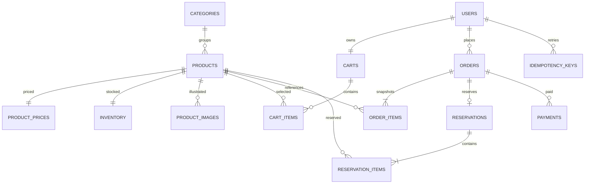

# Системы хранения данных

Этап 2 включает модель данных, выбор и эксплуатацию хранилищ, расчёт ресурсов и работающий транзакционный прототип. Основной источник чисел — [JSON-модель](../model/capacity.json); объёмы в штуках и ТБ с ростом/копиями находятся в [расчёте](capacity.md). Аппаратные бюджеты ниже — начальные оценки для проверки, а не результаты benchmark облачного оборудования.

## Данные и выбор хранилищ

| Данные | Источник истины / система | Паттерн доступа и согласованность | Альтернатива и причина выбора |
| --- | --- | --- | --- |
| Пользователи, роли, учётные данные | PostgreSQL | Точечный поиск username/id, ограничения уникальности | Документная БД не даёт преимущества для этой схемы |
| Каталог, категории, цены | PostgreSQL, JSONB для атрибутов | Чтение по SKU/категории; источник цены для checkout | MongoDB возможна для каталога; JSONB достаточно без дополнительного контура синхронизации цены |
| Запас и резервы | PostgreSQL | Короткие транзакции, блокировки, неотрицательный запас | Redis/Cassandra не выбираются источником многопозиционного транзакционного остатка |
| Корзины | PostgreSQL | Владелец, позиции, версия; постоянное состояние | Redis допускает потерю/вытеснение; для корзины выбран источник с бэкапами |
| Заказы и позиции | PostgreSQL | Запись вместе с резервом, история по пользователю, снимки цены/названия | Distributed SQL требует межузловой координации; исходная запись помещается в один primary |
| Локальные платежи | PostgreSQL | Привязка к заказу, состояние внешней операции | Реестр провайдера всё равно требует сверки; SQL хранит локальное состояние, не заменяет внешний платёж |
| Идемпотентность | PostgreSQL | UNIQUE по владельцу и ключу; долговременный ключ также в orders | Отдельный Redis-lock не делает результат заказа атомарным с БД |
| Outbox и inbox | PostgreSQL | Запись события в одной транзакции; выборка неопубликованных | Прямая запись БД + брокер без протокола оставляет окно потери события |
| Копии карточек | Redis | Cache-aside, версии, TTL; возможна ограниченная устарелость | Memcached проще, но Lua/HASH Redis удобны для CAS версий |
| Поисковые документы | OpenSearch | Текст, фильтры, релевантность; eventual consistency | PostgreSQL FTS дешевле в эксплуатации; OpenSearch выбран ради отдельной поисковой проекции и независимого масштабирования |
| Изображения и превью | S3 API; Garage на самостоятельном стенде | Объект по ключу, неизменяемые версии, отдельный медиаконтур | Байты в PostgreSQL увеличивают WAL и стоимость восстановления транзакционного контура |
| Сообщения и DLQ | RabbitMQ quorum queues | At-least-once, подтверждения и ограничение обработки | Kafka полезна для долгого replay-журнала; текущему сценарию достаточно задач/событий и пересборки проекций из SQL |
| Метрики | Prometheus TSDB | Временные ряды, низкая кардинальность labels | Общая OLTP не должна обслуживать сканы инфраструктурных рядов |
| Логи и трассировки | Loki / Tempo с объектным хранением | Поиск событий и трасс, ограниченный retention | Полнотекстовый поисковый кластер не перегружаем логами каталога; распределение по системам изолирует нагрузки |
| Бэкапы и WAL | Независимый S3 bucket / место хранения копий | Восстановление SQL на момент времени, копии медиа отдельно | Реплика не защищает от ошибочного удаления; копия на том же диске не защищает от его потери |

Логи/трассировки и метрики — целевые решения; в текущем backend доступны stdout и Actuator. OpenSearch, S3 и RabbitMQ не разворачиваются в транзакционной проверке этапа 2. Их ресурсные и эксплуатационные решения описаны здесь, доставка событий/полный поиск относятся к последующим этапам.

## ER-модель и ограничения

Исполняемая схема — [Flyway V1](../backend/commerce/src/main/resources/db/migration/V1__commerce_schema.sql). Outbox использует полиморфный aggregate_id, inbox — составной ключ consumer/event_id, поэтому их связи не изображают фиктивный внешний ключ ко всем типам агрегатов.

В БД закреплены PK/FK, уникальность SKU/username и ключа заказа, допустимые статусы, положительная цена/количество и `0 <= reserved <= on_hand`. Совпадение reserved с суммой активных резервов — межстрочный инвариант: поддерживается транзакциями и проверяется отдельным SQL-запросом. Одних CHECK для него недостаточно.

Заказ сохраняет цену и название позиции на момент покупки. Последующее изменение каталога их не переписывает. Используются целые копейки RUB, а не float. Созданный заказ связан с долговременным уникальным idempotency_key; очистка краткоживущего кэша ответа не разрешает создать дубликат.

## Транзакции и блокировки

Checkout выполняется при READ COMMITTED. Вставка уникального ключа идемпотентности сериализует одинаковые запросы. Затем блокируется корзина и проверяется её версия. Все товары/цены блокируются по возрастанию product_id, затем читается и блокируется запас. Порядок одинаков для административных изменений. Все позиции проверяются до изменения первого остатка.

Успех одной транзакцией создаёт заказ, позиции, резерв, события outbox и результат идемпотентности, увеличивает reserved и очищает корзину. Бизнес-отказ не оставляет частичного резерва, но сохраняет ответ для повтора в пределах окна. Сбой SQL откатывает всю транзакцию. Внешних сетевых платёжных вызовов внутри неё нет.

Истечение выбирает ограниченную пачку заказов через `FOR UPDATE SKIP LOCKED`, блокирует товары в том же порядке, однократно освобождает reserved и фиксирует EXPIRED/RELEASED с outbox. Сейчас это защищённая административная операция; автоматический планировщик и гонка с реальной оплатой проектируются в этапе взаимодействий.

Новый ключ не обходит версию уже использованной корзины. Запрос с прежним ключом и другим содержимым получает конфликт. Одинаковый ключ у разных пользователей не связывает их заказы. Чтение своего результата идёт в primary; API не отправляет произвольные SELECT на отстающую реплику.

## Индексы и планы

| Операция | Индекс/форма запроса | Причина |
| --- | --- | --- |
| Карточка | PK products/product_prices/inventory | Точечный доступ по SKU-id |
| Категория | Частичный `(category_id,id) WHERE active` | Keyset pagination; сначала выбираются 20 карточек в MATERIALIZED CTE, затем выполняются JOIN |
| Корзина | PK `(user_id,product_id)` | Чтение и изменение в границах одного владельца |
| История | `(user_id,created_at DESC,id DESC)` | Стабильный курсор без глубокого OFFSET |
| Истечение | `(expires_at,id) WHERE status='PENDING_PAYMENT'` | Обслуживание только актуального подмножества |
| Outbox | `(created_at,event_id) WHERE published_at IS NULL` | Не сканировать уже опубликованную историю |

Планы [EXPLAIN ANALYZE BUFFERS](stage2_query_plans.json) получены на 100 тыс. товаров и 200 тыс. дополнительных исторических заказов с 600 тыс. позиций. Их время зависит от конкретного стенда. Исходный вариант категории мог сканировать лишние строки ради JOIN; ограничение карточек до JOIN ограничивает число присоединяемых позиций размером страницы. На равномерном синтетическом каталоге PostgreSQL выбрал упорядоченный PK scan, а не составной индекс категории: это отражено в сохранённом плане. Составной индекс остаётся альтернативой для другого распределения/селективности; планировщик не принуждается через enable_seqscan=off.

## Redis и защита от устаревшего кэша

Копия карточки хранится в HASH `product:<id>` с body, version и expires. Эффективный TTL данных — 60–90 секунд с jitter; версия сохраняется до суток. Загрузка допускается Lua CAS только при версии не меньше сохранённой. После commit изменения удаляется body и поднимается watermark версии: запоздавший старый loader не должен затереть уже известную новую версию.

Single-flight объединяет загрузки одного SKU внутри одного API; на двух API может произойти по одной загрузке. Одновременно разрешено до четырёх origin-load на экземпляр, ожидание ограничено. HikariCP имеет восемь соединений на API, поэтому каталог не занимает все доступные origin-слоты. Redis-ошибки открывают короткую паузу обращений к кэшу; источник остаётся в PostgreSQL.

При отказе/eviction Redis или потере invalidation карточка может быть устаревшей до TTL. Это не гарантия линейризуемости кэша. Checkout всегда проверяет цену, активность и запас под SQL-блокировками, а изменение цены требует нового подтверждения. Rate-limit и межпроцессный distributed single-flight этим кодом ещё не реализованы.

## Объёмы и аппаратные бюджеты

В [capacity.md](capacity.md) и README приведены все категории, количество записей, логические и резервированные ТБ на первый и третий годы. После реализации события InventoryChanged считаются на каждый SKU: при трёх позициях заказа модель даёт 78 тыс. событий/сутки вместо прежних укрупнённых 42 тыс. Добавлены фактические SQL-шаги checkout/корзины и чтение учётных записей.

Для PostgreSQL модель сохраняет консервативные 8 КБ полезных данных на заказ с тремя позициями, ×2 на индексы/версии, ×3 копии. Синтетический прототип хранит меньшие строки: фактические table/index bytes приведены в проверке. Замер маленького снимка не подменяет прогноз трёхлетней истории.

| Система | Начальная целевая конфигурация | Диск / сеть | Обоснование и проверка |
| --- | --- | --- | --- |
| PostgreSQL | 1 primary + 2 standby по AZ; на узел 8 vCPU, 32 ГиБ | 512 ГБ NVMe, от 3000 IOPS и 100 МБ/с, 1 Гбит/с | Третий год: общий SQL-бюджет делится на 3 копии; при 30% свободного места укладывается в 512 ГБ/узел. Рабочие индексы держим в RAM; WAL/fsync и lock waits измеряем |
| Пулер | HikariCP 8/API; при росте два PgBouncer по 1 vCPU/1 ГиБ | До 64 server connections суммарно, 1 Гбит/с | Шесть API дают 48 подключений; оставляем ресурсы workers/операциям. max_connections не заменяет лимит активной работы |
| Redis | Primary + replica, на узел 1–2 vCPU/1 ГиБ | maxmemory 512 МиБ, 1 Гбит/с | Горячие 10% карточек и overhead плюс watermark/rate-limit; мониторинг RSS и evictions. Кэш восстанавливаем, а не считаем durable бизнес-данными |
| OpenSearch | 3 узла по 4 vCPU/8 ГиБ, heap 4 ГиБ | SSD 50 ГБ/узел, 1 Гбит/с | Один primary shard и одна replica достаточны исходному индексу; три голосующих узла по AZ. Фактический размер индекса/merge и сложные фильтры проверяем отдельно |
| S3 | Управляемая логическая ёмкость либо 3 Garage-узла по 2 vCPU/2 ГиБ | Для self-host: SSD 512 ГБ/узел, RF=3, сеть от 1 Гбит/с/узел | Медиа 160 ГБ в год 1, 230,4 ГБ в год 3 до собственных копий. При RF=3 нужно 480/691,2 ГБ суммарно плюс свободное место; CDN и cold-cache отдельно влияют на сеть |
| RabbitMQ | 3 узла по 2 vCPU/2 ГиБ | SSD 20 ГБ/узел, 1 Гбит/с | Quorum majority, persistent messages, publisher confirms; лимиты диска/RAM. Объём считаем по backlog/retention, не по всем событиям за год |
| Prometheus | 1 узел 2 vCPU/4 ГиБ, независимый бэкап | SSD 20 ГБ | 20 тыс. рядов / 15 с / 15 суток. Допустима потеря части телеметрии; HA-наблюдение и внешняя проверка добавляются в этапе надёжности |
| Loki/Tempo | Два независимых контура сбора/хранения по 2 vCPU/4 ГиБ | 20 ГБ буфера/узел и отдельные S3 buckets | В модели заложены две копии сжатой телеметрии. Сборщики/экспортеры и точная схема дублирования настраиваются позже, не считаются уже работающими |

IOPS нельзя напрямую приравнять к SQL QPS. Уточнённый пик модели около 536 SQL/с; ориентир бюджета: округлённые 540 SQL/с × 20% физических промахов × 12 страниц ≈ 1296 чтений/с, затем запас для WAL/обслуживания до первоначальных 3000 IOPS. Это пример расчёта, не замер; реальный page access берётся из BUFFERS, miss ratio и p99. Последовательный запас нужен для бэкапа/восстановления. Размер CPU окончательно выбирается профилированием, а не названием языка.

На текущем Docker-стенде доступны 12 виртуальных CPU и около 7,75 ГиБ общей RAM. Фактические лимиты: PostgreSQL 768 МиБ/2 CPU, Redis 128 МиБ/0,5 CPU, два API по 512 МиБ/1 CPU, HAProxy 128 МиБ. Это отдельная учебная конфигурация без репликации и нескольких AZ.

## Эксплуатация по системам

| Система | Наблюдаемость | Надёжность и восстановление | Рост и настройка |
| --- | --- | --- | --- |
| PostgreSQL | Query latency, pg_stat_statements, pool wait, pg_locks, deadlocks, vacuum/bloat, WAL/slots, lag, свободное место | fsync/full_page_writes; sync standby для нужного RPO; безопасное promotion/fencing; физические копии + WAL/PITR; регулярный restore | Индексы и лимиты, затем вертикальный рост/read replicas. Партиции помогают retention, но не масштабируют запись автоматически |
| Redis | Hits/misses, origin loads, ошибки, evictions, RSS, command p99 | Replica/управляемый failover; потеря кэша допустима; bounded fallback и прогрев | Горячие ключи сначала защищаем single-flight/L1 при необходимости; кластер только по измеренной RAM/QPS |
| OpenSearch | Search p95/p99, indexing lag, rejected tasks, heap/GC, disk watermarks, merge | Replica по AZ, snapshots в S3, полная пересборка из SQL | Shards и mapping по запросам; не увеличиваем shard count на каждый небольшой рост каталога |
| S3/Garage | GET/PUT latency/errors, bytes/requests, место, repair/replication lag, checksums | Managed durability либо RF=3 по независимым узлам; независимая копия/проверка объектов | Изображения по версиям ключей, очистка orphan/устаревших загрузок, CDN. WebDAV не используется как рабочий data_dir |
| RabbitMQ | Queue depth/oldest age, ready/unacked, confirms, DLQ, disk/RAM alarms | Три quorum-узла; идемпотентные consumers; неопубликованные события остаются в SQL | Prefetch/concurrency, максимальный backlog, retry/DLQ. При исчерпании outbox/disk включаем admission control |
| Prometheus/Loki/Tempo | Собственные ingest errors, cardinality, series/chunks, compaction, объём/retention | История телеметрии не блокирует покупку; отдельные копии/бэкап и внешний health-сигнал | Не использовать user_id/order_id в labels, ограничивать sampling, TTL и размер сообщения |
| Бэкапы | Успешность, возраст последней копии/WAL, размер, время restore | Отдельный доступ и место хранения; восстановление в новую БД и сравнение контрольных данных | Retention полного SQL/инкрементов/WAL и медиа отдельно; 100 ГБ Mail используются только для малого стенда |

Начальные target-настройки PostgreSQL: shared_buffers 8 ГиБ, effective_cache_size около 24 ГиБ, work_mem 8 МиБ с учётом конкуренции, max_connections 150, активные server pools до 64. `statement_timeout`, `lock_timeout` и `idle_in_transaction_session_timeout` ограничены и согласуются с API-deadline. На стресс-стенде они длиннее проектного latency SLO: 10/5/10 с и ожидание Hikari до 15 с позволяют проверить все 1000 попыток, но не доказывают p95 ≤ 500 мс при такой конкуренции.

В целевой конфигурации DDL/миграции, application DML и backup выполняются отдельными ролями; application не получает SUPERUSER/CREATEDB. Одноразовый Docker-стенд использует административную тестовую роль для создания БД восстановления. Его grants и demo-пароли не переносятся в production-конфигурацию.

## Миграции retention и масштабирование

Flyway V1 создаёт схему, V2 с синтетическими пользователями/товарами включается только через demo-profile. В production migrations не редактируются после применения. Изменения ведутся expand/contract: новое nullable поле, двойное чтение/запись при необходимости, backfill пачками, переключение и последующее удаление. Большие индексы создаются CONCURRENTLY отдельной нетранзакционной миграцией; добавление ограничений — через NOT VALID/VALIDATE, когда это применимо.

Retention: заказы/позиции и локальные платежи — 3 года как продуктовый сценарий; закрытые резервы — 30 суток; содержимое неактивных корзин очищается через 30 суток с увеличением версии, заголовок корзины сохраняется вместе с пользователем. В модели заголовки есть у всей зарегистрированной базы, непустые позиции — у 25%. Idempotency responses, outbox/inbox и дедупликация — 7 суток при согласованном окне replay; логи 7, трассы 3, метрики 15 суток. Это начальные допущения, не утверждение требований закона. Активные резервы/неопубликованный outbox не удаляются только по возрасту; их накопление вызывает разбор инцидента.

История очищается небольшими пачками с метриками или партициями после проверки объёма. Перенос orders на партиции потребует пересмотреть глобальный UNIQUE(user_id,idempotency_key) и FK: нельзя просто добавить partition key и потерять гарантию идемпотентности. Отдельный реестр бизнес-ключей либо иной ключ партиционирования проектируется до миграции.

Шардирование пока не требуется расчётной нагрузкой. Сначала исправляем запросы/индексы, ограничиваем конкуренцию, кэшируем и изолируем аналитику. Разделение orders по user_id, а inventory по SKU разрушает исходную локальную транзакцию и требует отдельного протокола согласования. Разделение популярного SKU по hash не создаёт независимых копий одного и того же запаса.

## Бэкапы и границы доказательства

Для целевого PostgreSQL планируется pgBackRest: полная физическая копия, инкременты, архив WAL, независимый S3 repository и проверка PITR. Синхронная репликация требует подходящего standby и корректного promotion/fencing; при отсутствии требуемого подтверждения запись может остановиться. Её наличие не заменяет бэкап.

На стенде реально выполнены `pg_dump -Fc` и `pg_restore --single-transaction --exit-on-error` в новую пустую БД. Сравниваются отпечатки inventory/заказов и количество позиций/резервов/outbox/idempotency. Это доказывает проверенный логический restore конкретного снимка, но не RTO production или готовность WAL/PITR. Медиа в этот dump не входят и должны копироваться через S3 API отдельно.

Основания: [PostgreSQL 17 locking](https://www.postgresql.org/docs/17/explicit-locking.html), [EXPLAIN](https://www.postgresql.org/docs/17/using-explain.html), [dump/restore](https://www.postgresql.org/docs/17/backup-dump.html), [continuous archiving](https://www.postgresql.org/docs/17/continuous-archiving.html), [pgBackRest](https://pgbackrest.org/user-guide.html).
