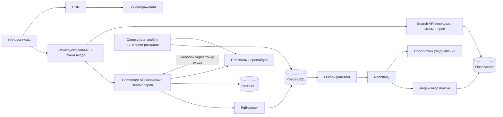

# План курсового проекта по электронной коммерции

Предлагаемый проект — интернет-магазин товаров для дома и электроники с каталогом, поиском, корзиной, оформлением и оплатой заказов. Отличительный нагрузочный сценарий — распродажа ограниченного запаса популярных товаров. Целевая аудитория для проектирования — от 1 млн MAU в России.

Главный результат по заданию — расчётно-пояснительная записка README.md в публичном репозитории. Работающий сервис в предоставленных требованиях явно не обязателен. Ниже обязательное архитектурное проектирование дополнено рекомендуемым прототипом для проверки решений. Код не должен вытеснять расчёты, схемы и обоснования.

План соответствует пяти этапам из лонгридов 2–6. Отдельной балльной рубрики в предоставленном документе нет: он отсылает к ЛМС. Соответствие плану позволяет закрыть перечисленные требования и самопроверки, но не заменяет сверку с рубрикой ЛМС.

## Границы продукта

Выбираем магазин одного продавца с единым учётом запасов. Это оставляет достаточно сложных задач распределённых систем и позволяет подробно разобрать согласованность оформления заказа.

Проектируем собственный учебный магазин. Существующие компании служат аналогами для исследования функций, аудитории и нагрузки; доступ к их внутренней архитектуре и данным не предполагается. Нашу целевую нагрузку и допущения описываем отдельно от фактических показателей аналогов.

Пять функций MVP:

1. Просмотр категорий и карточек товаров с изображениями и ценами.
2. Поиск с фильтрами по категории, цене и наличию.
3. Корзина зарегистрированного пользователя.
4. Создание заказа, резервирование товара и оплата через внешнего провайдера.
5. История заказов и просмотр их статуса.

Профиль и авторизация — вспомогательные возможности. В прототипе достаточно заранее созданных пользователей и простого тестового механизма аутентификации. Идентификатор пользователя для проверки доступа берётся из проверенных учётных данных; нельзя позволять клиенту получать чужой заказ подстановкой user_id.

Кабинет продавца, многоскладская логистика, рекомендации, отзывы, промокоды и полноценные возвраты можно вынести в развитие. Исключение — компенсационный возврат денег после поздней оплаты уже истёкшего заказа: его нужно описать как часть корректности платёжного процесса. Платёжные реквизиты обрабатывает провайдер.

## Как темы курса применяются в проекте

| Занятие | Что переносим в проект | Проверяемый результат |
| --- | --- | --- |
| 1. Компьютерные сети | Путь запроса, HTTP/TLS, keep-alive, пулы, задержки, неоднозначность таймаута | Схема сетевого пути и бюджет времени оформления заказа; повтор запроса не создаёт второй заказ |
| 2. Балансировка | L4/L7, алгоритмы, readiness, draining, CDN, ограничения DNS failover | Схема точек балансировки; отключение экземпляра API и его безопасный вывод |
| 3. Обзор БД | OLTP и поиск, транзакции и модели доступа, производные данные | Матрица данных и хранилищ с альтернативами |
| 4. Эксплуатация БД | Пул соединений, EXPLAIN, индексы, блокировки, репликация, кэш, бэкапы | Корректное резервирование, планы запросов, расчёт роста, сценарий восстановления |
| 5. ПО и оборудование | Runtime, CPU/RAM/диск/сеть, контейнеры, профилирование | Ресурсы каждого компонента и метод их проверки |
| 6. Взаимодействия | API-контракты, синхронные вызовы, дедлайны, идемпотентность | OpenAPI и диаграмма оформления/оплаты |
| 7. Взаимодействия, продолжение | Брокер, доставка, outbox, повторная обработка, фоновые задачи | Дубликаты и перезапуск обработчика не нарушают бизнес-состояние |
| 8. Надёжность | SLI/SLO, изоляция, деградация, RTO/RPO, инциденты | Матрица отказов и результаты проверок восстановления |
| 9. Архитектура больших систем | Границы модулей, эволюция, стоимость, рост | План масштабирования при росте в 5–10 раз и условия изменения архитектуры |

В описании курса занятия 6 и 7 имеют одинаковую программу; в проекте удобно разделить их на синхронный и асинхронный контуры. AI/ML в программе рассматривается, но для выбранного MVP не требуется.

## Предлагаемая архитектура

Стартовая архитектура — модульный Commerce API, отдельный Search API и фоновые обработчики. Каждый API запускается в нескольких экземплярах без локального пользовательского состояния. Заказы, остатки, корзины и локальное состояние платежей находятся в одной транзакционной БД. Их объединение в модульном ядре позволяет резервировать все позиции заказа одной локальной транзакцией.



У схемы есть отдельная физическая версия: зоны доступности, число экземпляров, реплики БД, отказоустойчивость балансировщика и брокера. Её составляем после расчётов. Стрелка PostgreSQL → publisher означает чтение таблицы outbox приложением, а не непосредственную отправку сообщений самой БД.

| Компонент | Предлагаемый выбор | Причина и сравнение |
| --- | --- | --- |
| Commerce API, Search API, workers | Java 25 LTS, Spring Boot, Spring MVC, Spring JDBC | Выбор учитывает предпочтение Java и сокращает время разработки. JDBC даёт явный контроль SQL и транзакций. JVM, GC, прогрев JIT и аллокации измеряем; Go сравниваем по памяти, старту и удобству развёртывания, а производительность проверяем на сценариях магазина |
| Транзакционные данные | PostgreSQL | Транзакции, ограничения, конкурентное резервирование; JSONB достаточно для неоднородных атрибутов каталога. MongoDB не требуется только ради JSON, Cassandra не соответствует основным операциям заказа |
| Пулы | HikariCP; PgBouncer в целевой архитектуре при необходимости | Ограничение суммарных подключений всех экземпляров. Transaction pooling требует проверить совместимость с используемым состоянием сессий |
| Кэш | Redis | Общий cache-aside для карточек, TTL, счётчики ограничения запросов. Корзина хранится в PostgreSQL; потеря кэша не должна терять заказ или корзину |
| Поиск | OpenSearch | Морфология, релевантность и комбинации фильтров. Сравниваем с PostgreSQL FTS; отдельный движок оправдываем именно требованиями поиска |
| Изображения | Garage с S3 API для стенда; S3-совместимое хранилище + CDN в целевой архитектуре | Большие неизменяемые объекты, независимое масштабирование выдачи; бинарные изображения не складываем в OLTP. Локальный/серверный кэш не приравниваем к географически распределённому CDN |
| Асинхронные задачи | RabbitMQ | Маршрутизация задач, независимые очереди потребителей, acknowledgements, ограничение незавершённой обработки. Kafka рассматриваем, если появится необходимость в длительном журнале, replay и нескольких независимых потоковых обработках |
| Входной трафик | HAProxy L7; в целевой схеме два LB за управляемой L4-точкой | TLS, маршрутизация по URL, active readiness и round-robin между одинаковыми API. Управляемый L7 остаётся альтернативой при выборе облака; сравнение с Envoy/Nginx приведено в чекпоинте 1 |
| Наблюдаемость | Prometheus, Grafana, OpenTelemetry, структурированные логи | Метрики нагрузки и насыщения, трассировка заказа, поиск причины сбоя. Для целевой схемы добавляем централизованный сбор логов и его retention |
| Развёртывание | Docker Compose для прототипа | Воспроизводимый запуск. Kubernetes оцениваем для целевой эксплуатации, но его наличие не является самостоятельной целью проекта |

RabbitMQ используется как брокер задач и событий с доставкой at-least-once. В целевой конфигурации рассматриваем три узла, durable quorum queues, persistent messages, publisher confirms и manual ack. При такой модели нужно явно хранить версию обновления товара и уметь полностью перестроить поисковый индекс из PostgreSQL: очередь не заменяет долгосрочный журнал событий.

ClickHouse, Flink, Airflow, service mesh, собственный Kubernetes-кластер и векторная БД в стартовый вариант не входят. Если добавляем аналитический сценарий, отдельно обосновываем объём событий, retention, ресурсы и необходимость ClickHouse. Для текущих фоновых задач достаточно специализированных workers и периодической сверки платежей.

## Реализация хранения изображений на имеющихся ресурсах

Ресурсы пользователя: Mac с M4 Pro, существующая ВМ с SSH-доступом и 100 ГБ в потребительском Облаке Mail. RAM, свободный диск и сетевые ограничения ВМ пока не измерены. Ни установка, ни подключение к ВМ при уточнении этого плана не выполнялись.

Рекомендуемый стенд без дополнительной подписки на object storage:

1. Для локальной разработки запускаем Garage в Linux ARM64-контейнере на Mac, сохраняем данные и метаданные в постоянных Docker volumes. Затем ту же конфигурацию можно перенести на ВМ с учётом её архитектуры и ресурсов.
2. Для одной ВМ используем одноузловую конфигурацию с replication_factor = 1. Создаём layout, бакет product-images, отдельный ключ приложения и права на бакет. Это работающее S3-совместимое хранилище для стенда, но одна ВМ не обеспечивает устойчивость к потере узла.
3. Java работает через AWS SDK for Java v2: endpoint, region, credentials и path-style addressing задаются конфигурацией. Покрываем интеграционной проверкой используемые операции PUT/GET/HEAD/DELETE и подписанные ссылки: S3-совместимость не означает поддержку всех возможностей Amazon S3.
4. В PostgreSQL храним product_id, bucket/object_key, content_type, размер и при необходимости checksum/размеры изображения. Байты хранятся на диске Garage; object key не обязан совпадать с физическим путём на диске.
5. Для простого MVP администратор загружает изображения через backend. Backend передаёт поток в object storage и после успеха записывает ссылку в БД. Далее можно добавить временные подписанные ссылки для прямой загрузки; объект прикрепляется к товару после проверки. Незавершённые загрузки очищает фоновая задача.
6. Изображения выдаются отдельным медиаконтуром. Для публичных изображений каталога можно поставить Nginx с proxy_cache перед read-only выдачей объектов. Приватные объекты требуют проверки доступа до кэша либо подписанных ссылок; нельзя безусловно кэшировать авторизованные ответы для всех пользователей.
7. При изменении картинки используем новый ключ, например products/123/<uuid>.webp. Это позволяет задавать длительный Cache-Control без выдачи старого содержимого под прежним URL.
8. Резервируем логические объекты через S3 API и согласованный бэкап PostgreSQL. Для копий можно использовать имеющееся Облако Mail через документированный WebDAV с паролем приложения или поддерживаемый клиент. Метаданные Garage и работающую внутреннюю БД нельзя считать корректно сохранёнными простым копированием активного каталога.

Потребительское Облако Mail не следует смешивать с отдельным продуктом VK Cloud Object Storage. Наличие 100 ГБ в cloud.mail.ru не предоставляет S3 bucket/credentials в VK Cloud. Для нашего стенда Облако Mail — внешнее место хранения резервных копий, а основное S3-хранилище использует локальный диск или диск ВМ. Монтировать WebDAV как рабочий data_dir Garage не предлагается: эта схема добавляет удалённую файловую зависимость и не проверенные гарантии хранения.

Для начального стенда достаточно примерно 1000 товаров × 3 изображения × 150 КБ = 450 МБ исходных изображений. Превью, служебные данные и резервные копии учитываем отдельно. Целевой расчёт на 100 тыс. SKU остаётся в записке; полный объём не обязательно загружать для демонстрации функций.

Если на ВМ доступен только SSH, во время разработки S3 endpoint можно открыть через SSH port forwarding. Публичный HTTP/HTTPS-доступ требует отдельно проверить доступные внешние порты и маршрутизацию. Один Nginx на ВМ демонстрирует HTTP-кэширование, но не сеть CDN по регионам. В целевой схеме CDN описываем и рассчитываем отдельно.

Документация решений:

- [Совместимость Spring Boot и Java](https://docs.spring.io/spring-boot/system-requirements.html)
- [Одноузловой Garage](https://garagehq.deuxfleurs.fr/documentation/quick-start/)
- [Сборки Garage, включая Linux ARM64](https://garagehq.deuxfleurs.fr/_releases.html)
- [Поддерживаемые возможности S3 в Garage](https://garagehq.deuxfleurs.fr/documentation/reference-manual/s3-compatibility/)
- [Свой endpoint в AWS SDK for Java](https://docs.aws.amazon.com/sdk-for-java/latest/developer-guide/endpoint-config.html)
- [Подписанные ссылки в Java SDK](https://docs.aws.amazon.com/sdk-for-java/latest/developer-guide/examples-s3-presign.html)
- [WebDAV в Облаке Mail](https://help.mail.ru/cloud/desktop/webdav/)

## Этап 0 Подготовка границ и исходных данных

Этап выполнен. Подготовлены [README](README.md), [границы продукта и сценарии](docs/product_scope.md), [реестр исходных параметров](docs/assumptions.md), [источники](docs/sources.md) и локальные правила .gitignore. Для проекта выделен отдельный репозиторий hdls-ecom-project с локальной рабочей папкой hlds.

Ниже перечислен состав этапа. Исходные числа остаются явно обозначенными допущениями до обоснования в чекпоинте 1. Попытки создания заказа отделены от успешных заказов и платежей; пример годового числа заказов далее в плане предполагает успешное создание всех рассчитанных попыток.

Фиксируем:

- описание продукта, роли покупателя и администратора каталога;
- пять функций MVP и исключения из объёма;
- географию: Россия, с последующим распределением по регионам и часовым поясам;
- горизонт расчёта: запуск, один год, три года;
- цель по аудитории и исходные предположения;
- две модели: обычный день и распродажа популярного товара.

Заводим таблицу «параметр → значение → единица → источник или допущение → влияние». Рыночные аналоги подтверждены оригинальными публикациями М.Видео, Ozon, АКИТ и Mediascope в [исследовании](docs/market_research.md); они отделены от допущений собственной аудитории.

MAU, активные покупатели и зарегистрированные пользователи — разные показатели. Если компания публикует число покупателей за год, его нельзя подставить в формулу MAU. Отсутствующие параметры явно считаем модельными и проверяем чувствительность результата к их изменению.

Готовность: описание и границы позволяют однозначно перечислить операции и данные системы.

## Чекпоинт 1 Требования нагрузка и балансировка

Соответствует лонгриду 2 и занятиям 1–2.

Этап выполнен: [README](README.md) содержит основные таблицы; [расчёт](docs/capacity.md) воспроизводится из [JSON-модели](model/capacity.json); подготовлены [балансировка](docs/balancing.md) и [результаты Java-стенда](docs/stage1_verification.md). Актуальные параметры следующих этапов берём из JSON. Пример ниже показывает только основные действия без повторов и дополнительных платёжных/административных запросов; полный API-пик модели равен примерно 640 RPS.

**Что делаем в расчётной записке**

1. Подбираем оригинальные источники для аналогов, аудитории и географии. Отдельно отмечаем модельные величины.
2. Составляем таблицу продуктовых метрик: MAU, DAU, действия за день, данные на пользователя в штуках и ГБ по типам.
3. Рассчитываем технические метрики: средний и пиковый RPS каждой операции, входящий/исходящий трафик, объекты и ТБ хранения.
4. Отдельно считаем обращения к CDN и origin, служебные запросы, webhooks и фоновые операции. Переводим API RPS в нагрузку на БД с учётом cache hit ratio и числа SQL на запрос.
5. Описываем L7-маршрутизацию /api/search и /api/*, health/readiness, таймауты, keep-alive и draining. Пользовательские сессии не привязываем к конкретному API-экземпляру.
6. Для географии выбираем один регион записи с несколькими AZ и CDN по стране. Мультирегиональную запись рассматриваем только при отдельном требовании; DNS TTL не объявляем гарантией мгновенного failover.

**Стартовая модель для обсуждения, все значения ниже — допущения**

MAU = 1 000 000, DAU = 200 000, каталог = 100 000 SKU, коэффициент суточного пика = 10. SKU в этой модели — единица учёта продаваемого товара; объём пользователей для долговременного хранения оцениваем отдельно от MAU.

| Тип основной API-операции | Действий на DAU в сутки | Запросов в сутки | Средний RPS | Пиковый RPS |
| --- | ---: | ---: | ---: | ---: |
| Просмотр каталога/карточек | 20 | 4 000 000 | 46,30 | 462,96 |
| Поиск | 5 | 1 000 000 | 11,57 | 115,74 |
| Чтение/изменение корзины | 2 | 400 000 | 4,63 | 46,30 |
| Создание заказа | 0,05 | 10 000 | 0,12 | 1,16 |
| Чтение истории/статуса заказа | 0,2 | 40 000 | 0,46 | 4,63 |
| Итого для перечисленных операций | 27,25 | 5 450 000 | 63,08 | 630,79 |

Формулы:

```text
requests_per_day_i = DAU × actions_per_user_per_day_i
average_rps_i = requests_per_day_i / 86 400
peak_rps_i = average_rps_i × peak_factor_i
daily_traffic_i = requests_per_day_i × average_payload_bytes_i
origin_media_traffic = media_delivery_traffic × (1 - CDN_hit_ratio)
```

Таблица — начальная модель основных операций, а не полный трафик системы. Инициацию оплаты, webhooks, административные изменения, health checks и повторы добавляем отдельными строками. Проверяем сценарии с коэффициентами пика 5, 10 и 30; у checkout на распродаже свой коэффициент и перекос по SKU. Нельзя равномерно распределять все обращения по каталогу.

Медиа считаем отдельно: 100 000 SKU × 4 изображения × 250 КБ = 100 ГБ исходных объектов, до превью, версий и резервирования. Пользовательский трафик определяется числом реально загружаемых изображений, их размером, браузерным кэшем и CDN hit ratio. Объём объектов и объём их выдачи — разные расчёты.

При 10 000 попыток в день и 90% успешного создания получаем 9000 заказов в день, или 3,285 млн в год. Если заказ вместе с тремя позициями занимает условные 8 КБ полезных данных, это 26,28 ГБ в год до индексов, платежей, резервов, WAL, репликации и бэкапов. Эти категории добавлены в расчёт; 26,28 ГБ не являются размером всей БД.

**Что проверяем прототипом**

Запускаем два API-экземпляра за HAProxy, добавляем liveness/readiness и request_id. Проверяем распределение запросов, остановку одного экземпляра и graceful shutdown без потери уже начатых операций.

**Критерий готовности**

Есть две сводные таблицы метрик, формулы и источники; есть география и схема балансировки; для выбранного инструмента рассмотрены альтернативы. Понятно, какая нагрузка доходит до каждого компонента.

## Чекпоинт 2 Данные хранение и эксплуатация БД

Соответствует лонгриду 3 и занятиям 3–4.

Этап выполнен: [выбор/эксплуатация хранилищ и ER](docs/storage.md), [Spring Boot backend](backend/commerce/pom.xml), [API и запуск](docs/backend_api.md), [проверка конкурентности и восстановления](docs/stage2_verification.md). В модели уточнены события на каждый SKU, SQL-шаги реализации и заголовки пустых корзин. Основные результаты включены в README; численные прогнозы отделены от измерений стенда.

**Что делаем в расчётной записке**

1. Перечисляем категории: пользователи, каталог и цены, остатки, корзины, заказы и позиции, резервы, платежи, idempotency records, outbox, consumer inbox, изображения, поисковые документы, кэш, очереди, метрики, логи, бэкапы.
2. Для каждой категории указываем источник истины, ключевые операции, согласованность, размер записи, число записей и retention.
3. Обосновываем PostgreSQL, Redis, OpenSearch, S3 и RabbitMQ через операции и требования. Поисковый индекс и кэш являются производными данными.
4. Рассчитываем хранение в штуках и ТБ на один и три года. Учитываем индексы, реплики, свободное место для обслуживания и восстановления. Бэкапы и WAL считаем отдельно с собственной политикой retention. Для управляемого S3 используем модель доступной ёмкости/тарификации, не добавляем произвольное число внутренних копий провайдера.
5. Для каждого хранилища оцениваем CPU, RAM, диск, IOPS/throughput, сеть, стоимость репликации и восстановления.
6. Описываем индексы, пулы, миграции expand/contract, vacuum, monitoring, резервирование и восстановление.

**Минимальная модель PostgreSQL**

```text
users
products, product_prices, inventory
carts, cart_items
orders, order_items
reservations, reservation_items
payments
idempotency_keys
outbox_events, consumer_inbox
```

У order_items сохраняем снимок названия и цены на момент покупки. Суммы — в минимальных денежных единицах и с валютой. Проверки неотрицательности остатков и допустимых статусов закрепляем в БД и прикладной логике. Индексы проектируем под чтение карточки, корзины, истории по (user_id, created_at, id), истекающих резервов и неопубликованного outbox. Для истории используем keyset pagination.

**Что проверяем прототипом**

Реализуем каталог, корзину, создание заказа и резервирование. Для одной позиции резерв создаём условным атомарным UPDATE либо блокировкой строки с проверкой доступности. Для нескольких позиций выполняем всю операцию одной транзакцией; порядок блокировок по SKU стабилен. При нехватке одного товара откатываем весь резерв. Внешний платёжный вызов не держит SQL-транзакцию открытой.

Реализуем cache-aside карточек с TTL и jitter, объединение конкурентных загрузок популярного товара и инвалидирование/версионирование при изменениях. Итоговая цена и доступность при checkout проверяются по PostgreSQL. Чтение сразу после собственной записи идёт с primary; устаревшая read replica для такого ответа не используется.

**Критерий готовности**

Есть ER-диаграмма, матрица хранилищ и оценки ресурсов/роста. Для критических SQL сохранены EXPLAIN (ANALYZE, BUFFERS) на репрезентативных данных. Тест 1000 конкурентных попыток на запас 100 единиц резервирует не более 100 единиц; повтор с тем же ключом не резервирует заново.

Шардирование PostgreSQL на старте не требуется только из-за 1 млн MAU. Сначала проверяем запросы, индексы, кэш, ограничения конкуренции и вертикальное масштабирование. При будущей декомпозиции orders по user_id и inventory по SKU нужно отдельно решить межшардовое резервирование: простое добавление шардов разрушает исходную локальную транзакцию.

## Чекпоинт 3 Программные компоненты оборудование и тестирование

Соответствует лонгриду 4 и занятию 5.

**Что делаем в расчётной записке**

1. Фиксируем Java/JVM, Spring Boot, Spring MVC, Spring JDBC, HikariCP и альтернативы; указываем стоимость сериализации, аллокаций, GC и сетевых обращений. Для SQL-миграций используем Flyway, для S3 — AWS SDK for Java v2. На Mac используем ARM64 JDK и образы; Java heap и полный RSS процесса измеряем отдельно.
2. Описываем модули Commerce API: каталог, корзина, заказы/остатки, платежи. Search API масштабируется независимо; тяжёлая индексация и уведомления выполняются отдельными процессами.
3. Для каждого API, worker и инфраструктурного компонента составляем ресурсную строку: число экземпляров, vCPU, RAM, тип/объём диска, IOPS, throughput, сеть, запас при отказе.
4. Разделяем локальный стенд и целевую физическую архитектуру: один ноутбук не изображает независимые AZ.
5. Описываем unit/integration/load тесты и контейнеризацию. CI/CD — дополнительная часть: проверка, сборка образа, миграции, деплой, rollback.

Потребность в экземплярах выводим из измеренной пропускной способности при заданном SLO и запасе. Для отказа узла проверяем оставшуюся ёмкость; для отказа AZ пересчитываем её по размещению в зонах. Формула «плюс один экземпляр» сама по себе не покрывает потерю зоны.

**Что проверяем прототипом**

Готовим Docker Compose, миграции, генератор каталога и пользователей, команды запуска и тестов. Инварианты транзакционного ядра проверяются интеграционно на реальных PostgreSQL и Redis. Модульные проверки переходов платежей и интеграция с брокером добавляются вместе с соответствующим кодом этапа 4. k6 генерирует нагрузку с заданной интенсивностью поступления, фиксируем dropped iterations, ошибки и задержки. JVM профилируем через Java Flight Recorder, для SQL используем pg_stat_statements и планы выполнения. Прогрев JIT отделяем от установившейся нагрузки, холодный старт измеряем отдельным сценарием.

На этапе 3 реализованные операции Commerce API дают около 521 RPS по JSON-модели. Измеряем этот профиль, затем повышаем интенсивность того же состава операций до 640 RPS и выше, строим график throughput/latency и ищем границу соблюдения целей. Полный состав API с поиском, оплатой и загрузкой изображений проверяем после реализации соответствующих операций. Пропуски генератора, ошибки и превышения задержек сохраняем в результатах. Конкуренция за популярный SKU проверяется отдельным сценарием этапа 2.

**Критерий готовности**

Чистое окружение поднимается по инструкции; есть таблица аппаратных ресурсов и обоснование количества экземпляров. Результаты тестов содержат конфигурацию машины, объём данных, профиль нагрузки, время прогрева, длительность, ошибки, p50/p95/p99 и загрузку ресурсов. Заявления о производительности не основаны на одной цифре RPS.

Реализация и обоснования представлены в [ресурсной модели](docs/runtime_resources.md), [нагрузочном отчёте](docs/stage3_verification.md) и [сводке измерений](docs/stage3_results.json). Для будущих компонентов ресурсы остаются проектным бюджетом.

Доработка этапа 3 согласует параметры обычного и нагрузочного запуска, вводит startup-прогрев и readiness по жизненному циклу Spring, init-state fully-down / slowstart HAProxy и модульные тесты на JUnit Jupiter. Проверяются холодный запуск, плавная замена API при 521 RPS и два 30-минутных профиля на 521 / 640 RPS. Методика и результаты связаны в [отчёте доработки](docs/stage3_followup.md).

## Чекпоинт 4 Взаимодействия оплата и фоновые процессы

Соответствует лонгриду 5 и занятиям 6–7.

**Что делаем в расчётной записке**

1. Составляем OpenAPI для основных операций и таблицу «кто → кому → протокол → синхронно/асинхронно → deadline → retry → идемпотентность → причина».
2. Внешний API — HTTPS/REST. Между Search API и Commerce API нет обязательного синхронного обращения на каждый поиск; индекс уже содержит поисковую проекцию. gRPC не вводим без измеримой необходимости.
3. Для заказа, резервирования, оплаты, истечения резерва и позднего webhook рисуем sequence-диаграммы.
4. Описываем RabbitMQ, схему событий, publisher confirms, consumer ack, prefetch, ограниченные retries с backoff/jitter, DLQ и процедуру повторной обработки.
5. Описываем polling publisher outbox, индексатор поиска, обработчик уведомлений, очистку истёкших резервов и сверку незавершённых платежей; для каждого указываем ресурсы и лимиты.

**Конкретный сценарий checkout**

1. Клиент присылает POST /orders с Idempotency-Key. Сервер связывает ключ с пользователем и хешем тела. Повтор того же запроса возвращает тот же результат; другое тело с тем же ключом отклоняется.
2. В одной SQL-транзакции сервер перепроверяет цены, резервирует все позиции, создаёт заказ PENDING_PAYMENT, сохраняет результат идемпотентной операции и outbox-событие. Для прототипа срок резерва — 15 минут, как явно выбранная продуктовая политика.
3. После commit отдельная операция инициации оплаты обращается к провайдеру со стабильным ключом идемпотентности. Ответ на создание заказа не ждёт окончания оплаты человеком.
4. При неоднозначном ответе провайдера платёж остаётся PENDING. Перед новой попыткой сверяем состояние через API; возможность безопасного повтора зависит от контракта провайдера.
5. Webhook обрабатывается идемпотентно: идентификатор события, идентификатор платежа и допустимый переход состояния проверяются транзакционно. Разные события об одном успешном платеже не запускают повторное исполнение заказа.
6. Успешный платёж при действующем резерве переводит заказ в PAID и резерв в подтверждённое списание. Операции над заказом и резервом сериализуются блокировкой/условным переходом, чтобы не конкурировать некорректно с обработчиком истечения.
7. Истечение срока переводит неоплаченный заказ в EXPIRED и освобождает резерв ровно один раз. Обработчик не освобождает уже подтверждённый запас.
8. Успешная оплата после EXPIRED не разрешает автоматически отгрузить отсутствующий товар: фиксируем требование компенсационного возврата, повторяем возврат идемпотентно и сверяем его статус.
9. Outbox publisher передаёт события в брокер; после подтверждения отмечает публикацию. Падение между подтверждением и отметкой создаёт повтор — это ожидаемая часть at-least-once.
10. Consumer inbox/уникальные ключи и транзакционные обновления защищают локальные бизнес-эффекты от повторов. Для внешних эффектов, например отправки сообщения, используем идемпотентность провайдера либо явно допускаем повтор уведомления. Глобальную exactly-once гарантию не заявляем.

Необходимые события: ProductUpdated, OrderCreated, PaymentSucceeded, OrderExpired. В каждом есть event_id, aggregate_id, aggregate_version, event_type, schema_version, occurred_at и trace_id. Индексатор не применяет устаревшую версию товара поверх более новой; удаление товара также версионируется.

Для бюджета создания заказа первоначально задаём цель p95 ≤ 500 мс, включая ожидание пула, SQL-транзакцию, сериализацию и сеть внутри оговорённой точки измерения. Connect/request/SQL/lock timeouts согласуем с оставшимся deadline после замеров. Повторы не должны умножаться на каждом уровне вызовов.

**Критерий готовности**

Повтор POST /orders даёт один заказ; повтор webhook не меняет результат повторно; падение publisher/consumer после части работы безопасно. Остановка брокера оставляет зафиксированные события в outbox. Задержка индексации не позволяет продать отсутствующий товар. Для ошибок есть DLQ и описанная процедура восстановления.

## Чекпоинт 5 Надёжность и наблюдаемость

Соответствует лонгриду 6 и занятию 8.

**Что делаем в расчётной записке**

1. Для каждого API, БД, кэша, поиска, брокера, object storage и worker задаём измеримые требования: доступность, latency/freshness, RTO и RPO, где применимо.
2. Для каждого SLI определяем точку измерения, окно, допустимые ответы и исключения. Бизнес-отказ «нет товара» сам по себе не является технической недоступностью.
3. Задаём метрики и точки сбора: gateway, приложение, клиентские пулы, экспортеры БД/Redis/брокера, host/container agents.
4. Описываем консистентность, репликацию, резервные копии, восстановление и предотвращение split-brain.
5. Составляем матрицу отказов и runbook: обнаружить, ограничить ущерб, восстановить, проверить данные, разобрать инцидент.

**Начальные целевые SLO, подлежащие проверке**

| Контур | Цель | Что уточняем |
| --- | --- | --- |
| Каталог | Доступность 99,9% за месяц; p95 ≤ 200 мс | Измерение на входном gateway, без доставки изображений |
| Поиск | Доступность 99,9%; p95 ≤ 300 мс | Размер ответа, сложность фильтров, свежесть индекса отдельно |
| Создание заказа | Доступность 99,9%; p95 ≤ 500 мс | Только создание и резерв, без ожидания действий пользователя/платёжной системы |
| Обновление поиска | 99% изменений видны за 10 секунд | Нормальный режим; для аварии отдельно время догоняющей обработки |
| Заказ/остаток/локальный платёж | RPO 0 при потере одного узла в выбранном регионе; целевой RTO ≤ 5 минут | Синхронное подтверждение записи пригодной standby, корректный failover и fencing; это не обещание при полной потере региона |
| Потеря региона | Первоначальная DR-цель: RPO ≤ 5 минут, RTO ≤ 1 часа | Нужны независимые копии/WAL, инфраструктура восстановления и проверка достижимости по объёму данных |

Для нулевого RPO выбираем синхронную репликацию PostgreSQL с подтверждением долговременной записи WAL на standby и политикой выбора новой primary, исключающей отставшую копию. При отсутствии необходимых подтверждений записи могут приостанавливаться. Наличие реплики не заменяет автоматическое переключение и изоляцию старой primary. Задержку и доступность такого режима измеряем.

Для резервирования используем физические бэкапы и архивирование WAL с восстановлением на момент времени. Копии хранятся независимо, с политикой retention и контролем успешного восстановления. Асинхронная копия в другом регионе имеет собственный измеряемый RPO. Поиск восстанавливается из PostgreSQL; для кэша потеря содержимого допустима.

**Матрица отказов**

| Отказ | Планируемое поведение | Как проверяем |
| --- | --- | --- |
| Экземпляр API | Исключение из балансировки, работа оставшихся экземпляров | Остановка процесса под нагрузкой; ошибки и время реакции |
| Redis | Ограниченный fallback к БД, объединение загрузок, ограничения нагрузки | Отключение кэша; отсутствие лавины SQL и потери корзин |
| OpenSearch | Отключение полнотекстового поиска, ограниченный просмотр категорий из Commerce API | Остановка поиска; checkout продолжает работать |
| RabbitMQ | События остаются в outbox; задерживаются индекс и уведомления | Пауза брокера; замер накопления и скорости догоняющей обработки |
| PostgreSQL primary | Запись временно недоступна до безопасного failover | Отказ primary; RTO, сохранность подтверждённых операций, старый primary изолирован |
| Провайдер оплаты | PENDING, ограничение повторов, последующая сверка | Таймаут, успешная операция с потерянным ответом, поздний webhook |
| Заполнение диска/рост WAL | Ограничение фоновой нагрузки и вмешательство по runbook | Контроль места, replication slots и прогноз времени до заполнения |

При отказе брокера продолжение оформления возможно только пока outbox имеет ограниченный безопасный запас; контролируем oldest_event_age, скорость роста, свободное место и включаем admission control до исчерпания ёмкости.

Ключевые метрики: RPS, p50/p95/p99, 5xx/timeouts, число запросов в работе, ожидание соединения, CPU/RSS/GC, PostgreSQL locks/slow queries/WAL/lag/disk, Redis hit ratio/evictions, queue depth и возраст старейшего сообщения, DLQ, outbox age, доля незавершённых платежей и нарушения инвариантов. Алерты связываем с расходованием error budget и задержкой бизнес-процессов. user_id/order_id не помещаем в labels метрик; они остаются в логах/трассировке с контролем чувствительных данных.

**Критерий готовности**

Есть SLO по компонентам, схема сбора сигналов, dashboard, матрица деградации и хотя бы один выполненный restore drill. Целевой RTO в архитектуре и реально измеренное время на стенде указаны раздельно.

## Финальная архитектурная проверка и защита

После занятия 9 проверяем согласованность всех разделов: нагрузка → данные → выбор инструментов → ресурсы → отказоустойчивость → стоимость.

Считаем рост аудитории и каталога в 5–10 раз, увеличение доли заказов, снижение cache hit ratio и потерю AZ. Формулируем измеримые триггеры изменений: насыщение primary при оптимизированных запросах, превышение задержек поиска, невозможность обработать очередь в пределах freshness SLO. Для каждого изменения описываем миграцию и влияние на инварианты.

Составляем ориентировочную стоимость compute, RAM, дисков, реплик, бэкапов, CDN/egress и наблюдаемости. Для цен нужны дата, регион и источник; в текущем плане конкретные тарифы не предполагаются.

Содержание итогового README:

1. Продукт, аналоги, география, источники и допущения.
2. MVP и пользовательские сценарии.
3. Продуктовые метрики.
4. Технические метрики, трафик и рост.
5. Балансировка и сетевой путь.
6. Данные, хранилища, согласованность и эксплуатация.
7. Программные компоненты и аппаратные ресурсы.
8. Взаимодействия, контракты, доставка и обработка данных.
9. Надёжность, наблюдаемость, восстановление и деградация.
10. Проверки, ограничения, стоимость и эволюция архитектуры.

Приложения допустимы, но обязательные выводы, таблицы и обоснования остаются доступны из README. Нужны диаграммы контекста/компонентов, физического размещения, ER, checkout и обработки отказов.

На защиту до 10 минут: продукт и профиль нагрузки — 1 минута; архитектура — 2; checkout и согласованность — 2; нагрузочные проверки и отказы — 2; ресурсы/стоимость/рост — 1; запас — 2 минуты.

## Порядок реализации прототипа

Это рекомендуемое дополнение к обязательной записке. При нехватке времени сначала доводим пять чекпоинтов документа; дополнительный код не компенсирует отсутствующие расчёты.

| Итерация | Реализация | Проверка завершения |
| --- | --- | --- |
| 1 | Каркас README, таблица допущений, Commerce API, PostgreSQL, миграции, каталог, два API за HAProxy | Каталог доступен; экземпляр можно безопасно выключить |
| 2 | Корзина, заказ, резерв, Idempotency-Key | Конкурентные заказы не превышают запас; повторы безопасны |
| 3 | Redis cache-aside, OpenSearch, индексатор и версии документов | Кэш снижает SQL-нагрузку; устаревшая карточка не влияет на проверку checkout |
| 4 | Outbox, RabbitMQ, retries/DLQ, stub платёжного провайдера, webhook, expiry и reconciliation | Сбои и повторы проходят через предсказуемые состояния |
| 5 | Prometheus/Grafana, трассировка, k6, Java Flight Recorder, SQL-профилирование | Есть воспроизводимый отчёт о нагрузке и узких местах |
| 6 | Сценарии отказов, восстановление бэкапа, итоговая записка и материалы защиты | Требования сведены с доказательствами; цели отделены от измеренных результатов |

Итерации можно распределить примерно на шесть недель, но это последовательность работ, а не заданные курсом сроки. Продолжительность зависит от опыта с Java/Spring, PostgreSQL и Docker.

Минимальный демонстрационный сценарий: найти товар → добавить в корзину → создать заказ → зарезервировать → провести тестовую оплату → повторить запрос/webhook → остановить обработчик и восстановить его → проверить единственный результат. Отдельно запускаются сценарии распродажи и истечения резерва.

## Материалы курса

План основан на программе занятий, требованиях к проекту и четырёх доступных лекциях. Рыночные данные и их применимость разобраны в [исследовании](docs/market_research.md), первичные ссылки собраны в [реестре источников](docs/sources.md). Подбор конкретных тарифов относится к оценке стоимости следующих этапов.

- Программа курса — локальный файл `lectures/lectures_description.docx`.
- Требования и чекпоинты — локальный файл `lectures/assignment_checkpoints.docx`.
- Лекции по сетям, балансировке, обзору и эксплуатации БД — локальные PDF в `lectures`.
